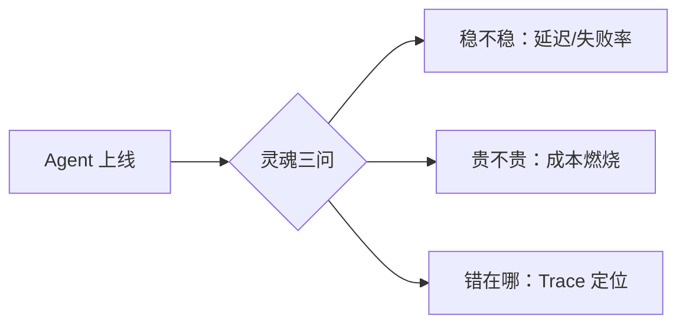

> 🤖 **AI 协作说明**：本文为工作台证据线草稿，由 AI 基于真实代码结构起草，作者负责补充真实业务数据与终审。
> **草稿状态：待作者 review**——所有效果数字均为占位，发布前必须替换为真实数据（搜索 `待补真实数据`）。

## 一、业务问题：企业不敢放量，是因为看不见

给企业落地 Agent 项目时，Pois 阶段 everyone 都兴奋，真要上生产就变成三个灵魂拷问：**稳不稳**（延迟与失败率）、**贵不贵**（Token 成本燃烧速度）、**错在哪**（badcase 定位）。回答不了这三个问题，POC 就永远停在 POC。

## 二、方案：四视图回答灵魂三问

[AI Agent 观测台 Agent Observatory](https://wuxiumu.github.io/zcode-workbench/workbenches/agent-observatory/)（点开即用，Mock 数据驱动）：

| 视图 | 回答的问题 | 图表形态 |
|------|------|------|
| Token 吞吐 | 用量结构与趋势 | 输入/输出 Token 多序列 |
| 模型延迟 | P50/P95/P99 与失败率 | 分位延迟曲线 + 错误率 |
| 调用 Trace | 单次调用链路细节 | Trace 瀑布 / 步骤展开 |
| 成本燃烧 | 照这个速度烧到月底多少 | 燃烧曲线 + 预算对照 |

工程形态与[运维监控台](https://wuxiumu.github.io/zcode-workbench/workbenches/ops-center/)同源：单文件、ECharts 5、性能护栏组件化——**观测运维和观测 Agent 本质是同一门手艺，只是指标从 CPU 换成了 Token**。

## 三、效果数字（发布前必须填真实值）

<!-- 待补真实数据：替换为你真实项目中的数字 -->
- 某客户 Agent 项目 P95 延迟：____ ms → ____ ms；
- 月度 Token 成本可控率：超预算次数 ____ 次 → ____ 次；
- badcase 平均定位时间：____ 小时 → ____ 分钟；
- 接入观测后客户批准放量：____ 个 Agent。

## 四、给同类场景的复用建议

1. **成本视图要带"燃烧率预测"**——只看历史累计没有行动价值，"照当前速度月底超预算 x%"才能触发决策；
2. **Trace 是排障刚需**——多步 Agent 出错时，缺 Trace 的定位方式就是重新跑一遍祈祷；Trace 瀑布把每步的输入输出和耗时摊开；
3. **分位数比平均值诚实**——平均延迟 800ms 可能藏着 5% 的 8 秒长尾，而长尾才是用户流失的地方。

**在线直达**：[https://wuxiumu.github.io/zcode-workbench/workbenches/agent-observatory/](https://wuxiumu.github.io/zcode-workbench/workbenches/agent-observatory/)
