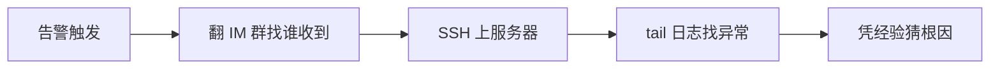

> 🤖 **AI 协作说明**：本文为工作台证据线草稿，由 AI 基于真实代码结构起草，作者负责补充真实业务数据与终审。
> **草稿状态：待作者 review**——所有效果数字均为占位，发布前必须替换为真实数据（搜索 `待补真实数据`）。

## 一、业务问题：告警很多，信息很少

典型中小团队的运维现状：监控告警散落在 N 个工具里——邮件一组、IM 群一组、短信一组。出事时的真实流程是：

问题不在工具少，而在**信息没有被组织成决策路径**：CPU、内存、磁盘、服务状态、告警流各自为政，值班的人要在 5 个界面之间来回跳。

## 二、方案：一张单文件作战地图

[运维监控台 Ops Center](https://wuxiumu.github.io/zcode-workbench/workbenches/ops-center/)（点开即用，Mock 数据驱动）把运维现场收敛成四张视图：

| 视图 | 回答的问题 | 图表形态 |
|------|------|------|
| 服务器指标总览 | 现在健康吗 | CPU/内存/磁盘多序列实时曲线 |
| 服务状态矩阵 | 哪个服务异常 | 服务 × 状态色块矩阵 |
| 告警流时间线 | 刚才发生了什么 | 告警事件流水 |
| 资源 Top 排行 | 谁在吃资源 | 横向排行 |

技术形态刻意保持极简（这也是给客户的示范意义）：

- **单文件交付**：`workbenches/ops-center/index.html` 一个文件，无构建、无后端，复制即可嵌入任何系统；
- **ECharts 5 图表**：亮暗主题注册、自适应容器；
- **性能护栏**：`IntersectionObserver` 懒初始化（滚到视口才建图）、`document.visibilityState` 判定后台标签页停刷——这套护栏是踩坑后抽成的共享组件 `perf-guard.js`，15 个工作台共用；
- **Mock 数据生成器**：接口形状与真实监控数据对齐，接真实数据源时只换数据层。

## 三、效果数字（发布前必须填真实值）

<!-- 待补真实数据：替换为你真实项目中的数字，例如某次故障的发现时长对比 -->
- 告警触达到「定位到根因区间」的时间：从 ____ 缩短到 ____；
- 一次典型故障的 MTTR：____ 分钟 → ____ 分钟；
- 值班同学跨工具切换次数：____ 次 → ____ 次；
- 覆盖服务器 ____ 台 / 服务 ____ 个。

> 数字必须是真实项目里的。FDE 证据的说服力来自真实，不来自漂亮。

## 四、给同类场景的复用建议

1. **先画决策路径再做图**——每个图表必须对应值班时的一个具体问题，否则就是装饰；
2. **接口形状先行**——Mock 数据按真实监控数据的字段结构生成，前端先行、后端跟进时零返工；
3. **性能护栏组件化**——懒初始化、后台停刷这类优化写一次、全站复用，别每个页面重踩一遍。

**在线直达**：[https://wuxiumu.github.io/zcode-workbench/workbenches/ops-center/](https://wuxiumu.github.io/zcode-workbench/workbenches/ops-center/)（姊妹篇：[增长分析台](https://wuxiumu.github.io/zcode-workbench/workbenches/growth-analytics/) / [AI Agent 观测台](https://wuxiumu.github.io/zcode-workbench/workbenches/agent-observatory/)）
