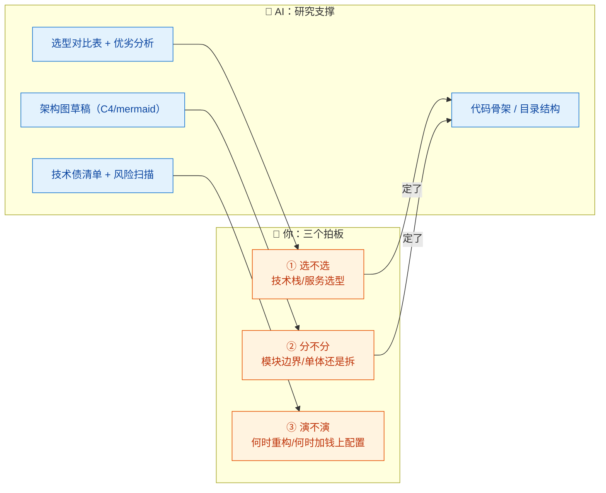
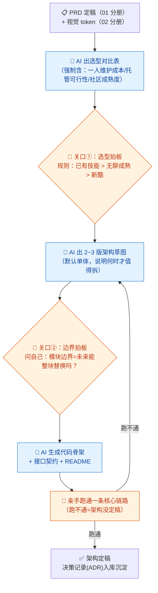

# 03-架构师 × AI 协同

> 💬 **一句话读懂本篇**：AI 给得了技术选型对比表，给不了"适合你"——一人公司的架构第一原则不是先进，而是**你一个人养得起**。

| 版本 | 适用范围 | 前置阅读 |
|---|---|---|
| V0.1 | 一人公司 / 超级个体 | [AI协同开发规范](/2026/10/12/ai-collaborative-development-specification/)（总纲）、[00-汇总·一人公司AI协同岗位全景](/2026/10/12/ai-collaboration-roles-overview/) |

**岗位定位**：🧠 人主导 · AI 承担约 30% 工作量。架构是全系列**AI 承担比例最低**的岗位：选错型的代价以月计，而 AI 的偏好恰恰是"流行、复杂、简历驱动"——和一人公司需要的"无聊、简单、可托管"完全相反。

---

## 一、传统画像：架构师原来干什么

| 工作项 | 传统做法 | 痛点 |
|---|---|---|
| 技术选型 | 调研、POC、评审会 | 信息散落在各处，对比耗时 |
| 模块划分 | 画分层图、定接口边界 | 靠经验，边界常扯皮 |
| 性能与扩展 | 容量规划、压测、演进方案 | 一人公司大多过度设计 |
| 技术债管理 | 记录、排期偿还 | 没人记录，越滚越大 |
| 风险把关 | 评审高风险变更 | 传统靠会议，一人靠自觉 |

## 二、AI 协同后的新画像

**你是"首席取舍官"，AI 是研究员 + 画图员。** 一人公司架构师的全部工作可以压缩成三个决策，每个决策 AI 只能递材料，不能替你拍板：



**一人公司架构三原则**（写进每次提示词，压制 AI 的复杂化倾向）：
1. **无聊优先**——选社区最成熟、文档最全、你已有的技术，不追新。
2. **托管优先**——能用云服务/SaaS 就不自建（数据库、队列、认证、对象存储全托管）。
3. **单体优先**——微服务是团队规模的产物，一人公司拆服务 = 给自己招了 N 个运维对象。

---

## 三、逐项对比：传统做法 vs AI 协同做法

| 工作项 | 🐢 传统做法 | 🚀 AI 协同做法 | 谁主导 |
|---|---|---|---|
| 技术选型 | 调研+POC 一周 | AI 出对比表（含"一人维护成本"维度），你做 1~2 天小 POC 验证 | 🧠 **你拍板** |
| 架构设计 | 评审会+架构文档 | AI 出 2~3 版方案草图（含取舍说明），你选一版并亲手改 | 🤝 AI 起草你定稿 |
| 模块划分 | 分层设计、接口定义 | AI 生成目录结构和接口契约（OpenAPI/Proto），你审边界 | 🤝 人机协同 |
| 代码骨架 | 手搭脚手架 | AI 按定稿方案生成骨架工程，跑通 Hello World 级链路 | 🤖 AI 主导 |
| 技术债管理 | 定期评审 | 让 AI 扫代码库出"债务清单+利息评估"，你决定还不还 | 🧠 **你拍板** |
| 容量规划 | 压测+预估 | 一人公司直接托管弹性伸缩，AI 只帮你算成本 | 📦 交给云 |
| 高风险变更评审 | 上会评审 | AI 出变更影响面分析，你对照总纲风险分级决定审级 | 🧠 **你拍板** |

> ⚠️ **AI 在架构岗最大的问题不是错，而是"过度"**：你问它方案，它默认给你微服务+消息队列+多缓存。必须用三原则约束它降级。

---

## 四、协同工作流：从 PRD 到可开工的骨架



**节奏建议**：每个关键决策写一条 **ADR（架构决策记录）**——三行就够：背景/决定/放弃的备选。让 AI 帮你格式化，但"放弃的备选+理由"必须是你写的，那是三个月后的你的救命稻草。

---

## 五、提示词模板（直接抄作业）

### 模板 A · 技术选型对比

```text
【背景】一人公司项目：xxx；我的已有技能栈：xxx；预算：xxx/月；预期用户量级：xxx
【任务】针对「要选的东西（如 Web 框架/数据库/部署方式）」给出 3 个候选的对比表
【必须包含的对比维度】
1. 社区成熟度与文档质量  2. 与我已会技术栈的重合度
3. 一人维护成本（升级/排障/安全补丁）  4. 托管服务可得性
5. 从它迁移走的成本
【约束】禁止推荐需要专职运维的方案（K8s 自建、自建消息队列等）；
最后只列事实和取舍，不要替我下结论。
```

### 模板 B · 架构方案草图

```text
【输入】PRD 摘要：xxx；已定选型：xxx；三原则：无聊优先/托管优先/单体优先
【任务】给出 2 版架构方案（mermaid 图 + 文字说明）：
方案1：最简可行（能少一个组件就少一个）
方案2：为「用户量×10」预留演进点，但不提前实现
【输出】每版说明：组件清单+托管服务对应+月成本估算+主要风险
【约束】两版差异必须实质（不是换个框架名）；明确指出方案1到方案2的演进触发条件。
```

### 模板 C · 技术债扫描

```text
以下是项目目录结构和 xxx 模块代码（粘贴/给出路径）。
请以架构师视角输出技术债清单，每条包含：
1. 债务描述  2. 不处理的后果（具体场景）  3. 处理成本（小时级估算）
4. 建议：立即还 / 观察 / 不还（说明理由）
按「利息高低」排序，最多列 10 条，不要凑数。
```

### 模板 D · 代码骨架生成

```text
【输入】定稿架构方案（粘贴）+ 接口契约（粘贴）
【任务】生成骨架工程：目录结构、入口文件、配置样例（密钥用环境变量占位）、
一条能跑通的核心链路示例（如 用户注册→入库→返回）
【约束】
1. 技术栈版本：xxx（写死版本号）
2. 不引入清单之外的依赖
3. README 写明本地启动步骤，保证照着做能跑通
```

---

## 六、验收清单（架构定稿前逐项勾）

**简单性（一人公司头等大事）**
- [ ] 组件数量砍到不能再砍（每个组件都要问：不用它行不行？）
- [ ] 无自建基础设施：数据库/队列/认证/存储全部托管或有 SaaS 替代
- [ ] 部署链路你自己能闭眼复述（说不清 = 太复杂）

**可演进性**
- [ ] 模块边界清晰：任一模块可整块替换而不动其他
- [ ] 方案 1→2 的演进触发条件已写明（什么指标到了才动）
- [ ] ADR 已记录，含"放弃的备选和理由"

**可验证性**
- [ ] 核心链路已亲手跑通（不是 AI 说能跑）
- [ ] 骨架工程 README 照做能启动
- [ ] 配置无硬编码密钥（对应总纲红线第 1 条）

**成本**
- [ ] 月成本估算过，且在预算内（含用户量×10 的情形）
- [ ] 无"未来可能用到"的预付费服务

---

## 七、坑点清单

| 坑 | 长什么样 | 怎么防 |
|---|---|---|
| 过度工程 | 日活 100 的产品配了微服务+MQ+多级缓存 | 提示词写死三原则；模板 B 强制"最简可行"为方案 1 |
| 简历驱动 | AI 推荐的都是"面试加分项"而非"你需要的" | 模板 A 加"与已有技能栈重合度"维度 |
| 版本幻觉 | 推荐的框架版本/特性不存在或已废弃 | 选型定稿前亲手装一遍跑 Hello World |
| 纸上架构 | 图画得很美，链路跑不通 | 关口"亲手跑通核心链路"不过不算定稿 |
| 无记录决策 | 三个月后忘了为什么选 A 弃 B，来回摇摆 | ADR 三行起步，AI 格式化、你写理由 |
| 云成本失控 | 弹性伸缩+忘了关的服务，账单悄悄爆炸 | 上线前设账单告警；每月让 AI 帮你审一次账单明细 |

---

> 💬 **收尾一句**：架构师的 AI 协同心法是"**让 AI 替你看全选项，让自己对取舍负责**"。一人公司最好的架构，是让你晚上睡得着、白天写得动、账单付得起的那一个。
> **下一册**：[04-后端开发 × AI 协同](/2026/10/12/ai-collaboration-backend-dev/)——AI 承担 70% 的主力编码岗，看好了是提效，看漏了是埋雷。
