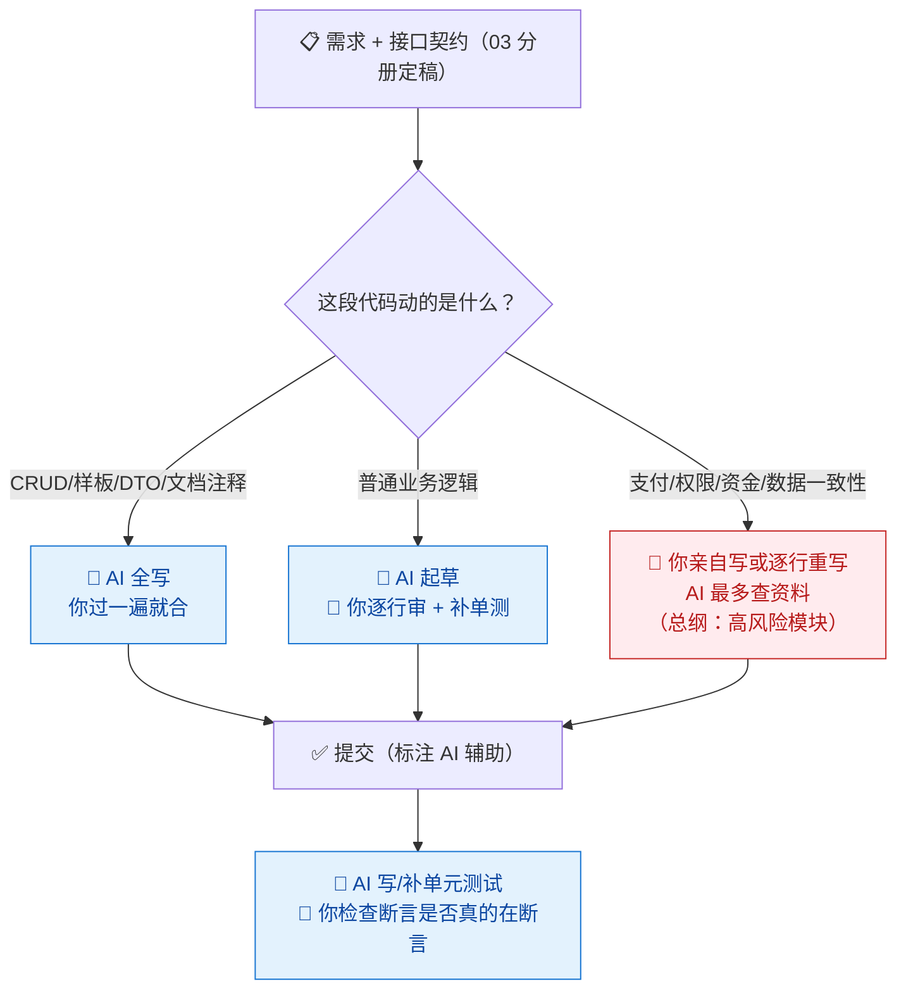
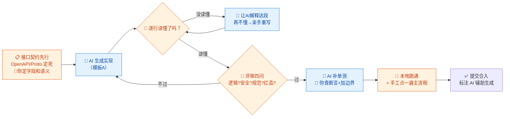

# 04-后端开发 × AI 协同

> 💬 **一句话读懂本篇**：后端是 AI 写得最快、也埋雷最深的岗位——CRUD 放心交给它，但**支付、权限、数据一致性**这三样，AI 只能当草稿纸。

| 版本 | 适用范围 | 前置阅读 |
|---|---|---|
| V0.1 | 一人公司 / 超级个体 | [AI协同开发规范](/2026/10/12/ai-collaborative-development-specification/)（总纲）、[00-汇总·一人公司AI协同岗位全景](/2026/10/12/ai-collaboration-roles-overview/) |

**岗位定位**：🤖 AI 主导 · AI 承担约 70% 工作量。后端代码有明确的"对错"（跑得通跑不通、测试过不过），所以 AI 成熟度极高；但后端也是**错误代价最高**的地方——前端丑了是体验问题，后端错了是资损和数据泄露。

---

## 一、传统画像：后端工程师原来干什么

| 工作项 | 传统占比 | 特点 |
|---|---|---|
| CRUD / 接口样板 | ~40% | 重复劳动，无创造性 |
| 核心业务逻辑 | ~25% | 值钱的部分，靠脑力 |
| 单元测试 | ~10% | 都知道重要，都懒得写 |
| Bug 修复 / 排障 | ~15% | 看日志、复现、定位 |
| 重构 / 性能优化 | ~10% | 一直想排期，一直没排上 |

## 二、AI 协同后的新画像

**你从"码农"变成"技术主管 + 核心逻辑主程"。** 分工按风险切，不按工作量切：



> 💡 **时间去哪了**：编码时间降 60%，但**评审时间升 3 倍**。总纲说得直白：看不懂的代码不许提交。AI 写得越快，你读得越认真。

---

## 三、逐项对比：传统做法 vs AI 协同做法

| 工作项 | 🐢 传统做法 | 🚀 AI 协同做法 | 谁主导 |
|---|---|---|---|
| CRUD / 接口 | 手写或代码生成器 | 给契约（OpenAPI/表结构），AI 出全套接口+DTO+校验 | 🤖 AI 主导，你抽查 |
| 核心业务逻辑 | 手写 | AI 出草稿→你逐行审→关键分支亲手改 | 🤝 强管控协同 |
| 支付 / 权限 / 资金 | 资深工程师手写+双人评审 | **你亲手写**，AI 只许查文档、列 checklist | 🧠 人主导（总纲红线） |
| 单元测试 | 补不动，覆盖率低 | AI 按函数批量生成，你补边界用例、检查断言质量 | 🤖 AI 主导，**你补边界** |
| Bug 排障 | 看日志、打断点、猜 | 贴日志+相关代码，AI 给 3 个可疑点排序，你验证 | 🤝 人机协同 |
| 重构 | 不敢动祖传代码 | AI 出重构方案+等价性说明，小步改+每步跑测试 | 🤝 AI 干活你把关 |
| SQL / 数据访问 | 手写，慢查询后补索引 | AI 写初版，你审执行计划（详见 10 分册） | 🤝 人机协同 |
| 注释 / API 文档 | 没空写 | AI 全自动生成，你核对口径 | 🤖 AI 主导 |

---

## 四、协同工作流：一个接口的诞生



**节奏建议**：**契约先行**是 AI 协同后端的命门——字段名、类型、错误码、分页语义定死了，AI 生成的代码才不会自由发挥；契约没定就让 AI 写实现，等于让实习生自己猜需求。

---

## 五、提示词模板（直接抄作业）

### 模板 A · 按契约实现接口

```text
【背景】技术栈：xxx（写死版本号）；项目结构：（贴目录树/相关文件）
【任务】按以下接口契约实现完整代码：
（粘贴 OpenAPI/接口定义 + 相关表结构）
【约束】
1. 遵循项目现有分层和命名（参考已贴代码，不要自创风格）
2. 不引入新依赖；必须处理：参数校验/空值/重复提交/事务边界
3. 错误码统一走项目定义，禁止吞异常
4. 涉及权限的接口必须显式校验（贴出现有鉴权中间件用法）
【输出】完整代码 + 单元测试 + 你做的所有假设（列出来）
```

### 模板 B · Bug 定位

```text
【现象】xxx（预期 vs 实际，何时开始，影响范围）
【输入】报错日志：（粘贴）；相关代码：（粘贴）；最近变更：（描述）
【任务】给出最可疑的 3 个原因，按可能性排序，每个附：
1. 判断依据  2. 一条能验证它的检查方法（日志/断点/最小复现）
【约束】只基于我给的代码和日志推理，不要猜我没贴的部分；信息不足就先列出你需要什么。
```

### 模板 C · 单元测试补全

```text
以下是函数/接口代码（粘贴）和它的业务规则（粘贴）。
请生成单元测试，要求：
1. 覆盖：正常路径 / 每个业务规则的边界 / 异常输入（空、超长、非法类型、并发）
2. 每个断言写明"验证的是哪条规则"（注释标注）
3. 禁止无意义断言（如只断言"不抛异常"）
4. 使用项目现有测试框架：xxx，Mock 掉外部依赖
输出后自查：列出你认为还测不到、需要人工补的场景。
```

### 模板 D · 安全加固审查

```text
以下是即将上线的后端代码（粘贴）。请以攻击者视角审查：
1. 注入类：SQL/命令/模板注入，逐个数据流追踪
2. 越权：水平越权（改别人数据）/垂直越权（用管理接口）
3. 敏感信息：日志打印、错误响应泄露、硬编码
4. 资损路径：金额计算精度、重复提交、并发扣减
按严重程度分级输出，每条附修复代码。修复后我会再人工复核。
```

---

## 六、验收清单（合入前逐项勾）

**逻辑**
- [ ] 每一行都读懂了（读不懂 = 不许合入，总纲铁律）
- [ ] 实现与接口契约逐字段一致，无自由发挥
- [ ] AI 列出的"假设清单"逐条核对过，假设都成立
- [ ] 调用的 API/库/方法真实存在且版本正确（防幻觉，本地跑过）

**安全**
- [ ] 所有输入有校验，SQL 走参数化/ORM，无字符串拼接
- [ ] 每个数据操作有权限校验，改"别人的"数据被拒绝
- [ ] 无硬编码密钥，日志不打印敏感字段
- [ ] 支付/权限/资金相关：**由你亲手写或逐行重写**（不是审过就算）

**质量**
- [ ] 单测断言有效（改坏代码测试会红）
- [ ] 异常路径有兜底，事务边界正确
- [ ] 无循环内 IO、N+1 查询
- [ ] 提交信息标注"AI 辅助生成"

---

## 七、坑点清单

| 坑 | 长什么样 | 怎么防 |
|---|---|---|
| 幻觉 API | 调用不存在的方法、错误的参数签名 | 合入前本地跑通；IDE 里逐个跳转确认 |
| 过时写法 | 用旧版本框架语法，和新版不兼容 | 提示词写死版本号（模板 A） |
| 表面正确单测 | 覆盖率 90%，断言全是 `assert not null` | 模板 C 强制"断言标注规则"+人工改坏代码验证测试会红 |
| 吞异常 | `catch` 之后打个日志继续跑，错误静默扩散 | 评审四问之"扛造吗"；禁止空 catch |
| 想当然默认值 | 你没说的业务规则，AI 自己补了一个"合理"的 | 模板 A 强制输出"假设清单"，逐条核对 |
| 事务边界漂移 | AI 把该在一个事务里的操作拆开了，并发下数据错乱 | 高风险数据操作列为关口③人审重点 |
| 依赖夹带 | 悄悄 import 了一个没听说过的三方库 | 约束"不引入新依赖"；新增依赖走总纲白名单 |

---

> 💬 **收尾一句**：后端 AI 协同的公式是"**AI 写 70%，你为 100% 负责**"。CRUD 提效省下的时间，正好花在支付和权限那 30% 上——这才是这笔账算得过来的原因。
> **下一册**：[05-前端开发 × AI 协同](/2026/10/12/ai-collaboration-frontend-dev/)——设计稿即代码的时代，前端是 AI 化最顺滑的岗位。
