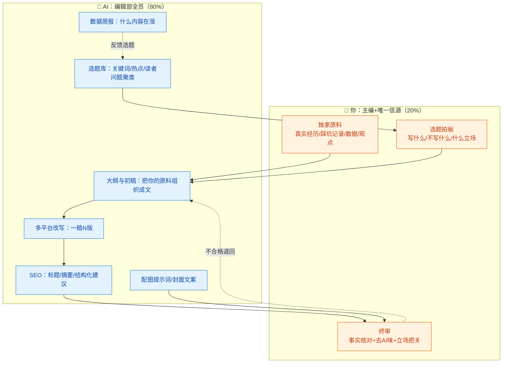
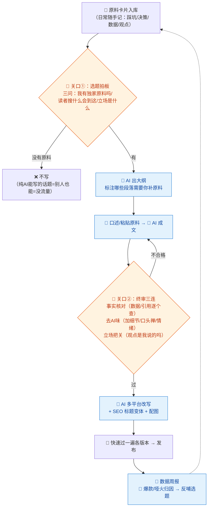

# 13-内容运营 × AI 协同

> 💬 **一句话读懂本篇**：内容运营是 AI 化率最高的岗位之一（~80%），但同质化也是全网最重的灾区——**AI 负责量产，你负责"只有你能写的那 20%"**：真实经历、独家观点、踩坑现场。

| 版本 | 适用范围 | 前置阅读 |
|---|---|---|
| V0.1 | 一人公司 / 超级个体 | [AI协同开发规范](/2026/10/12/ai-collaborative-development-specification/)（总纲）、[00-汇总·一人公司AI协同岗位全景](/2026/10/12/ai-collaboration-roles-overview/) |

**岗位定位**：🤖 AI 主导 · AI 承担约 80% 工作量。与 12 分册的关系：增长是**买流量**（付费、见效快、停投即停），内容是**赚信任**（免费、复利慢、越滚越值）。一人公司两条腿都要有，但内容这条腿 AI 只能替你走路，替不了你长肌肉。

---

## 一、传统画像：内容运营原来干什么

| 工作项 | 传统做法 | 痛点 |
|---|---|---|
| 选题策划 | 热点追踪、关键词研究、读者反馈 | 选题枯竭是常态 |
| 内容生产 | 一篇深度文写 1~2 天 | 产能天花板低 |
| 多平台分发 | 一篇改 N 版适配各平台调性 | 纯体力活 |
| SEO | 关键词布局、内外链、结构化数据 | 门槛玄学化 |
| 数据复盘 | 看阅读/涨粉/转化 | 数据好不知道为什么好 |

## 二、AI 协同后的新画像

**你是"主编 + 唯一的信源"，AI 是"编辑部全员"。** 内容岗的分工核心不是"谁写"，而是**"哪部分必须含有你的真实经验"**——这部分是 AI 永远写不出、也是读者唯一想看的东西。



> 💡 **心法**：把日常开发中的踩坑、决策、数据随手记成"原料卡片"（三五行即可，可以让 AI 帮你从聊天记录/commit 里提炼）。**原料库存决定内容产能**，AI 只是把原料加工成菜。

---

## 三、逐项对比：传统做法 vs AI 协同做法

| 工作项 | 🐢 传统做法 | 🚀 AI 协同做法 | 谁主导 |
|---|---|---|---|
| 选题 | 编辑灵感+热点追踪 | AI 维护选题库（关键词/读者问题聚类/竞品内容缺口），你按"我有原料吗"筛 | 🤝 AI 供你选 |
| 初稿 | 从空白文档开始憋 | **你先倒原料（口述/笔记），AI 组织成文**——顺序反了就是垃圾 | 🤝 你出核 AI 成文 |
| 独家观点 | 靠积累 | 观点必须你给；AI 只负责论证结构和反方视角预演 | 🧠 **你立场** |
| 多平台改写 | 手工逐平台改 | AI 一稿 N 版：公众号长文/小红书图文/推特串/知乎回答（模板 C） | 🤖 AI 主导 |
| SEO | 研究玄学 | AI 出关键词矩阵+标题变体+结构化建议，你审搜索意图匹配 | 🤖 AI 主导 |
| 配图 | 找图/做图 | AI 生成配图提示词或直接生图（02 分册工具链复用），注意商用许可 | 🤖 AI 主导 |
| 事实核查 | 编辑核对 | **你核对**——AI 会编造数据、案例、引用（内容岗的头号红线） | 🧠 **你签字** |
| 数据复盘 | 手工看后台 | AI 出周报：什么选题/标题/形式在涨，归因标注置信度 | 🤝 AI 分析你调整 |

> ⚠️ **内容岗的两条红线**：
> 1. **编造红线**——AI 初稿里的数据、案例、名人名言、"研究表明"，没出处的全部删掉或亲手核实。虚构的"真实故事"被读者拆穿一次，账号信誉清零。
> 2. **AI 味红线**——通篇正确的废话、排比堆砌、"总而言之"式收尾，读者一眼识破。终审必须做"去 AI 味"：加你的口头禅、具体细节、真实情绪。

---

## 四、协同工作流：一篇内容的诞生



**节奏建议**：一人公司的可持续产能是"**每周 1 篇深度 + N 篇平台改写**"，深度文吃你的原料库存，改写吃 AI 产能。日更不是目标，断更三周才是问题——让 AI 排内容日历提醒你。

---

## 五、提示词模板（直接抄作业）

### 模板 A · 原料成文（核心模板）

```text
【我的原料】（口述/笔记原样粘贴，不用整理）：
- 经历/踩坑：xxx
- 数据/截图说明：xxx
- 我的观点（可能偏激，保留它）：xxx
【读者】xxx 平台上的 xxx 人群，他们搜到这篇时想解决的问题：xxx
【任务】把原料组织成文章，结构建议：钩子开头（用原料里最反常识的点）→ 问题共鸣 →
我的经历与数据 → 观点与论证 → 可带走的行动清单
【约束】
1. 只用我给的原料，禁止补充"行业普遍情况""有研究表明"类无出处内容
2. 原料不够撑起的段落，标注【原料缺口：需要补xxx】，不要编
3. 保留我的语气和口头禅：xxx；不确定的观点表述标出来让我确认
4. 字数：xxx；禁止排比堆砌和"总而言之"式收尾
```

### 模板 B · 选题库维护

```text
【输入】我的原料卡片清单：（粘贴标题即可）；近期读者问题/评论：（粘贴）；
竞品近期内容：（列标题）
【任务】输出选题清单（10 条），每条附：
1. 目标关键词/读者搜索场景  2. 我手里的独家原料是哪张卡片
3. 建议角度（教程/踩坑复盘/观点争议/对比评测）  4. 预估难度（原料够不够）
【约束】没有原料支撑的选题标【需先攒原料】，不硬凑；
优先"竞品没写透 + 我有实战"的交叉区。
```

### 模板 C · 多平台改写

```text
【输入】定稿主文：（粘贴）；目标平台：公众号 / 小红书 / 推特(X) / 知乎
【任务】按平台特性改写：
公众号：保留深度，标题给 3 个变体
小红书：300 字内+分点+emoji 适度，标题带搜索关键词
推特：thread 形式，首条即钩子
知乎：问题式切入，先给结论再展开，语气更克制
【约束】各版本事实口径必须一致；平台化的夸张只许在标题钩子上，不许进正文论点。
```

### 模板 D · 事实核查

```text
以下是待发布文章（粘贴）。请执行核查：
1. 列出所有事实性陈述（数据/时间/人物/引用/技术细节），逐条标注：
✅有据可查（给出处）/ ⚠️无法验证（建议删除或改写）/ ❌疑似编造
2. 技术类内容：指出可能过时的版本/API/工具说法
3. 列出"读者可能挑刺"的表述，给弱化或加固建议
【约束】宁可多标⚠️——我会按"无法验证即删除"处理。
```

---

## 六、验收清单（发布前逐项勾）

**事实（一票否决）**
- [ ] 所有数据/案例/引用有出处，无出处已删（模板 D 跑过）
- [ ] 技术细节核过版本（防 04 分册同款幻觉，换到了文章里）
- [ ] "真实经历"确实是我的经历，AI 没有替我"丰富"细节

**人味**
- [ ] 至少有一处只有我能写的内容（踩坑现场/独家数据/争议观点）
- [ ] 去 AI 味过：无排比堆砌、无"在当今时代"式开头、无万能废话段
- [ ] 观点是我的立场，不是我看不懂的高级表述

**平台适配**
- [ ] 各版本口径一致，标题夸张没进正文论点
- [ ] 配图有商用许可（02 分册同款检查）
- [ ] 引流路径正确：CTA 指向的落地页/产品链接点过

---

## 七、坑点清单

| 坑 | 长什么样 | 怎么防 |
|---|---|---|
| 无米之炊 | 没原料硬让 AI 写，产出一篇"正确的废话" | 关口①铁律：没原料不写 |
| 编造引用 | AI 顺手编个"斯坦福研究表明" | 模板 A 禁补出处 + 模板 D 逐条核查 |
| AI 味暴露 | 读者评论区："一眼 AI 写的" | 终审"去 AI 味"三连；保留你的口头禅和毛边 |
| 同质化淹没 | 写的选题全网 AI 都在写 | 选题只打"竞品没写透+我有实战"交叉区 |
| 日更焦虑 | 为频率牺牲深度，账号变成 AI 垃圾场 | 节奏写死：每周 1 深度 + N 改写，断更三周才叫问题 |
| 平台违规 | 医疗/金融类表述触红线，限流封号 | 敏感行业选题先查平台规则；立场把关项固定 |
| 原料枯竭 | 只输出不记录，两个月后无米下锅 | 原料卡片是日常纪律：踩坑当天记，AI 帮你归档 |

---

> 💬 **收尾一句**：内容岗的 AI 协同公式是"**你出真相，AI 出产量**"。全网 AI 内容泛滥的时代，稀缺的恰恰是"这个人真的做过"——你的日常原料库，才是这个岗位的核心资产。
> **下一册**：[14-客服 × AI 协同](/2026/10/12/ai-collaboration-customer-service/)——AI 承担 85% 的岗位：机器人挡在前面，你只处理升级件，但知识库质量决定一切。
