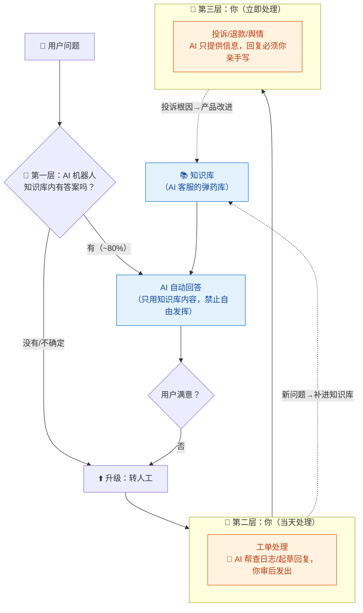
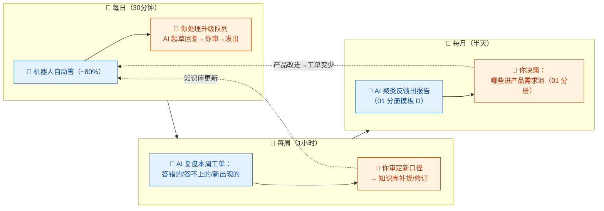

# 14-客服 × AI 协同

> 💬 **一句话读懂本篇**：客服是 AI 化率最高的岗位（~85%）——机器人挡在前面答 80% 的问题，你只处理升级件；但记住：**机器人答错的每一句，用户都记在你头上**。知识库质量决定一切。

| 版本 | 适用范围 | 前置阅读 |
|---|---|---|
| V0.1 | 一人公司 / 超级个体 | [AI协同开发规范](/2026/10/12/ai-collaborative-development-specification/)（总纲）、[00-汇总·一人公司AI协同岗位全景](/2026/10/12/ai-collaboration-roles-overview/) |

**岗位定位**：🤖 AI 主导 · AI 承担约 85% 工作量。客服岗的特殊结构：**AI 直接面对用户**（其他岗位 AI 产出都经你的手）。这带来最高的效率，也意味着 AI 的幻觉会直接变成你的公关事故——所以本册一半篇幅在讲"怎么给 AI 上笼头"。

---

## 一、传统画像：客服原来干什么

| 工作项 | 传统占比 | 特点 |
|---|---|---|
| 重复答疑（怎么注册/退款/价格） | ~60% | 高频低值，答案固定 |
| 工单处理（bug 反馈/账号问题） | ~20% | 需要查系统、跨部门 |
| 投诉与情绪安抚 | ~10% | 最耗心力，最考验人 |
| 反馈收集整理 | ~10% | 最有价值，最常被忽略 |

## 二、AI 协同后的新画像

**你是"客服总监"：管知识库、管升级线、管赔偿权。** 三层漏斗结构，AI 在第一层全职，你在第二三层出现：



> 💡 **核心机制**：每个 AI 答不上来/答错的问题，都是知识库的补货清单。**客服系统的进化速度 = 知识库的更新纪律**，这个纪律只能你执行。

---

## 三、逐项对比：传统做法 vs AI 协同做法

| 工作项 | 🐢 传统做法 | 🚀 AI 协同做法 | 谁主导 |
|---|---|---|---|
| 重复答疑 | 人工复制粘贴标准答案 | AI 机器人基于知识库自动答，**限定"无据不答，转人工"** | 🤖 AI 主导（带笼头） |
| 知识库建设 | 专人维护 FAQ | AI 从文档/历史工单生成初版，你审定每条口径 | 🤝 AI 起草你定稿 |
| 工单处理 | 查后台、写回复 | AI 起草回复+查日志摘要（08 分册模板 D 复用），**你审后发出** | 🤝 强管控协同 |
| 投诉处理 | 客服主管出面 | **你亲手写**——AI 只提供背景信息；道歉、赔偿、承诺都是经营决策 | 🧠 人主导 |
| 退款决策 | 按规则+主管审批 | 规则你定（如"xx 元以下直接退"），AI 机器人按规则执行，规则外转你 | 🧠 **你定规则** |
| 情绪识别 | 靠客服经验 | AI 识别负面情绪自动升级，宁可多升不可漏升 | 🤖 AI 哨兵 |
| 反馈归集 | 手工整理 | AI 按周聚类工单主题（01 分册模板 D 复用），你决定改不改产品 | 🤝 AI 归集你决策 |
| 多语言 | 雇人/不做 | AI 机器人天然多语言，**口径与中文版一致由知识库保证** | 🤖 AI 主导 |

> ⚠️ **给 AI 机器人上的三个笼头**（配置时逐条落实）：
> 1. **无据不答**：只允许引用知识库内容回答，检索不到就转人工——禁止模型自由发挥编答案。
> 2. **敏感转人工**：投诉、退款超额、法律威胁、人身安全、负面情绪，触发词直接升级。
> 3. **不承诺**：机器人不许承诺赔偿/上线时间/功能变更——这些是你的经营决策权。

---

## 四、协同工作流：知识库驱动的日常循环



**节奏建议**：衡量客服系统的唯一北极星指标是**升级率**（转人工占比）——它应该逐月下降。降不下来就检查：知识库覆盖不够？AI 检索不准？还是产品本身问题太多（那是 01 分册的事）。

---

## 五、提示词模板（直接抄作业）

### 模板 A · 知识库初版生成

```text
【输入】产品文档/定价页/退款政策：（粘贴）；历史高频问题（如有）：（粘贴）
【任务】生成客服知识库，每条格式：
问题（用户会怎么问，含口语变体3种）/ 标准答案（3句话内）/ 依据出处 / 是否允许AI直接回答
【约束】
1. 只从输入材料生成，材料里没有的标【缺口：需补充】——这些缺口就是我的待办
2. "是否允许AI直接回答"按风险标注：涉及承诺/赔偿/法律的一律标 ❌转人工
3. 答案说人话：禁止"尊敬的用户您好"式废话开头
```

### 模板 B · AI 机器人系统提示词（部署到客服工具）

```text
你是「产品名」的客服助手。铁律（优先级从高到低）：
1. 只依据提供的知识库内容回答；知识库没有的，回答：
   "这个问题我需要请创始人本人确认，已为你转接，将在24小时内回复"——禁止编造
2. 遇到以下情况立即转人工，不做实质回答：
   投诉/退款请求超过xxx元/法律或监管相关/用户表达强烈不满或人身安全/媒体身份
3. 禁止承诺：赔偿、上线时间、功能变更、折扣——一律"我记录下来转给创始人确认"
4. 语气：友好简洁，每次回答不超过3句话+1个操作指引；不确定就转人工，猜错比不答更糟
5. 用户数据：不向用户透露他人信息；核实身份按流程 xxx
【知识库】（挂载检索）
```

### 模板 C · 工单回复起草

```text
【输入】用户工单原文：（粘贴，已脱敏）；相关日志/订单信息：（粘贴，已脱敏）；
知识库相关条目：（粘贴）
【任务】起草回复：1) 先回应情绪/确认问题 2) 说明原因（用户听得懂的话）
3) 给出解决步骤或补偿方案选项（标出哪些超出我授权需我改）4) 结尾给预期时间
【约束】原因必须基于我给的日志，不许猜；猜测处标注【待核实】；
补偿方案只列选项不定稿——批不批是我的事。
```

### 模板 D · 周复盘

```text
【输入】本周升级工单清单：（粘贴，脱敏）；机器人答错/答不上记录：（粘贴）
【任务】输出周复盘：
1. 知识库补货清单：每条给出建议答案草稿（标注需要我确认口径的）
2. 机器人问题归因：检索不到/知识库缺失/知识库过时/超出客服范畴，各占比
3. 产品信号：重复出现≥3次的问题，指向什么产品缺陷
【约束】按影响用户数排序；"产品信号"只报事实频次，改进建议留给01分册流程。
```

---

## 六、验收清单

**机器人上线前（一次性）**
- [ ] 系统提示词含三笼头：无据不答、敏感转人工、不承诺（模板 B 逐条核对）
- [ ] 知识库每条经你审定口径；【缺口】清零或有明确转人工兜底
- [ ] 压力测试过：故意问知识库外的问题、诱导承诺、扮演愤怒用户——机器人表现合格
- [ ] 升级通道真实可用：转人工后你真的能收到（自己发一条测试）

**每周例行**
- [ ] 升级队列清零（当天件当天清，客服时效是信誉）
- [ ] 答错/答不上清单过完，知识库补货
- [ ] 回复抽查：AI 起草的回复发出前都经你审了吗（疲劳时最容易放水）

**每月例行**
- [ ] 升级率环比：降了吗？没降找原因
- [ ] 投诉/退款记录复盘：有没有该改规则的
- [ ] 知识库口径 vs 产品现状：定价变了、功能下线了，答案改了吗

**永远**
- [ ] 工单贴给 AI 前已脱敏（用户手机号/邮箱/订单号，总纲红线）
- [ ] 投诉与舆情回复是你亲手写的
- [ ] 机器人身份不伪装成真人（平台合规+基本诚实）

---

## 七、坑点清单

| 坑 | 长什么样 | 怎么防 |
|---|---|---|
| 幻觉承诺 | 机器人为安抚用户，承诺"明天就修复/给您退款" | 笼头③禁止承诺；上线前诱导测试 |
| 编造答案 | 知识库没有，机器人"根据常识"答了个错的 | 笼头①无据不答；答错记录每周清零 |
| 升级失灵 | 用户投诉半天，机器人循环道歉不转人工 | 敏感触发词宁多勿少；每周亲测升级通道 |
| 知识库腐烂 | 产品改价三个月，机器人还在报旧价 | 发版流程加一条：变更影响客服口径吗（并入 08 分册变更清单） |
| 脱敏遗漏 | 整段工单含手机号直接贴给 AI | 验收"永远"第一条；工单系统配置自动脱敏 |
| 假装真人 | 机器人自称"客服小姐姐"，被识破上热搜 | 亮明 AI 身份；真诚是最低成本的公关 |
| 数据盲区 | 只看解决率不看升级率，机器人"解决"的都是循环话术 | 北极星指标定为升级率，解决率仅参考 |

---

> 💬 **收尾一句**：客服岗的 AI 协同公式是"**AI 挡量，你保质；知识库是产品，机器人是销售**"。用户不区分"AI 答错"和"你答错"——所以真正的功夫全在上线前的笼头和每周的补货纪律里。
> **下一册**：[15-项目管理（自我管理）× AI 协同](/2026/10/12/ai-collaboration-project-management/)——一人公司最后一种帽子：没有同事催你，AI 当你的项目经理，你当自己的老板。
