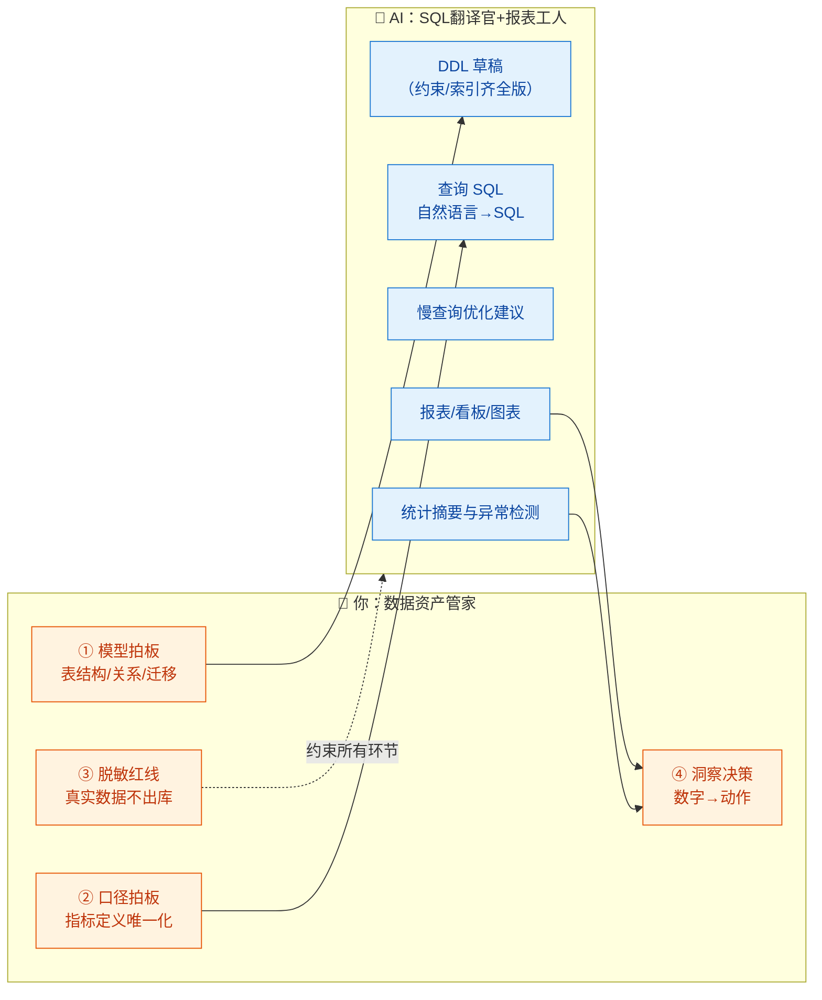
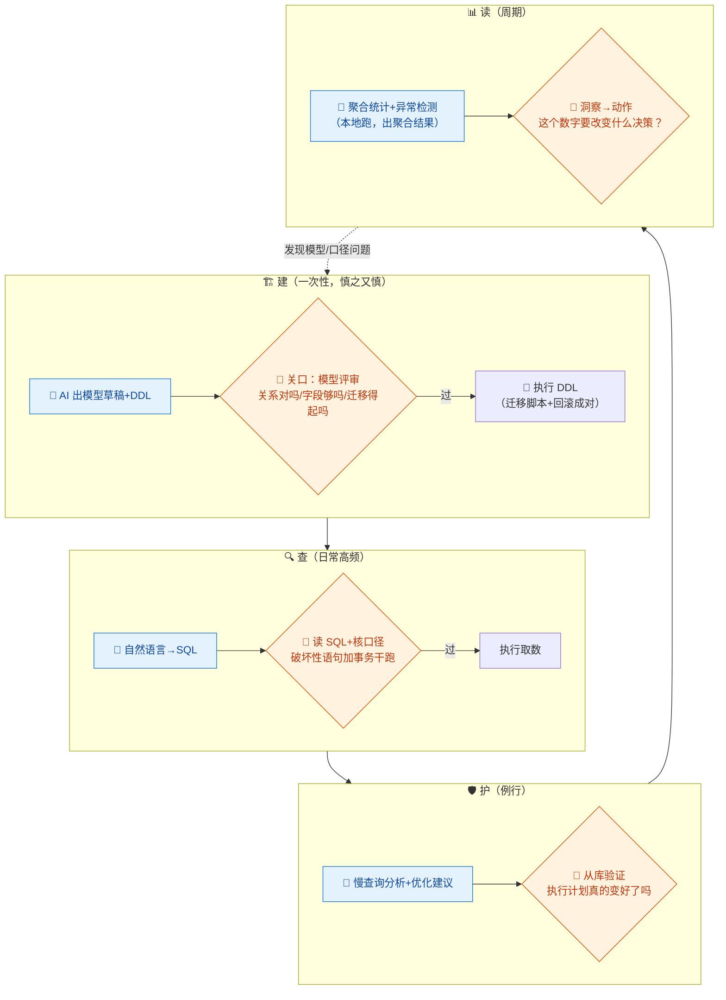

# 10-数据库与数据分析 × AI 协同

> 💬 **一句话读懂本篇**：AI 写 SQL 又快又溜，但它优化的是"这条查询"，你负责的是"整个数据资产"——**模型拍板、口径统一、脱敏红线**，三样都不能外包。

| 版本 | 适用范围 | 前置阅读 |
|---|---|---|
| V0.1 | 一人公司 / 超级个体 | [AI协同开发规范](/2026/10/12/ai-collaborative-development-specification/)（总纲）、[00-汇总·一人公司AI协同岗位全景](/2026/10/12/ai-collaboration-roles-overview/) |

**岗位定位**：🤝 人机协同 · AI 承担约 60% 工作量。本册合并传统的 DBA + 数据分析师两个岗位：一人公司里它们本来就是同一顶帽子——**数据的"建、查、护、读"全归你**。

---

## 一、传统画像：DBA / 数据分析师原来干什么

| 岗位 | 工作项 | 传统做法 | 痛点 |
|---|---|---|---|
| DBA | 数据模型设计 | ER 图、范式讨论、评审 | 定错了迁移成本极高 |
| DBA | 建库建表 | 手写 DDL | 约束/索引经常偷懒漏掉 |
| DBA | 性能调优 | 慢查询日志、执行计划 | 专业门槛高 |
| DBA | 备份恢复/迁移 | 脚本+演练 | 见 08 分册 |
| 分析师 | 取数 | 业务方排队等 SQL | 一人公司：自己排队等自己 |
| 分析师 | 报表看板 | BI 工具搭建 | 搭完没人看，看了口径打架 |
| 分析师 | 洞察 | 专题分析报告 | 最值钱也最没时间做 |

## 二、AI 协同后的新画像

**你是"数据资产管家"，AI 是"SQL 翻译官 + 报表工人"。** 分工的分界线非常清晰：**碰结构、碰口径、碰真实数据的动作归你；写查询、做图表、跑统计归 AI。**



---

## 三、逐项对比：传统做法 vs AI 协同做法

| 工作项 | 🐢 传统做法 | 🚀 AI 协同做法 | 谁主导 |
|---|---|---|---|
| 数据模型设计 | DBA 画 ER 图评审 | AI 从 PRD 出模型草稿（模板 A），**你拍板**——迁移成本你背 | 🧠 你拍板 |
| 建表 DDL | 手写，约束靠自觉 | AI 生成"约束齐全版"（NOT NULL/外键/索引/注释一个不落） | 🤖 AI 起草你审 |
| Schema 变更 | 上线窗口手工执行 | AI 生成迁移脚本+回滚脚本（成对，同 08 分册纪律） | 🤝 强管控协同 |
| 日常取数 | 写 SQL 排查半天 | 自然语言→SQL（模板 B），**你核对口径再跑** | 🤖 AI 主导 |
| 慢查询调优 | DBA 看执行计划 | AI 解读执行计划给建议（模板 C），**你在从库验证后再上** | 🤝 AI 建议你验证 |
| 报表看板 | 搭 BI、对口径 | AI 按指标字典生成看板和图表代码 | 🤖 AI 主导 |
| 数据洞察 | 专题分析 | AI 跑统计、找异常、出摘要，**你负责"数字→动作"** | 🤝 人机协同 |
| 数据校验 | 手工抽查 | AI 写校验 SQL（空值/重复/引用完整性/业务规则） | 🤖 AI 主导 |
| 备份恢复 | 定时任务 | 见 08 分册，季度演练不许省 | 🧠 你演练 |

> ⚠️ **两条铁律**：
> 1. **AI 生成的 SQL，先读再跑**——`UPDATE/DELETE` 不带对 `WHERE` 的事故年年有；SELECT 也可能拖垮生产库（全表扫大表）。
> 2. **真实用户数据不进 AI 对话**（总纲红线第 2 条）——要 AI 帮你分析，喂**表结构+假数据**，或本地跑完只把**聚合结果**贴出去。

---

## 四、协同工作流：数据的"建、查、护、读"四循环



**节奏建议**：建一份**指标字典**（每个指标一行：名称/定义/口径/负责 SQL），让 AI 生成的一切查询和报表都引用它——口径打架是一人公司数据工作最常见的暗坑：上周"活跃用户"和这周的不是一个东西，你自己都不知道。

---

## 五、提示词模板（直接抄作业）

### 模板 A · 数据模型设计

```text
【输入】PRD 摘要与业务规则：（粘贴）；预期数据量级与增长：xxx；数据库：xxx（托管服务）
【任务】设计数据模型：
1. ER 图（mermaid erDiagram）
2. 每张表的 DDL：字段类型精确、NOT NULL 默认拉满、外键与索引齐全、每列带注释
3. 设计说明：为什么这样拆表、预留了什么扩展点、哪些地方故意反范式（说明理由）
【约束】
1. 面向"未来迁移得起"：主键策略明确、时间字段统一带时区、软删除策略统一
2. 不确定的业务规则标【待确认】，禁止自行拍板字段语义
3. 一人公司原则：表数量克制，别为"将来可能的微服务"提前拆库
```

### 模板 B · 自然语言取数

```text
【输入】表结构：（粘贴 DDL，不含真实数据）；指标字典相关条目：（粘贴）
【需求】统计：xxx（自然语言描述）
【任务】生成查询 SQL，并附：
1. 口径说明：这条 SQL 里"xxx"是怎么定义的（时间边界/去重规则/排除条件）
2. 与指标字典的一致性自查：有无口径偏差
3. 预估扫描量：会不会扫大表？需要哪个索引？
【约束】只输出 SELECT；聚合粒度明确；口径含糊处先向我提问再写 SQL。
```

### 模板 C · 慢查询优化

```text
【输入】慢 SQL：（粘贴）；EXPLAIN 输出：（粘贴）；表结构与数据量：（粘贴）
【任务】1) 解读执行计划，指出瓶颈（全表扫/错误索引/回表过多/join 顺序）；
2) 给出优化方案：改写 SQL / 加索引（给出 DDL）/ 结构调整，各注明代价
3) 预测优化后执行计划的变化
【约束】加索引必须说明写入代价和空间代价；
不确定的地方标注"需在从库验证"——我会先 EXPLAIN 对比再上线。
```

### 模板 D · 数据质量校验

```text
【输入】表结构 + 业务规则：（粘贴）
【任务】生成一组校验 SQL，覆盖：
1. 完整性：关键字段空值率、外键孤儿记录
2. 唯一性：业务唯一键重复检测
3. 合理性：数值范围异常（负金额/未来时间/超长文本）
4. 一致性：跨表汇总对账（如订单总额 vs 支付流水总额）
每条校验附：查出问题时的严重度（阻塞级/关注级）和建议处置。
```

---

## 六、验收清单

**建（模型/DDL 上线前）**
- [ ] 模型是**你拍板**的：每张表说得清"存什么、谁写、谁读"
- [ ] DDL 约束齐全：NOT NULL/默认值/外键/唯一约束/索引一个不缺
- [ ] 迁移脚本 + 回滚脚本成对，且在测试库演练过
- [ ] 大表变更评估过锁表影响（选低峰窗口，参照 08 分册时间窗纪律）

**查（每次执行 AI 给的 SQL 前）**
- [ ] SQL 逐行读懂，WHERE 条件和你想要的一致
- [ ] `UPDATE/DELETE`：先在事务里 `SELECT` 同条件确认行数，再执行
- [ ] 生产库大查询：先 `EXPLAIN`，确认不全表扫
- [ ] 贴给 AI 的只有表结构和假数据/聚合结果，**无真实用户数据**

**护（例行）**
- [ ] 慢查询清单每周过一遍，优化先在从库验证
- [ ] 备份恢复季度演练（08 分册）
- [ ] 数据库账号最小权限：应用账号无 DDL 权限，你的管理账号开 MFA

**读（每次看报表前）**
- [ ] 指标口径出自指标字典，和上次看的是同一个定义
- [ ] 异常数字先怀疑口径和管道，再怀疑业务
- [ ] 每个"洞察"落成一个动作或一个决定，否则不看（防止报表囤积癖）

---

## 七、坑点清单

| 坑 | 长什么样 | 怎么防 |
|---|---|---|
| 无 WHERE 惨案 | AI 生成的 UPDATE 少了条件，全表更新 | 铁律：破坏性语句先事务+SELECT 干跑 |
| 口径漂移 | 同一指标两个报表两个数，AI 每次都"合理"地定义了一遍 | 指标字典唯一化，模板 B 强制引用 |
| 索引反向优化 | AI 建议的索引和你的查询模式不匹配，写入变慢查询没快 | 模板 C 强制"从库验证 EXPLAIN 对比" |
| 方言幻觉 | 把 MySQL 语法写给 PostgreSQL（函数/分页/类型） | 提示词写死数据库类型+版本 |
| 真实数据出库 | 为让 AI"帮忙看看数据"，贴了含手机号的查询结果 | 红线：只贴结构/假数据/聚合结果 |
| 软删除混乱 | 有的表软删有的物理删，统计到处漏条件 | 模板 A 统一删除策略，校验 SQL 盯孤儿数据 |
| 报表囤积癖 | AI 做看板太容易，做了 20 张一张不看 | "读"关口：每张报表绑定一个决策，无决策不上线 |

---

> 💬 **收尾一句**：数据岗的 AI 协同公式是"**AI 管语法，你管语义**"。SQL 写得再快，模型错了迁移不起、口径错了决策全歪、数据漏了无法挽回——这三件事的把关权，一分钟都不要让渡。
> **下一册**：[11-技术文档 × AI 协同](/2026/10/12/ai-collaboration-tech-docs/)（规划中）——AI 承担 85% 的岗位，你的活儿只剩"事实核对"四个字，但恰恰最不能省。
