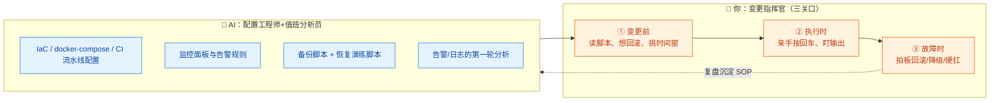
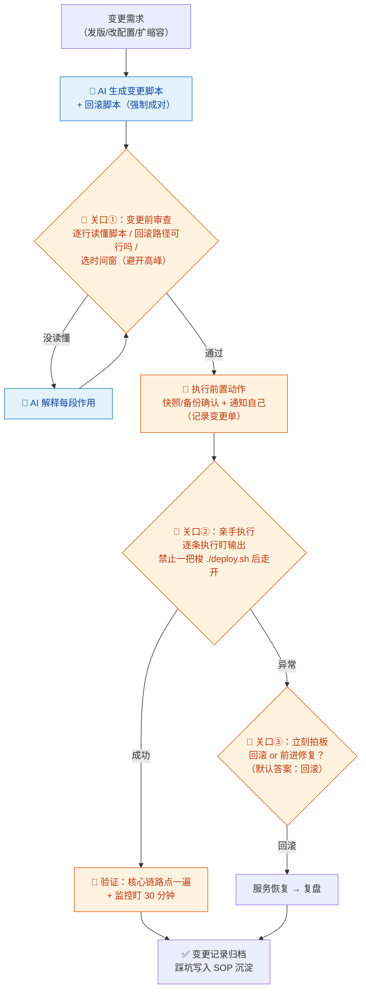

# 08-运维 DevOps × AI 协同

> 💬 **一句话读懂本篇**：运维是"AI 写配置很爽、敲回车很险"的岗位——脚本可以让 AI 全包，但**生产环境的每一次变更、每一个回车，必须你亲手按、亲眼看**。

| 版本 | 适用范围 | 前置阅读 |
|---|---|---|
| V0.1 | 一人公司 / 超级个体 | [AI协同开发规范](/2026/10/12/ai-collaborative-development-specification/)（总纲）、[00-汇总·一人公司AI协同岗位全景](/2026/10/12/ai-collaboration-roles-overview/) |

**岗位定位**：🤝 人机协同 · AI 承担约 60% 工作量。运维的错误代价是**即时且面向全部用户的**（服务挂了、数据丢了），所以本册的主旋律是：AI 负责"写"，你负责"按"；自动化程度越高，变更纪律越严。

---

## 一、传统画像：运维工程师原来干什么

| 工作项 | 传统做法 | 痛点 |
|---|---|---|
| 环境搭建 | 手动装机器、配环境 | 环境漂移，"我机器上是好的" |
| 部署发布 | 手工/半自动发布 | 深夜发布，心跳加速 |
| 监控告警 | 搭监控、配阈值、盯大盘 | 告警风暴或该响不响 |
| 备份恢复 | 定时备份 | **备份从不演练恢复，恢复时才发现全是坑** |
| 故障处理 | 救火：看日志、定位、回滚 | 一人公司：你不在，全站等死 |
| 成本治理 | 月底看账单 | 忘了关的服务在默默烧钱 |

## 二、AI 协同后的新画像

**一人公司运维总原则：托管优先（承接 03 分册），能不运维就不运维。** 剩下的活儿，你是"变更指挥官"，AI 是"配置工程师 + 值班分析员"：



> 🚫 **铁律**：AI 生成的运维脚本，**禁止不看内容直接在生产执行**；禁止给 AI 工具接生产环境凭证让它"自己上去修"。

---

## 三、逐项对比：传统做法 vs AI 协同做法

| 工作项 | 🐢 传统做法 | 🚀 AI 协同做法 | 谁主导 |
|---|---|---|---|
| 环境搭建 | 手动配服务器 | AI 写 IaC/docker-compose，环境即代码可重建 | 🤖 AI 写，**你审后执行** |
| CI/CD | 专人维护流水线 | AI 生成流水线配置（构建→测试→部署），你管部署审批环节 | 🤝 人机协同 |
| 部署发布 | 手工/脚本发布 | AI 写好部署脚本+回滚脚本**成对交付**，你在时间窗亲手执行 | 🧠 **你按回车** |
| 监控告警 | 凭经验配阈值 | AI 按服务清单出监控项+阈值+告警文案，你只留"值得半夜起床"的告警 | 🤝 AI 起草你裁剪 |
| 日志分析 | 肉眼 grep | 贴日志片段，AI 第一轮归因（模板 D），你验证后处置 | 🤝 人机协同 |
| 备份 | 配了定时任务就完事 | AI 写备份+**恢复演练**脚本，每季度你真演练一次 | 🧠 **你演练你签字** |
| 故障处置 | 团队救火 | AI 当分析副手；**回滚/降级/重启的决策只能你做** | 🧠 人主导 |
| 成本治理 | 月底看账单惊呆 | AI 定期审账单出优化清单（03 分册坑点呼应），你执行 | 🤝 人机协同 |

---

## 四、协同工作流：一次生产变更的标准动作



**节奏建议**：一人公司没有值班表，靠两件事保平安——①告警只配"必须起床"级别的（少了才能睡）；②**任何变更都有回滚脚本**，让"搞砸了"的代价从事故降为麻烦。

---

## 五、提示词模板（直接抄作业）

### 模板 A · CI/CD 流水线

```text
【背景】代码仓库结构：xxx；技术栈：xxx；部署目标：托管平台/服务器（说明）
【任务】生成完整流水线配置：拉代码→装依赖→跑测试→构建→部署→失败通知
【约束】
1. 部署环节必须人工审批触发（不许 push 即上线）
2. 密钥全部走 CI Secrets，配置里只留占位符
3. 每步失败有明确日志输出；部署步骤附回滚方式
【输出】流水线配置 + 需要我在平台侧配置的 Secrets 清单
```

### 模板 B · 部署 + 回滚脚本（强制成对）

```text
【背景】服务：xxx；当前部署方式：（描述）；目标：xxx
【任务】生成一对脚本：
1. deploy.sh：部署步骤，每步带 echo 进度和失败即停（set -e）
2. rollback.sh：一键回到当前版本（说明它依赖什么前置状态，如镜像 tag/快照）
【约束】脚本中禁止出现任何明文密钥；破坏性命令（rm/drop/重启）前必须要求确认输入；
最后输出「执行前检查清单」给我。
```

### 模板 C · 监控告警设计

```text
【输入】服务清单与架构：（粘贴 03 分册架构图/组件列表）
【任务】输出监控方案：
1. 每个组件的监控项（可用性/延迟/错误率/资源）与建议阈值
2. 告警分级：🔴立即处理（打电话级）/ 🟡当天看 / 🟢仅记录
3. 每条告警的文案模板：发生了什么+第一步查什么
【约束】🔴级告警总数控制在 5 条以内——半夜叫醒我的必须是真值得的；
宁缺毋滥，告警疲劳比没有告警更危险。
```

### 模板 D · 故障第一轮归因

```text
【现象】xxx 服务从 xx:xx 开始 xxx（用户可见影响：xxx）
【输入】告警内容：（粘贴）；相关日志：（粘贴，已脱敏）；最近变更记录：（粘贴）
【任务】按可能性排序给出 3 个假设，每个附：验证方法（一条命令/一次查询）+ 若成立的处置动作
【约束】先看"最近变更"——多数故障是变更引起的；只基于我给的信息推理，缺什么信息直接列出来。
```

---

## 六、验收清单（每次生产变更前逐项勾）

**变更前**
- [ ] 脚本逐行读懂（含 AI 生成的"看起来没问题"的部分）
- [ ] 回滚脚本存在，且想清楚了触发条件（默认：不确定就回滚）
- [ ] 快照/备份已确认（数据库变更：备份必须能恢复，见下）
- [ ] 时间窗合适（避开业务高峰、避开你接下来要睡觉的时段）
- [ ] 无明文密钥进脚本/仓库/聊天记录（总纲红线第 1 条）

**变更中**
- [ ] 亲手执行，逐条盯输出，不"一把梭后走开"
- [ ] 破坏性命令执行前二次确认了目标环境（生产 ≠ 测试，看清 prompt）

**变更后**
- [ ] 核心链路真实点过一遍（首页/登录/下单等）
- [ ] 监控盯了 30 分钟，错误率/延迟无异常
- [ ] 变更记录归档：改了什么、为什么、怎么回滚的（三行即可）

**季度例行**
- [ ] 备份**恢复演练**做过一次：真的从备份恢复出可用数据
- [ ] 账单审过一次：没有遗忘的服务在烧钱
- [ ] 🔴级告警清单复查：还都值得半夜起床吗

---

## 七、坑点清单

| 坑 | 长什么样 | 怎么防 |
|---|---|---|
| 未读执行 | AI 给的脚本直接 root 跑，里面一条 `rm -rf` 认错了路径 | 关口①逐行读懂；破坏性命令强制确认输入 |
| 备份幻觉 | 备份任务天天"成功"，恢复时才发现文件损坏/没权限 | 季度恢复演练，写进验收清单 |
| 告警风暴 | 配了 50 条告警，狼来了三次后你把通知关了 | 模板 C：🔴级 ≤5 条，宁缺毋滥 |
| 环境漂移 | 生产被手工改过，和 IaC 代码对不上 | 铁律：一切变更走脚本，禁止 SSH 上去"就改一行" |
| 密钥进聊天记录 | 排障时把含密钥的配置贴给 AI | 贴日志/配置前先脱敏，设成肌肉记忆 |
| 过度架构 | 一人公司上了 K8s 集群，运维对象比用户多 | 承接 03 分册三原则：托管优先；服务器数得过来 |
| 无回滚发布 | 只有 deploy 没有 rollback，出事现场手写回滚 | 模板 B 强制成对交付，缺回滚不执行 |

---

> 💬 **收尾一句**：运维岗的 AI 协同公式是"**AI 写 100% 的脚本，你按 100% 的回车**"。自动化的尽头不是无人值守，而是每次变更都有据可查、有路可退。
> **下一册**：[09-安全 × AI 协同](/2026/10/12/ai-collaboration-security/)——AI 能做安全初筛，但攻击者也在用 AI；这个岗位你永远只能"部分外包"。
