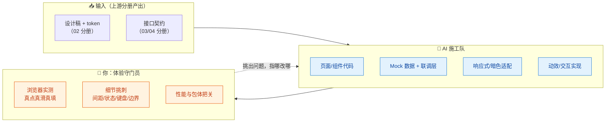
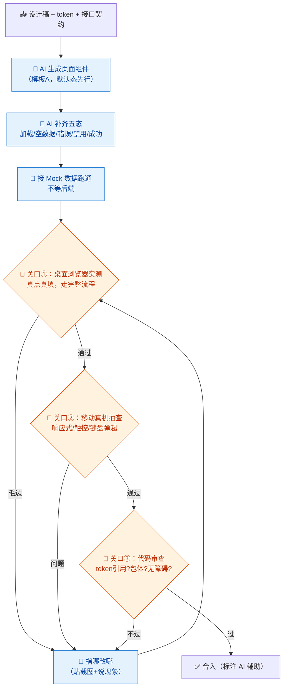

# 05-前端开发 × AI 协同

> 💬 **一句话读懂本篇**：前端是 AI 化最顺滑的岗位——所见即所得，错了立刻看得见；但"看得见"也意味着**平庸和毛边直接暴露给用户**，验收标准要比你想的更细。

| 版本 | 适用范围 | 前置阅读 |
|---|---|---|
| V0.1 | 一人公司 / 超级个体 | [AI协同开发规范](/2026/10/12/ai-collaborative-development-specification/)（总纲）、[00-汇总·一人公司AI协同岗位全景](/2026/10/12/ai-collaboration-roles-overview/) |

**岗位定位**：🤖 AI 主导 · AI 承担约 70% 工作量。前端代码风险低于后端（错了通常不丢数据），且 AI 生成→浏览器预览→人工验收的循环极短，是一人公司里**人机协作爽感最强**的岗位。

---

## 一、传统画像：前端工程师原来干什么

| 工作项 | 传统占比 | 特点 |
|---|---|---|
| 页面/组件开发 | ~40% | 按设计稿还原，体力+细心 |
| 状态管理/数据对接 | ~20% | 和后端接口联调 |
| 样式/响应式/兼容 | ~20% | 碎、烦、难有成就感 |
| 交互细节/动效 | ~10% | 体验的魔鬼细节 |
| 性能优化 | ~10% | 一直想做一直没时间 |

## 二、AI 协同后的新画像

**你是"体验守门员"，AI 是全能施工队。** 02 分册的设计 token 在这里兑现价值：token 在手，AI 写出的页面天然一致，你的工作重心从"写"移到"挑刺"。



---

## 三、逐项对比：传统做法 vs AI 协同做法

| 工作项 | 🐢 传统做法 | 🚀 AI 协同做法 | 谁主导 |
|---|---|---|---|
| 页面还原 | 对着设计稿手写 | 贴设计稿+token，AI 直接出组件代码（02 分册模板 D） | 🤖 AI 主导 |
| 组件库建设 | 手写+维护 Storybook | AI 按 token 批量生成基础组件，你定 API 设计 | 🤝 你定 API，AI 实现 |
| 状态管理 | 手搭 store、写 action | AI 生成状态层样板，**你定状态边界和数据流向** | 🤝 人机协同 |
| 接口联调 | 等后端、对字段、扯皮 | 契约在手 AI 生成请求层+类型+Mock，前后端并行 | 🤖 AI 主导 |
| 响应式/暗色 | 逐断点调 | AI 按断点清单批量适配，你真机抽查 | 🤖 AI 主导，**你抽查** |
| 表单校验 | 手写规则、错误提示 | 从后端契约/表结构生成校验+提示文案 | 🤖 AI 主导 |
| 动效交互 | 调参半天 | AI 出实现，你用"体感"验收（这个只能你来） | 🤝 人机协同 |
| 性能优化 | 有空再说 | AI 审包体/渲染路径给优化清单，你按性价比挑着做 | 🤝 人机协同 |
| 浏览器兼容 | 逐个试 | AI 列出所用特性的兼容矩阵，你只实测目标浏览器 | 🤝 人机协同 |

> ⚠️ **前端验收的特殊性**：后端靠测试通过，前端靠**真人真浏览器真操作**。AI 说"已完成响应式适配"不算数，你在手机上滑一遍才算数。

---

## 四、协同工作流：一个页面的诞生



**节奏建议**：改前端别打字描述，**截图圈问题**——"这个按钮"远不如一张画了红圈的图。多数 AI 工具支持贴图，这是前端协同独有的高效沟通方式。

---

## 五、提示词模板（直接抄作业）

### 模板 A · 页面/组件生成

```text
【输入】设计稿：（贴图）；设计 token：（粘贴 JSON）；接口契约：（粘贴）
【任务】用「框架+版本号」实现该页面
【约束】
1. 颜色/字号/间距/圆角一律引用 token，禁止硬编码
2. 组件 props 设计遵循项目现有组件规范：（贴一个现有组件示例）
3. 覆盖五态：默认/加载/空数据/错误/禁用
4. 数据请求走项目统一请求层（贴现有用法），不要直接 fetch
5. 表单校验规则与后端契约一致，错误提示用中文、说人话
【输出】组件代码 + 用到的 Mock 数据 + 与设计稿的差异说明
```

### 模板 B · 状态管理设计

```text
【输入】页面功能描述：xxx；涉及的接口：（粘贴契约）
【任务】先不要写代码——给出状态设计方案：
1. 状态清单（每个状态：名称/类型/谁写入/谁消费）
2. 服务端状态 vs 客户端状态的划分（哪些该用查询缓存而不是手动 store）
3. 数据流向图（mermaid）
【约束】状态数量最少化：能从已有状态派生的绝不新建；
方案给我看完确认后，再按方案生成代码。
```

### 模板 C · 挑刺修复（配合截图）

```text
【现象】（贴截图，圈出问题）在 xxx 视口宽度下，xxx 元素出现 xxx 问题
【期望】xxx（描述正确表现，或贴设计稿对应部分）
【输入】相关组件代码：（粘贴）
【约束】只改这个问题，不要顺手重构其他部分；改完说明动了哪几行、为什么。
```

### 模板 D · 性能审查

```text
以下是项目的构建产物分析/关键组件代码（粘贴）。
请输出性能优化清单，每条包含：
1. 问题（如：首屏包体过大/不必要的重渲染/图片未懒加载）
2. 用户可感知的后果
3. 修复方法 + 预估收益（大/中/小）
按收益排序，只列值得做的（一人公司：性价比低的直接不列）。
```

---

## 六、验收清单（合入前逐项勾）

**实测（浏览器里真操作过）**
- [ ] 完整用户流程走通：真点、真填、真提交
- [ ] 五态齐全：默认/加载/空数据/错误/禁用，且都亲眼看过
- [ ] 移动真机抽查：响应式断点、触控目标、软键盘弹起不挡输入
- [ ] 极端输入试过：超长文本、特殊字符、连续快速点击

**代码**
- [ ] 样式全部引用 token，grep 无硬编码色值/魔法数字
- [ ] 无 AI 夹带的多余依赖（新组件库、新工具包问过自己"项目里没有吗"）
- [ ] 列表有 key、图片有 alt、可聚焦元素有 focus 态
- [ ] 数据请求走统一请求层，无散落的手写 fetch

**性能**
- [ ] 包体无明显膨胀（新页面引入的依赖 < 预期）
- [ ] 长列表有虚拟化/分页，图片有懒加载和尺寸约束
- [ ] 无控制台报错和警告（AI 代码常留 warning，别惯着）

---

## 七、坑点清单

| 坑 | 长什么样 | 怎么防 |
|---|---|---|
| 硬编码魔法值 | 颜色写死 `#3b82f6`，改主题时全站漏改 | 模板 A 约束 + 验收 grep 色值 |
| 依赖夹带 | 为一个按钮引入整个组件库 | 约束"用项目已有"；新依赖走总纲白名单 |
| Demo 态幻觉 | AI 演示时数据完美，空数据/错误态一塌糊涂 | 五态清单强制逐项过（关口①） |
| 兼容 API 幻觉 | 用了目标浏览器不支持的新 CSS/API | 让 AI 列兼容矩阵；Can I Use 核实关键特性 |
| 过度抽象 | 三个页面各用一次的东西抽了八层组件 | 规则："用到第三次才抽象"，评审砍掉多余层 |
| 动效喧宾夺主 | 到处是过渡动画，页面卡顿还分散注意 | 动效白名单制：核心反馈动效保留，装饰动效默认砍 |
| 无障碍欠账 | 键盘走不通、对比度不够 | 验收清单固定项；上线前 Tab 键走一遍全流程 |

---

> 💬 **收尾一句**：前端协同的爽点是"生成即所见"，坑点也在"所见即所得"——用户看到的就是你的验收水平。**AI 负责快，你负责细。**
> **下一册**：[06-移动端开发 × AI 协同](/2026/10/12/ai-collaboration-mobile-dev/)——跨端方案让一人做 App 成为可能，但上架合规这道坎 AI 替不了你。
