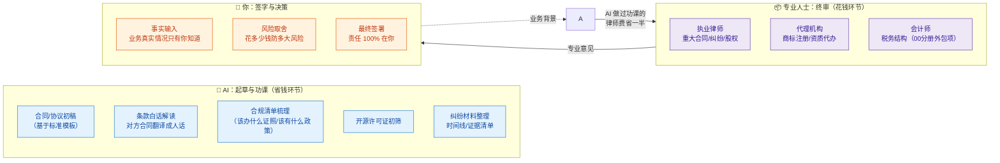
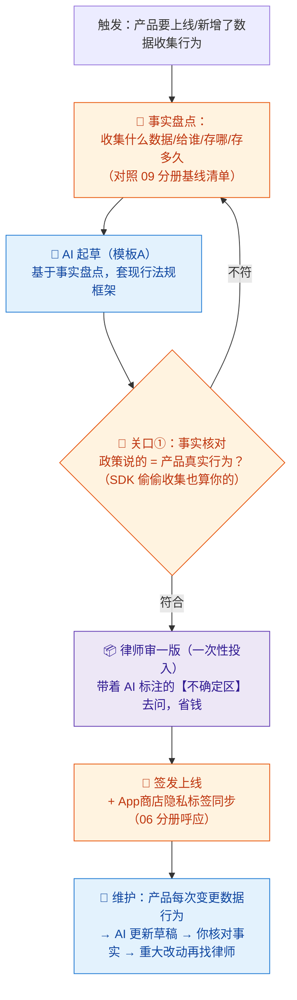
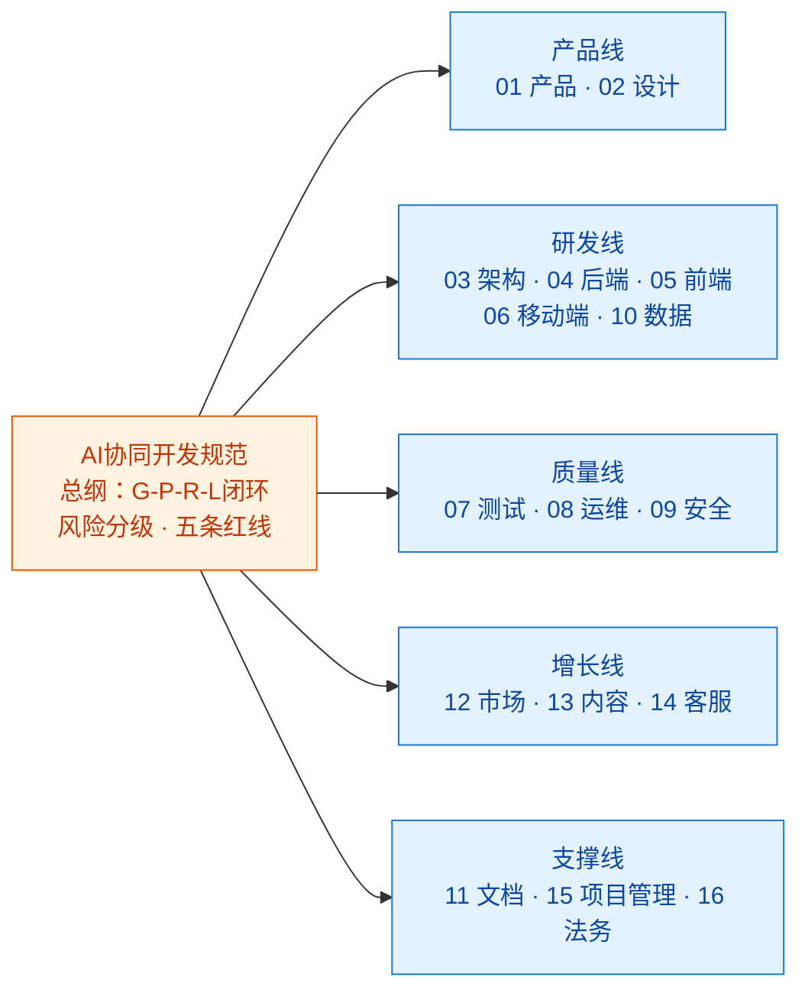

# 16-法务合规 × AI 协同（终册 · 附录级）

> 💬 **一句话读懂本篇**：法律是全系列唯一"**AI 起草、专业人士终审、你签字**"三段式的岗位——AI 帮你把律师费花在刀刃上，但永远不能替你省掉律师。

| 版本 | 适用范围 | 前置阅读 |
|---|---|---|
| V0.1 | 一人公司 / 超级个体 | [AI协同开发规范](/2026/10/12/ai-collaborative-development-specification/)（总纲）、[00-汇总·一人公司AI协同岗位全景](/2026/10/12/ai-collaboration-roles-overview/) |

**岗位定位**：📦 外包为主 + AI 起草 · AI 承担约 20% 工作量。**本册为附录级**：不追求你掌握法务技能，只追求两件事——**知道什么时候必须花钱请专业人士，以及花钱前怎么用 AI 把功课做足**。

> ⚠️ **本册免责声明**：以下内容是工作流程规范，不构成法律意见。法律法规因地区、行业而异且持续更新，重大事项请咨询执业律师。

---

## 一、一人公司的法务现实

| 事项 | 传统公司 | 一人公司现实 |
|---|---|---|
| 合同审核 | 法务部/外聘顾问 | 用模板居多，重大合同才请律师 |
| 隐私政策/用户协议 | 法务起草 | 网上抄模板（**高危动作**，见坑点） |
| 知识产权 | 商标专利专人管 | 容易裸奔，出事才想起注册 |
| 开源许可证 | 合规团队审 | 开发者自己看（经常不看） |
| 数据合规 | DPO/法务 | 个保法/GDPR 该适用就适用，不因公司小而豁免 |
| 纠纷应对 | 法务出面 | 你亲自上，律师按小时计费 |

**核心策略**：**AI 做功课降成本，专业人士把关控风险，保险和注册兜住大坑。** 法律错误的代价结构和代码完全不同——bug 可以热修，合同签了就不能撤。

---

## 二、三段式分工模型



**什么钱不能省（必须请专业人士的红线场景）**：
- 🔴 股权/合伙协议（哪怕和好朋友）——AI 初稿都不建议直接用
- 🔴 融资、并购、对赌条款
- 🔴 收到律师函/被起诉/要起诉别人
- 🔴 核心商标注册（检索和类别选择专业性极强）
- 🔴 数据出境、金融/医疗/教育等强监管行业准入
- 🟡 金额大或期限长的客户合同：AI 起草可以，**发出前律师过一遍**

---

## 三、逐项对比：传统做法 vs AI 协同做法

| 工作项 | 🐢 传统做法 | 🚀 AI 协同做法 | 谁终审 |
|---|---|---|---|
| 用户协议/隐私政策 | 律师起草（贵）或抄模板（险） | AI 按你的**真实**数据行为起草（模板 A）→ 律师审一版 → 之后小改 AI 维护 | 📦 律师首审，👤 你签发 |
| 客户合同 | 来回拉锯，每版都请律师 | AI 解读对方条款+标风险点（模板 B），你带着标注问题清单找律师，按小时省 | 📦 律师把关重大条款 |
| 开源合规 | 不看 | AI 扫依赖清单出许可证矩阵（模板 C），copyleft 传染项人工复核 | 👤 你决策替换/购买/开源 |
| 商标/域名 | 想起才注册 | AI 帮你梳理类别清单和近似风险初筛，**注册走代理机构** | 📦 代理机构 |
| 证照合规 | 别人提醒才办 | AI 按业务形态出"该办清单"（ICP/增值电信/行业资质），你逐条核实官网 | 👤 你核实办理 |
| 纠纷应对 | 慌 | AI 整理时间线+证据清单+诉求选项，**策略和文书交给律师** | 📦 律师 |
| 日常法律咨询 | 按次付费问律师 | 先问 AI 做功课（了解概念和框架），带着具体问题找律师——问题质量决定计费效率 | 📦 律师 |

> ⚠️ **AI 用法务的两大特有幻觉**：①**编造法条和案例**——AI 引用"某某法第 X 条"和判例可能是虚构的，任何法条引用必须到官方源（人大网/政府官网/裁判文书网）核对原文；②**过时法规**——训练数据截止前的法规可能已修订，让 AI 标注"需核实现行有效版本"。

---

## 四、协同工作流：隐私政策为例（一人公司最高频的法务件）



**节奏建议**：法务件的特点是"**一次搭好、长期小修**"——首次花律师费把协议/政策框架立正，之后的维护 AI+你自己就够了；但每年至少一次请专业人士整体复查（法规会变）。

---

## 五、提示词模板（直接抄作业）

### 模板 A · 隐私政策/用户协议起草

```text
【业务事实】产品：xxx；收集的数据逐项列出：（字段/用途/是否必须/保存期限）
第三方 SDK 与服务：（名称/各自收集什么）；数据存储位置：xxx；是否出境：xxx
【任务】起草隐私政策，结构符合「适用地区现行法规」要求（地区：xxx），包含：
收集清单（表格化）/ 使用目的 / 共享与第三方 / 存储与安全 / 用户权利（查阅/删除/注销的具体路径）/ 未成年人条款 / 联系方式
【约束】
1. 只写我提供的事实，禁止添加"我们可能会"式的兜底扩权条款
2. 引用的法规名称和条款标注【需核实：请查证现行有效版本】
3. 输出两版：完整法律文本 + 一屏"人话摘要"（放在收集弹窗里的那种）
4. 列出你不确定、建议咨询律师的部分，单独成节
```

### 模板 B · 对方合同解读

```text
以下是对方发来的合同（粘贴，隐去当事人敏感信息）。请：
1. 白话摘要：这笔交易的核心权利义务，各用 3 句话
2. 风险条款清单，按对我方（一人公司/服务提供方/采购方——注明我是哪方）不利程度排序：
   条款位置 / 原文关键句 / 风险是什么 / 常见的替代写法
3. 重点核查：付款条件与违约条款是否对等、责任上限有没有、自动续约陷阱、知识产权归属、单方解约权
4. 生成「问题清单」：我要带去问律师的问题，按重要性排序
【约束】你的分析仅供我做功课，不替代法律意见；引用法律依据处标注【需核实】。
```

### 模板 C · 开源许可证合规

```text
【输入】项目依赖清单：（粘贴 npm/pip/go mod 等输出，含版本号）；
我的分发方式：（SaaS 在线服务 / 分发客户端 / 开源）
【任务】输出许可证合规矩阵：
依赖 / 许可证 / 对我的义务（署名/开源传染/禁止商用等）/ 风险级（安全可用/需署名/传染性注意/建议替换）
特别注意：AGPL 对 SaaS 的传染、GPL 对分发的传染、双重许可证的商业选项
【约束】不确定的许可证标注【需人工核对 LICENSE 原文】；
高风险项给出替代库建议（注明替代成本）。
```

---

## 六、验收清单

**签署任何合同前**
- [ ] 白话复述得出：我得到什么、付出什么、什么情况下违约、最坏赔多少
- [ ] 红线场景对照过（第二节）：属于🔴类的，律师已过目
- [ ] 付款/交付/解约条款看过原文（不是只看 AI 摘要）
- [ ] 对方主体核实过（工商信息查过，不是只信名片）

**上线任何产品前**
- [ ] 隐私政策与真实数据行为一致（含第三方 SDK）
- [ ] 用户协议含：服务边界、责任上限、争议解决方式
- [ ] 该办的证照清单核实过（AI 梳理 + 官网逐条确认）
- [ ] 核心商标至少提交检索（名称裸奔 = 替别人养品牌）
- [ ] 开源许可证矩阵无高风险项（模板 C）

**例行（每年）**
- [ ] 协议/政策请专业人士整体复查一次（法规更新）
- [ ] AI 引用的所有法条抽查过官方源
- [ ] 纠纷预案存在：知道第一个电话打给谁（提前存好律师/代理联系方式）

---

## 七、坑点清单

| 坑 | 长什么样 | 怎么防 |
|---|---|---|
| 抄模板政策 | 网上抄的隐私政策写着"不收集位置"，你的 App 在收 | 模板 A 从真实事实起草；关口①事实核对（06 分册同款） |
| 法条幻觉 | AI 引用不存在的"第 X 条"，写得有鼻子有眼 | 铁律：法条必核官方源；模板强制【需核实】标注 |
| 小钱酿大祸 | 为省两千律师费，签了带无限连带责任的合同 | 第二节红线场景清单贴在桌前 |
| 商标裸奔 | 产品火了才发现名字被抢注，改名或高价赎回 | 立项时同步检索+提交，代理费是小钱 |
| AGPL 传染 | AI 引入的依赖带 copyleft，SaaS 也被要求开源 | 模板 C 进发版流程（04 分册依赖白名单呼应） |
| 朋友合伙口头约定 | "咱俩谁跟谁"，赚钱后翻脸无凭据 | 红线场景第一条：股权合伙必须书面+律师 |
| AI 当律师用 | 拿 AI 分析直接应诉/发律师函 | 三段式铁律：AI 只做功课，出场必须是执业人士 |

---

> 💬 **收尾一句**：法务岗的 AI 协同公式是"**AI 降功课成本，专业人士控风险上限，你签字负全责**"。一人公司在法律上的正确姿势不是懂法，而是**知道哪些地方不懂法的代价付不起**。

---

## 🎉 系列完结页

《AI协同开发规范》一人公司系列 16 册全部成稿：



**全系列一句话总纲**：每个岗位都是同一个公式——**AI 出产量，你出判断；AI 可以错，你不能不看。** 一人公司的极限不是你会多少技能，而是你能对多少个岗位的产出负责。
