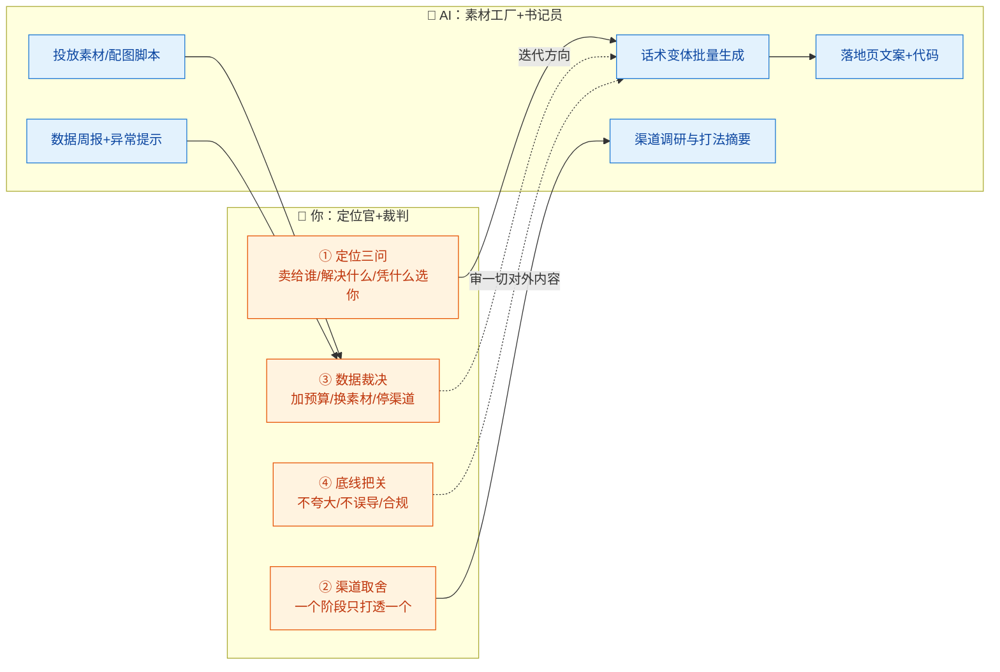
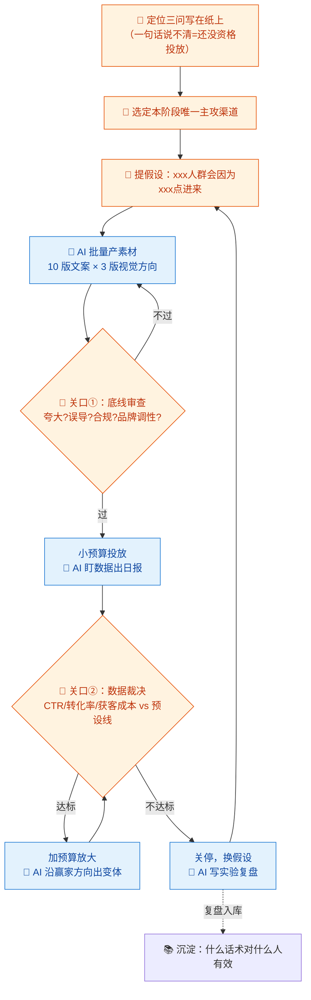

# 12-市场增长 × AI 协同

> 💬 **一句话读懂本篇**：AI 能量产一百条文案，但回答不了"卖给谁、凭什么、多少钱"——增长岗的 AI 协同是"**你定定位，AI 铺量，数据裁决**"。

| 版本 | 适用范围 | 前置阅读 |
|---|---|---|
| V0.1 | 一人公司 / 超级个体 | [AI协同开发规范](/2026/10/12/ai-collaborative-development-specification/)（总纲）、[00-汇总·一人公司AI协同岗位全景](/2026/10/12/ai-collaboration-roles-overview/) |

**岗位定位**：🤝 人机协同 · AI 承担约 60% 工作量。市场增长是一人公司**最容易"用 AI 假装在增长"**的岗位：素材产得飞快、页面做得漂亮，但定位没想清楚，量铺得越多浪费越多。

---

## 一、传统画像：市场/增长原来干什么

| 工作项 | 传统做法 | 痛点 |
|---|---|---|
| 定位与信息架构 | 定位工作坊、话术打磨 | 一人公司容易自嗨 |
| 落地页/官网 | 设计+开发+文案 | 改一次话术要动三个环节 |
| 投放素材 | 设计+文案批量出 A/B 版本 | 素材产能是投放的瓶颈 |
| 渠道运营 | 各平台账号、SEO、外链 | 精力不够，处处浅尝 |
| 数据分析 | 埋点、漏斗、归因 | 工具一堆，结论没有 |

## 二、AI 协同后的新画像

**你是"定位官 + 增长裁判"，AI 是"素材工厂 + 数据书记员"。** 一人公司增长的正确顺序永远是：定位想清楚 → 单渠道打透 → 再复制放大。AI 加速的是第二步的迭代，救不了第一步的糊涂。



---

## 三、逐项对比：传统做法 vs AI 协同做法

| 工作项 | 🐢 传统做法 | 🚀 AI 协同做法 | 谁主导 |
|---|---|---|---|
| 定位与话术 | 工作坊、反复打磨 | AI 出 N 版定位话术供**刺激思考**，最终一句话必须你自己写 | 🧠 **你拍板** |
| 落地页 | 设计→开发→文案三段接力 | AI 一次出文案+页面代码（02/05 分册流水线复用） | 🤖 AI 主导 |
| 投放素材 | 产能瓶颈，一周十几版 | AI 批量出文案变体+配图提示词，一天五十版，**投放数据选优** | 🤖 AI 铺量，**数据裁决** |
| 渠道调研 | 逐个平台研究 | AI 出渠道打法摘要+竞品动作清单，你实地验证后再投入 | 🤝 人机协同 |
| SEO | 关键词研究+写文章 | AI 做关键词矩阵（13 分册内容线承接），你看搜索意图匹配度 | 🤝 人机协同 |
| 数据分析 | 手工拉报表 | AI 生成漏斗分析+周报（模板 D），**你只做裁决动作** | 🤝 AI 分析你决策 |
| 竞品监控 | 没空盯 | AI 定期整理竞品定价/功能/话术变化，你判断要不要跟进 | 🤖 AI 盯梢你判断 |
| 定价 | 拍脑袋 | AI 出定价结构对比（免费增值/订阅/买断），**你结合成本与用户拍板** | 🧠 **你拍板** |

> ⚠️ **对外内容的红线（比代码红线更容易踩）**：不夸大功效、不虚构用户评价、不误导定价（暗取消/隐藏费用是重灾区）。AI 文案天然爱吹，**每条对外发布的话术都要过你的"不骗人"审查**——一人公司的品牌就是创始人信誉，赔不起。

---

## 四、协同工作流：一轮增长实验



**节奏建议**：每轮实验**预设裁决线**（如"获客成本 > ¥xx 即关停"），投前写死——投放中的人（尤其花自己钱的人）最擅长给自己找"再等等"的理由，让规则替你残忍。

---

## 五、提示词模板（直接抄作业）

### 模板 A · 定位话术刺激（不是替你定位）

```text
【输入】产品：xxx；目标用户：xxx；我目前的定位假设：xxx；竞品：xxx
【任务】生成 5 版差异化定位话术，每版基于不同的切入角度
（如：省时间/省钱/身份认同/恐惧规避/极简主义），各附：
一句话主张 / 支撑理由 / 最适合的渠道 / 这版的软肋
【约束】禁止万能话术（"让工作更高效"这种等于没说）；
你的输出只是刺激我思考的原料，最后由我定稿——所以每版都要旗帜鲜明，宁可偏激不要平庸。
```

### 模板 B · 投放素材批量生成

```text
【输入】定位话术（我定稿版）：xxx；目标人群：xxx；渠道：xxx（含素材规格）；
本轮假设：xxx
【任务】产出 10 版文案变体：
3 版直击痛点 / 3 版场景代入 / 2 版对比竞品（不点名）/ 2 版反常识钩子
每版标注：主打情绪 + 建议视觉方向 + 我假设它有效的理由
【约束】
1. 底线自查：无夸大功效、无虚构背书、无误导表述，逐版声明
2. 变体之间差异要实质（换钩子换角度），不是同义词替换凑数
```

### 模板 C · 落地页生成

```text
【输入】定位话术：xxx；素材赢家方向：xxx；技术栈：xxx + 设计 token（02 分册）
【任务】生成落地页文案+代码，结构：
首屏（主张+副标题+主CTA）→ 痛点共鸣 → 方案演示 → 信任背书（只放真实存在的）→ FAQ → 底部CTA
【约束】
1. CTA 全页一个动作，不要又注册又关注又加群
2. 信任背书区留占位并注明【只放真实素材，禁止编造评价/客户logo】
3. 移动端优先；加载性能：无重型依赖
```

### 模板 D · 增长数据周报

```text
【输入】本周各渠道数据：花费/曝光/点击/注册/付费（粘贴表格，脱敏）；上周数据：xxx；预设裁决线：xxx
【任务】输出周报：
1. 结论先行：本周该做的 1 个动作（加预算/关停/换素材）
2. 漏斗对比：哪一环节流失异常，可能原因（标注是数据推断还是瞎猜）
3. 素材榜单：赢家为什么赢（从文案角度归因），输家共性问题
【约束】数据不足以支撑的结论必须标注；不许为了周报好看而找亮点。
```

---

## 六、验收清单（对外发布前逐项勾）

**底线（一票否决项）**
- [ ] 无夸大功效、无虚构用户/评价/背书
- [ ] 定价展示无误导：免费试用说清自动续费、取消路径明示
- [ ] 广告素材标注合规（平台要求"广告"标识的已加）
- [ ] 竞品对比不点名、不贬损、事实可举证

**策略**
- [ ] 本轮素材服务于**写下来的假设**（说不出假设=不许投）
- [ ] 裁决线已预设（多少钱、多少天、什么指标、不达标怎么办）
- [ ] 渠道聚焦：本阶段主攻渠道只有一个

**执行**
- [ ] 落地页 CTA 单一，移动端真机看过，加载 3 秒内
- [ ] 埋点齐全：曝光/点击/注册/付费漏斗每环有数
- [ ] 实验复盘无论成败都入库（输的经验比赢的贵）

---

## 七、坑点清单

| 坑 | 长什么样 | 怎么防 |
|---|---|---|
| AI 吹牛体质 | 文案自动升级到"业界领先""彻底改变" | 模板 B 强制逐版底线自查；发布前人工过"不骗人"审查 |
| 素材海战术幻觉 | 一天产 50 版素材，感觉在增长，实际全在乱枪打鸟 | 每批素材绑定假设；没假设的产能是浪费 |
| 渠道花心 | 五个平台各发一点，处处浅尝 | 关口"一个阶段一个主攻渠道"，写进裁决规则 |
| 自嗨定位 | AI 顺着你的假设论证，越看越对 | 模板 A 要"软肋"栏；拿话术找 3 个真实用户念一遍看反应 |
| 数据归因过度 | 一次爆款，AI 复盘出十条"成功规律" | 周报模板强制区分"数据推断"和"瞎猜"；单点成功不当规律 |
| 暗模式诱惑 | AI 建议"加个倒计时弹窗提升转化" | 底线清单一票否决；一人公司品牌=创始人信誉 |
| 预算失控 | 自动投放规则+忘了看的账户 | 平台侧设日预算上限；账单告警（08 分册同款纪律） |

---

> 💬 **收尾一句**：增长岗的 AI 协同公式是"**AI 提产能，假设提效率，数据提正义**"。素材可以无限生成，但每一块钱投放都该为一个写下来的假设服务——这是一人公司和"烧钱换增长"最划清界限的地方。
> **下一册**：[13-内容运营 × AI 协同](/2026/10/12/ai-collaboration-content-ops/)——和增长共用素材能力，但逻辑相反：增长买流量，内容赚信任。
