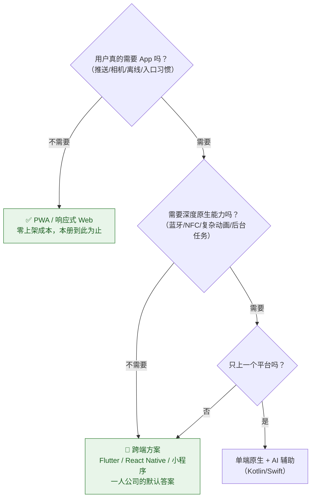
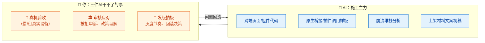
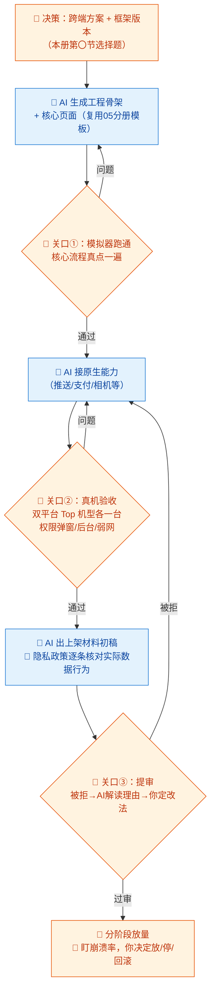

# 06-移动端开发 × AI 协同（可选册）

> 💬 **一句话读懂本篇**：一人公司做 App 的正确姿势是"能不做就不做，要做就跨端"——AI 让跨端开发成本降到一人可承受，但**上架审核、隐私合规、真机碎片化**三座山，还得你自己爬。

| 版本 | 适用范围 | 前置阅读 |
|---|---|---|
| V0.1 | 一人公司 / 超级个体 | [AI协同开发规范](/2026/10/12/ai-collaborative-development-specification/)（总纲）、[00-汇总·一人公司AI协同岗位全景](/2026/10/12/ai-collaboration-roles-overview/) |

**岗位定位**：🤝 人机协同 · AI 承担约 60% 工作量。**本册为可选册**：产品形态以 Web 为主（PWA 够用）的可直接跳过；决定上 App Store / 应用市场再回来读。

---

## 〇、开工前先做一道选择题



**一人公司结论**：90% 的情况选**跨端**——一套代码、AI 熟悉度最高（Flutter/RN 语料丰富）、维护面最小。原生能力确有硬需求时，再单端补齐。

---

## 一、传统画像：移动端工程师原来干什么

| 工作项 | 传统做法 | 痛点 |
|---|---|---|
| 双端开发 | iOS + Android 各写一遍（或各养一人） | 一人公司不可承受 |
| 机型适配 | 一堆测试机逐个试 | 碎片化地狱 |
| 上架发布 | 证书、签名、审核材料、等审核 | 流程繁琐，被拒常见 |
| 崩溃治理 | 接崩溃平台、看堆栈、复现 | 用户机型你根本没有 |
| 热修复/灰度 | 平台搭建 | 小团队常跳过，出事全量炸 |

## 二、AI 协同后的新画像

**你是"跨端包工头 + 上架事务官"。** 代码 AI 写（跨端框架的样板度极高，正对 AI 胃口），你把精力留给三件 AI 干不了的事：**真机验收、审核应对、发版决策**。



---

## 三、逐项对比：传统做法 vs AI 协同做法

| 工作项 | 🐢 传统做法 | 🚀 AI 协同做法 | 谁主导 |
|---|---|---|---|
| 页面开发 | 双端各写一遍 | 跨端框架写一遍，AI 出 80% 代码（同 05 前端分册打法） | 🤖 AI 主导 |
| 原生能力调用 | 查文档写桥接 | AI 生成桥接/插件调用样板，**你核实插件真实存在且维护中** | 🤝 强管控协同 |
| 机型适配 | 测试机海战术 | AI 列适配风险清单（刘海/折叠屏/权限差异），你租云真机抽查 Top 机型 | 🤝 人机协同 |
| 崩溃排障 | 看堆栈猜 | 贴堆栈+代码，AI 定位可疑点（模板 C），你复现验证 | 🤝 人机协同 |
| 上架材料 | 手写描述/截图/隐私政策 | AI 出文案初稿和材料清单，**隐私政策你逐条核对真实行为** | 🧠 你把关合规 |
| 审核被拒 | 老手凭经验申诉 | AI 解读拒审理由+申诉信草稿，你决定改代码还是申诉 | 🧠 **你拍板** |
| 发版 | 一键全量 | AI 帮你搭灰度/分阶段发布配置，放量节奏你定 | 🧠 **你拍板** |
| 版本升级维护 | 依赖升级专人盯 | AI 定期生成升级评估（breaking changes 清单），你挑时机做 | 🤝 人机协同 |

> ⚠️ **移动端专属红线**：插件/SDK 幻觉在移动端代价更高——AI 编造的 Flutter/RN 插件名看着都很真。**每个新插件必须：官方仓库存在 + 近半年有维护 + 许可证可商用。**

---

## 四、协同工作流：从决定做 App 到上架



**节奏建议**：**留足审核缓冲**——首次提审被拒是常态（隐私声明不符、缺测试账号、功能不完整是三大拒因）。重要节点上线倒排时，商店审核按"至少一周、可能两轮"预留。

---

## 五、提示词模板（直接抄作业）

### 模板 A · 跨端页面生成

```text
【背景】框架：Flutter x.x / React Native x.x（写死版本）；设计 token：（粘贴）
【任务】实现「页面名」，双端一致
【约束】
1. 只用项目已有依赖；需要新插件时先停下来，列候选（含维护状态+许可证）等我确认
2. 平台差异（iOS/Android 表现不同处）显式处理并列清单给我
3. 覆盖五态 + 安全区适配（刘海/底部横条）
4. 权限调用前必须有用途说明弹窗逻辑
【输出】代码 + 平台差异清单 + 需要我确认的事项
```

### 模板 B · 上架材料清单

```text
【背景】App 功能：xxx；目标商店：App Store / Google Play / 国内商店
【任务】输出上架材料清单和初稿：
1. 应用描述（商店文案，突出核心场景，不堆形容词）
2. 隐私政策要点清单：App 实际收集了哪些数据（对照我贴的权限和 SDK 列表）
3. 审核注意事项：这类 App 常见拒因 Top5
【约束】隐私政策部分只列"根据你提供的信息，实际发生的数据收集"，
不确定的标注【需人工确认】，禁止套模板编造。
```

### 模板 C · 崩溃堆栈分析

```text
【输入】崩溃堆栈：（粘贴）；发生机型/系统版本分布：（粘贴）；相关代码：（粘贴）
【任务】1) 解读堆栈，定位最可疑代码行；2) 解释为什么只在这些机型/版本上崩；
3) 给修复方案 + 一个能复现它的最小场景描述
【约束】堆栈信息不足时，明确告诉我还需要什么（如 release 符号表）。
```

---

## 六、验收清单（提审前逐项勾）

**真机实测（模拟器不算数）**
- [ ] iOS / Android 各至少一台真机走完核心流程
- [ ] 权限全流程：首次弹窗→拒绝→再进 App 的降级体验正常
- [ ] 弱网/断网：加载态、超时、重试表现正常
- [ ] 后台切换/来电打断/锁屏恢复不崩不丢状态

**合规（拒因重灾区）**
- [ ] 隐私政策与**实际**数据收集行为逐条一致（SDK 收集也算）
- [ ] 提供审核测试账号和演示说明
- [ ] 无热更新执行远程代码（iOS 红线）
- [ ] 账号注销入口存在且真能注销（双平台硬性要求）

**发布**
- [ ] 版本号/构建号策略明确，能区分线上包
- [ ] 崩溃监控已接入，发版后盯 48 小时
- [ ] 回滚方案想好：商店包撤不回，靠"服务端开关"关功能

---

## 七、坑点清单

| 坑 | 长什么样 | 怎么防 |
|---|---|---|
| 插件幻觉 | AI 引用的插件不存在/已停更/换个名字 | 每个新插件人工上官方仓库核实三件事：存在、维护中、许可证 |
| 双端"差不多" | 代码一套，但 iOS 手势/Android 返回键体验各缺一块 | 模板 A 强制输出"平台差异清单"，逐条真机验证 |
| 隐私政策套模板 | 政策写了"不收集位置"，SDK 在偷偷收 | 关口②用商店的隐私标签工具对照实际行为核 |
| 审核周期误判 | 上线日定了，首审被拒直接开天窗 | 倒排期预留"至少一周、可能两轮"；被拒先让 AI 解读理由 |
| 全量发布翻车 | 新版本有崩溃，商店包撤不回 | 分阶段放量 + 关键功能包服务端开关 |
| 模拟器幻觉 | 模拟器一切完美，真机键盘遮挡/安全区错乱 | 验收清单"真机实测"整块不许跳过 |

---

> 💬 **收尾一句**：移动端是一人公司**决策含量最高**的开发岗——做不做 App、上不上双端、什么时候发版，每个都是经营决策。代码 AI 包了，判断力你得全包。
> **下一册**：[07-测试 QA × AI 协同](/2026/10/12/ai-collaboration-qa-testing/)——一人公司没有测试同事，AI 就是你的第二双眼睛，但"自己检查自己作业"的陷阱要提前防。
