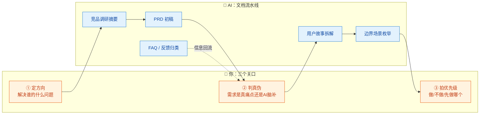
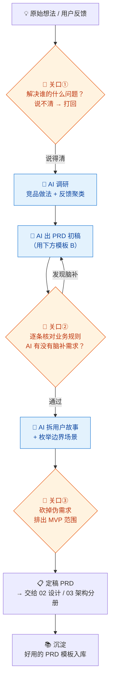

# 01-产品经理 × AI 协同

> 💬 **一句话读懂本篇**：AI 能帮你写出一流的 PRD，但写不出"该做哪个产品"的判断——产品经理这个岗位，AI 化的是笔，不是脑。

| 版本 | 适用范围 | 前置阅读 |
|---|---|---|
| V0.1 | 一人公司 / 超级个体 | [AI协同开发规范](/2026/10/12/ai-collaborative-development-specification/)（总纲）、[00-汇总·一人公司AI协同岗位全景](/2026/10/12/ai-collaboration-roles-overview/) |

**岗位定位**：🧠 人主导 · AI 承担约 40% 工作量。全部岗位里，产品经理是**AI 放大效应最强、也最容易被 AI 带偏**的岗位：需求定义错一寸，后面研发、测试、上线全部错一丈。

---

## 一、传统画像：产品经理原来干什么

| 工作项 | 传统做法 | 痛点 |
|---|---|---|
| 需求收集 | 用户访谈、客服反馈、老板拍脑袋 | 信息散、样本少 |
| 竞品分析 | 手动注册试用、截图、写对比文档 | 一个竞品分析能耗 2~3 天 |
| PRD 撰写 | Word/语雀手写，画原型、补边界 | 大量时间在"格式化劳动" |
| 需求拆解 | 拆用户故事、排优先级 | 靠经验，容易漏边界 |
| 跨部门沟通 | 跟设计、研发、测试反复对齐 | 一人公司没这烦恼（也没有队友兜底） |

## 二、AI 协同后的新画像

**你从"写文档的人"变成"需求决策官"**——AI 负责把想法变成结构化的文档流水线，你只在三个关口出现：**定方向、判真伪、拍优先级**。



---

## 三、逐项对比：传统做法 vs AI 协同做法

| 工作项 | 🐢 传统做法 | 🚀 AI 协同做法 | 谁主导 |
|---|---|---|---|
| 需求洞察 | 小样本访谈，凭感觉 | AI 归类客服记录/评论/社群反馈，聚类出高频痛点 | AI 干粗活，**你判真伪** |
| 竞品分析 | 逐个注册试用，手写文档 | AI 出对比框架和公开信息摘要，你只补"亲手试用"的主观体验 | 🤝 各一半 |
| PRD 撰写 | 从零手写 2 天 | AI 按模板出初稿 20 分钟，你修订关键规则 1 小时 | 🤖 AI 起草，**你签字** |
| 边界场景 | 靠经验，经常漏 | AI 枚举异常流/边界值/权限组合，你筛掉不成立的 | 🤖 AI 主导 |
| 优先级排序 | KANO/MoSCoW 手工评 | AI 给排序建议+理由 | 🧠 **你拍板（不许外包）** |
| 原型图 | Axure/Figma 手画 | AI 生成低保真原型/线框图，或直接生成可点击 HTML 原型 | 🤝 人机协同 |
| 数据指标定义 | 手工梳理北极星指标 | AI 出指标树草案，你定口径 | 🧠 你拍板 |

> ⚠️ **唯一不许 AI 主导的事：做不做的决策。** AI 会把每个需求都论证得头头是道——它擅长"如何做"，不负责"值不值得做"。

---

## 四、协同工作流：一个需求的完整旅程



**节奏建议**：小需求当天走完；大需求"AI 初稿过夜、人修订半天"——让 AI 先跑，你睡醒了再当裁判，比同步盯着效率高。

---

## 五、提示词模板（直接抄作业）

### 模板 A · 需求真伪预判（关口②的帮手）

```text
【角色】你是资深产品顾问，以挑剔著称。
【任务】质疑以下需求，而不是完善它：
需求描述：（粘贴）
【输出】
1. 这个需求背后的真实用户场景是什么？有没有更简单的替代方案？
2. 列出 3 个"这可能伪需求"的理由
3. 列出 3 个"这可能是刚需"的信号
4. 验证这个需求最低成本的方法（不要开发，用问卷/落地页/人工模拟）
```

### 模板 B · PRD 初稿

```text
【背景】产品：xxx；目标用户：xxx；本次要解决的问题：xxx
【任务】按以下结构输出 PRD 初稿：
1. 需求背景与目标（含可度量的成功指标）
2. 用户故事（As a... I want... So that...）
3. 功能清单（P0/P1/P2 分级，每项含验收标准）
4. 业务流程（用 mermaid flowchart 描述）
5. 边界与异常场景（空值/超时/无权限/并发）
6. 数据埋点需求
【约束】
- 不确定的业务规则，标注【待确认】，禁止自行编造
- 范围仅限本期 MVP，锦上添花的功能放"后续迭代"章节
```

### 模板 C · 竞品分析

```text
【任务】对比以下竞品在「xxx 功能」上的做法：竞品A/B/C
【输出】对比表：功能覆盖度 / 交互流程 / 定价 / 用户评价中的高频抱怨
【约束】只写你有把握的公开信息，不确定的标注【需人工核实】；
最后给我 3 个差异化切入点建议（仅建议，我来决策）。
```

### 模板 D · 用户反馈归类

```text
以下是最近 50 条用户反馈（粘贴，注意先脱敏）。
请：1) 按主题聚类并统计频次；2) 每类给 1 条代表性原话；
3) 按「抱怨强度 × 频次」给出关注排序；4) 只归类，不给功能建议。
```

---

## 六、验收清单（PRD 定稿前逐项勾）

**方向对不对**
- [ ] 目标用户和场景是**你验证过的**，不是 AI 推测的
- [ ] 成功指标可度量，且上线后真的会去看
- [ ] MVP 范围是你砍过的，不是 AI 给的全集

**内容真不真**
- [ ] 所有【待确认】标注已逐条落实，无遗留
- [ ] 业务规则逐条来自你的输入，无 AI 脑补的"想当然"默认行为
- [ ] 竞品信息与定价已抽查核实（AI 常编造竞品功能）

**能不能开工**
- [ ] 每个 P0 功能有明确验收标准（测试能照着写用例）
- [ ] 边界场景覆盖：空值/超时/无权限/重复提交
- [ ] 无真实用户数据、无敏感信息残留（对应总纲红线）

---

## 七、坑点清单

| 坑 | 长什么样 | 怎么防 |
|---|---|---|
| AI 脑补需求 | PRD 里冒出你没说过的"业务规则"，写得还很像真的 | 用模板 B 强制【待确认】机制；关口②逐条对照你的原始输入 |
| 全能倾向 | 让出个 MVP，AI 给你规划了三期生态平台 | 提示词写死范围；你亲手砍掉 30% 再定稿 |
| 竞品幻觉 | 编造竞品的功能、定价、融资信息 | 关键事实必须人工核实，尤其定价 |
| 论证陷阱 | 你随口一个想法，AI 能引经据典论证"必须做" | 用模板 A 反向质疑；记住 AI 顺着你说，不等于用户对 |
| 术语漂移 | 同一个概念前后章节叫法不一（订单/交易/单据） | 定稿前让 AI 自查术语表，统一口径 |
| 反馈脱敏遗漏 | 把含手机号/邮箱的用户反馈直接贴给 AI | 归类前先脱敏（对应总纲安全红线） |

---

> 💬 **收尾一句**：AI 让"写 PRD"这件事贬值了，让"判断做什么"这件事升值了。一人公司的产品经理，省下的是笔头时间，花的是决策心力。
> **下一册**：[02-UIUX 设计 × AI 协同](/2026/10/12/ai-collaboration-uiux-design/)——审美定调是你的，出稿速度是 AI 的。
