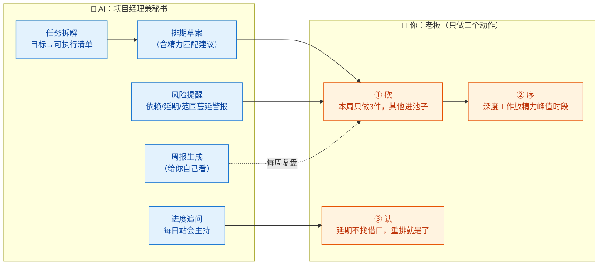
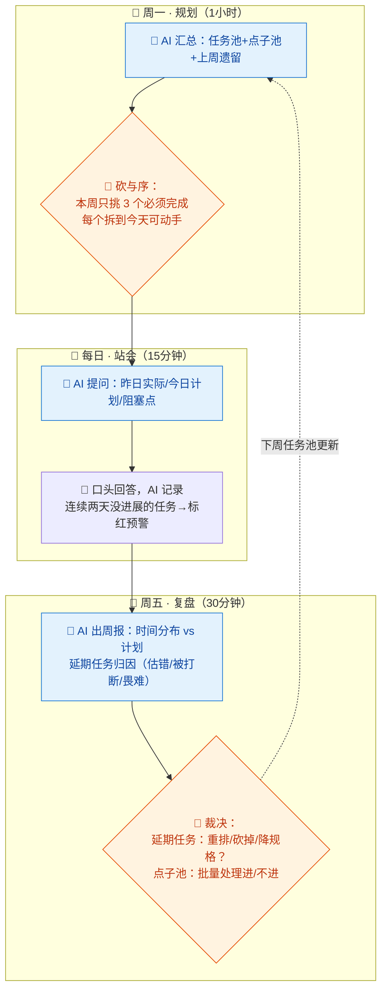

# 15-项目管理（自我管理）× AI 协同

> 💬 **一句话读懂本篇**：一人公司没有同事催你、没有周会逼你——项目经理这顶帽子的本质是"**你雇 AI 当监工，你自己当老板**"：AI 管排期和追问，你只管一件事：取舍。

| 版本 | 适用范围 | 前置阅读 |
|---|---|---|
| V0.1 | 一人公司 / 超级个体 | [AI协同开发规范](/2026/10/12/ai-collaborative-development-specification/)（总纲）、[00-汇总·一人公司AI协同岗位全景](/2026/10/12/ai-collaboration-roles-overview/) |

**岗位定位**：🧠 人主导 · AI 承担约 30% 工作量。本册管的不只是"项目"，而是一人公司最稀缺的资源——**你一个人的注意力**。前面 14 册告诉你每个岗位怎么和 AI 干活，本册告诉你怎么把这些活儿排进有限的一天里。

---

## 一、传统画像：项目经理原来干什么

| 工作项 | 传统做法 | 一人公司的对应物 |
|---|---|---|
| 排期规划 | WBS 拆解、甘特图 | 你自己心里（经常没有）的那本账 |
| 进度跟进 | 站会、周报、催办 | 没人催你 = 你也没进度 |
| 风险管理 | 风险登记册、预案 | 出事才发现"早该想到" |
| 范围控制 | 变更评审、防蔓延 | **一人公司头号杀手：想到啥做啥** |
| 资源协调 | 调人调预算 | 调的是你明天的精力 |
| 汇报沟通 | 对上对下对甲方 | 对自己诚实 |

## 二、AI 协同后的新画像

**你是"老板"，AI 是"项目经理兼秘书"。** 一人公司项目管理的三个真相：
1. 计划可以粗，**取舍必须狠**——AI 帮你看见全部待办，你负责残忍地砍
2. 没有外部压力，就要**制造结构**——固定节奏（每日/每周）代替站会
3. 最大的风险不是延期，是**方向漂移**——每周对照一次"我在做的和我要的一样吗"



---

## 三、逐项对比：传统做法 vs AI 协同做法

| 工作项 | 🐢 传统做法 | 🚀 AI 协同做法 | 谁主导 |
|---|---|---|---|
| 目标拆解 | PM 出 WBS | AI 把目标拆到"2 小时粒度"的可执行任务（模板 A），你砍掉伪必要项 | 🤝 AI 拆你砍 |
| 排期 | 甘特图、关键路径 | AI 出排期草案：按依赖排序+标注"该放精力峰值的任务"，你确认 | 🤝 人机协同 |
| 每日跟进 | 站会 | AI 主持"一个人的站会"：昨天做了啥/今天做啥/卡在哪（模板 B） | 🤖 AI 追问你答 |
| 范围控制 | 变更评审会 | 新想法一律先进"点子池"，AI 每周汇总让你**批量裁决**，杜绝随想随做 | 🧠 **你裁决** |
| 风险管理 | 风险登记册 | AI 从你的进度记录里找模式：哪类任务总延期/哪个依赖在飘 | 🤝 AI 提醒你改 |
| 周报 | 给老板看 | AI 生成周报**给你自己看**：时间花哪了 vs 目标要什么 | 🤖 AI 写你面对 |
| 精力管理 | 没人管 | AI 按任务类型标注"深度/浅度"，你把深度任务排进峰值时段 | 🧠 **你自知** |
| 复盘 | 项目结束开会 | 每个里程碑 AI 出复盘模板：预估 vs 实际偏差、下次改什么 | 🤝 人机协同 |

> ⚠️ **一人公司项目管理的反模式**：用 AI 排出一份精美到小时的计划，然后第三天就崩了，自责，放弃管理。**正确的期待**：计划的价值不在被遵守，在于每天给你一个"对照物"——偏差本身就是信息。

---

## 四、协同工作流：一周的管理节奏



**节奏建议**：把这三个仪式**写进日历当会议对待**（虽然只有你一个人参加）。一人公司的管理系统崩掉，从来不是因为工具不好，而是因为"反正没人查"——仪式感就是自己给自己造的查岗。

---

## 五、提示词模板（直接抄作业）

### 模板 A · 目标拆解

```text
【目标】xxx（一句话+截止时间+完成的定义）
【输入】现状：xxx；我的可用时间：每周约 xx 小时（深度 xx / 浅度 xx）
【任务】拆成任务清单：
1. 每个任务粒度 ≤2 小时（超过的继续拆）
2. 标注：依赖关系 / 深度or浅度 / 预估耗时 / 是否可交给AI代劳（引用系列分册打法）
3. 给出建议执行序（按依赖+精力匹配）
【约束】
1. 标注"可以不做"的部分——范围最小的可交付版本是什么？
2. 我的预估习惯偏乐观，请给每个任务乘 1.5 的缓冲并注明
```

### 模板 B · 每日站会（配合定时任务/日历提醒）

```text
你是我的项目监工。现在主持每日站会，规则：
1. 依次问我：昨天计划完成了吗（对照下方计划表）？今天做哪三件？有什么阻塞？
2. 我说"完成了"但你发现没有产出物佐证的，追问一句
3. 同一任务连续两天出现在"今天计划"里，标记 🔴 并问我：是估错了、被打断了，还是不想做？
4. 最后用 5 行以内总结今天的时间投入结构（深度/浅度/救火）
【本周计划表】（粘贴）
```

### 模板 C · 周报与归因

```text
【输入】本周每日站会记录：（粘贴）；本周计划 vs 实际：（粘贴）
【任务】生成给我自己看的周报：
1. 时间去哪了：按岗位帽子分布（产品/开发/测试/市场…对照 00 分册岗位表）
2. 延期归因：每个延期任务分类——估算失误/被动打断/畏难拖延/范围膨胀
3. 模式警告：连续 2 周以上出现的同类问题（这是我最该改的）
4. 下周建议：基于以上，3 件事的建议清单（我来裁决）
【约束】语气直接，不安慰；数据不足的结论标注出来。
```

### 模板 D · 点子池批量裁决

```text
【输入】本周收集的点子：（粘贴）；当前目标与本周三件事：（粘贴）
【任务】每个点子给出：1) 与当前目标的关系（直接服务/间接/无关）
2) 最小验证成本（不做完整功能，怎么先验证值不值得）3) 建议：现在做/排期/池子里继续泡/杀掉
【约束】你的建议倾向从严——我的毛病是啥都想做，你的职责是帮我说"不"。
```

---

## 六、验收清单

**每周规划（周一）**
- [ ] 本周必须完成 ≤3 件（超过 3 件 = 没有重点）
- [ ] 每件拆到了"今天就能动手"的粒度
- [ ] 深度任务排进了你的精力峰值时段（不是见缝插针）
- [ ] 新点子全部进池子，没有一个直接插队进本周

**每日（站会）**
- [ ] 站会真的开了（哪怕对着 AI 说了三句话）
- [ ] 🔴 预警任务当天给了处置：拆小/换时段/砍掉，三选一
- [ ] 被打断的时间记了一笔（周报归因的原料）

**每周复盘（周五）**
- [ ] 延期任务都有归因，且"连续两周同类问题"被正视
- [ ] 点子池批量裁决过，池子没有只进不出
- [ ] 下周计划基于本周**实际**产能（不是理想产能）

---

## 七、坑点清单

| 坑 | 长什么样 | 怎么防 |
|---|---|---|
| 精美计划三日崩 | AI 排出分钟级计划，崩了自责，弃疗 | 期待校准：计划是对照物不是军令状；模板 A 强制 1.5 倍缓冲 |
| 范围蠕变 | "顺手加个小功能"，两周后主线没动 | 点子池制度 + 模板 D 让 AI 帮你说"不" |
| 假忙碌 | 一天很满，周报显示全是浅度杂务 | 周报"时间去哪了"按帽子分布，深度占比低于 30% 就报警 |
| 无人问责漂移 | 没交付也没人知道，目标悄悄换了 | 周五仪式雷打不动；周报"模式警告"栏专治温水煮青蛙 |
| 估算乐观病 | 每个任务都"应该两小时能搞定" | AI 强制乘缓冲；复盘统计你的估算偏差系数，下轮直接用 |
| 工具囤积癖 | 花一周研究项目管理工具，没干正事 | 规则：清单+日历+AI 对话就是全部工具，两年内不换 |
| 只排产不留白 | 计划排满，一个意外全线崩 | 每天留 20% 空白时段；意外是常态不是异常 |

---

> 💬 **收尾一句**：自我管理岗的 AI 协同公式是"**AI 给结构，你给取舍**"。一人公司最贵的资产是你每天的注意力——前面 14 册让每个岗位的活儿变快了，本册保证这些快出来的时间流向你真正要的地方。
> **下一册**：[16-法务合规 × AI 协同](/2026/10/12/ai-collaboration-legal-compliance/)（终册·附录级）——AI 起草、外包终审、你签字：法律这件事，省钱的边界在哪里。
