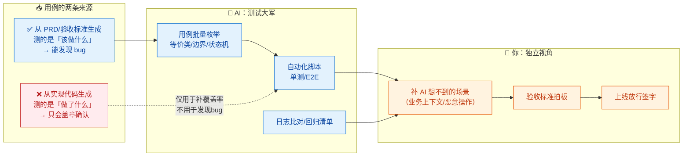
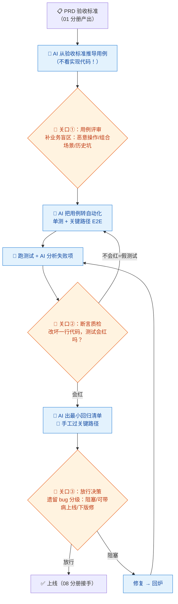

# 07-测试 QA × AI 协同

> 💬 **一句话读懂本篇**：一人公司没有测试同事，AI 就是你的第二双眼睛——但小心"**自己检查自己作业**"：用 AI 按你的代码生成测试，测的是"代码做了什么"，不是"代码该做什么"。

| 版本 | 适用范围 | 前置阅读 |
|---|---|---|
| V0.1 | 一人公司 / 超级个体 | [AI协同开发规范](/2026/10/12/ai-collaborative-development-specification/)（总纲）、[00-汇总·一人公司AI协同岗位全景](/2026/10/12/ai-collaboration-roles-overview/) |

**岗位定位**：🤝 人机协同 · AI 承担约 60% 工作量。测试岗的核心矛盾：AI 生成用例又快又多，但**用例的"来源"决定测试的价值**——从需求推导的用例能发现 bug，从实现代码推导的用例只会盖章确认。

---

## 一、传统画像：测试工程师原来干什么

| 工作项 | 传统做法 | 痛点 |
|---|---|---|
| 用例设计 | 按 PRD 写等价类/边界值/场景用例 | 费脑，容易漏 |
| 手工测试 | 点点点，回归测试点到麻木 | 每次发版重复劳动 |
| 自动化 | 写脚本、维护脚本 | 维护成本高，常烂尾 |
| Bug 管理 | 提单、复现、跟进 | 一人公司：自己给自己提单 |
| 验收把关 | 上线前最后一道闸 | 传统公司靠独立测试岗的"第三方视角" |

## 二、AI 协同后的新画像

**你戴上"QA 帽子"时，AI 是测试大军；但独立性必须人为制造。** 关键动作：**用例从需求生成，不从代码生成**——这是本分册最重要的一句话。



---

## 三、逐项对比：传统做法 vs AI 协同做法

| 工作项 | 🐢 传统做法 | 🚀 AI 协同做法 | 谁主导 |
|---|---|---|---|
| 用例设计 | 测试手写，评审补漏 | AI 从**验收标准**批量推导（模板 A），你补"业务里才懂的坑" | 🤝 AI 量产，**你补盲区** |
| 边界枚举 | 靠经验 | AI 系统性枚举：空/超长/非法/并发/超时/权限组合 | 🤖 AI 主导 |
| 单元测试 | 开发顺手写（常不写） | AI 批量生成（04 分册模板 C），你验断言质量 | 🤖 AI 主导 |
| E2E 自动化 | 专人搭框架写脚本 | AI 搭 Playwright/Cypress 脚本，你维护选择器稳定性 | 🤝 人机协同 |
| 手工回归 | 发版前全量点点点 | AI 生成"变更影响面→最小回归清单"，你只点关键路径 | 🤝 人机协同 |
| Bug 定位 | 复现→排查→提单 | 贴日志+步骤，AI 给可疑点（04 分册模板 B），你验证 | 🤝 人机协同 |
| 测试数据 | 手造 | AI 生成**假数据**（禁止用真实用户数据，总纲红线） | 🤖 AI 主导 |
| 上线放行 | 测试经理签字 | **你签字**——放行责任 AI 永远分担不了 | 🧠 人主导 |

---

## 四、协同工作流：一个功能的测试闭环



**节奏建议**：日常小改动跑"自动化 + 影响面抽查"即可；**碰钱、碰权限、碰数据的变更**必须走完三关口。测试时间的分配原则：AI 覆盖 80% 常规面，你把省下的时间全砸在"AI 想不到的 20%"。

---

## 五、提示词模板（直接抄作业）

### 模板 A · 用例设计（从需求，不从代码）

```text
【输入】功能描述与验收标准：（粘贴 PRD 相关节）
业务规则：（粘贴）
【任务】设计测试用例集，要求：
1. 方法覆盖：等价类 / 边界值 / 状态转换 / 权限矩阵，各标注属于哪类
2. 每条用例：前置条件 / 操作步骤 / 预期结果 / 优先级(P0~P2)
3. 单独一节「恶意与异常场景」：非法输入、重放、并发、越权尝试
【约束】只依据我给的验收标准推导，不要看实现代码；
验收标准含糊处，列出【需求疑问】向我提问，禁止自行脑补预期结果。
```

### 模板 B · E2E 自动化脚本

```text
【输入】用例清单（P0 部分，粘贴）；技术栈：Playwright/Cypress + 前端框架版本
【任务】为 P0 用例生成 E2E 脚本
【约束】
1. 选择器优先用 data-testid / 语义化 role，禁止脆弱的 nth-child 和文本匹配
2. 测试数据自建自清（before/after），禁止依赖环境残留数据
3. 每个脚本独立可跑，不依赖执行顺序
4. 失败时自动截图
【输出】脚本 + 需要在页面代码里补的 data-testid 清单
```

### 模板 C · 变更影响面分析（最小回归清单）

```text
【输入】本次变更的 diff：（粘贴）；项目模块依赖关系：（描述/贴目录）
【任务】1) 分析这个 diff 可能影响到的功能面（顺着调用链说，别只看改动文件）；
2) 输出「最小回归清单」：上线前必须手工验证的场景，按风险排序，控制在 10 条以内；
3) 指出哪些既有自动化测试覆盖了这次变更，哪些没覆盖。
```

### 模板 D · 断言质检（防假测试）

```text
以下是一组测试代码（粘贴）和它测的业务代码（粘贴）。
请挑毛病：
1. 哪些断言是"弱断言"（改了业务逻辑它也不会红）？逐个指出并加强
2. 哪些用例实际没测到声称在测的场景（Mock 掉了被测逻辑本身）？
3. 测试之间有没有顺序依赖或共享状态？
输出修正后的测试代码。
```

---

## 六、验收清单（放行前逐项勾）

**用例质量**
- [ ] P0 用例全部来自验收标准推导（不是照着代码写的）
- [ ] 你人工补过至少一轮"业务盲区"场景（AI 不知道的历史坑、恶意操作）
- [ ] 【需求疑问】全部澄清，无"AI 脑补的预期结果"

**测试有效性**
- [ ] 断言质检做过：故意改坏一处业务逻辑，相关测试变红
- [ ] 无"只测顺利路径"的用例集；错误路径、边界都有覆盖
- [ ] E2E 脚本独立可重复跑，数据自建自清

**回归与放行**
- [ ] 最小回归清单手工过完（碰钱/碰权限/碰数据的变更：全量回归）
- [ ] 测试数据无真实用户信息（总纲红线）
- [ ] 遗留 bug 已分级并有书面决定：可带病上线的，写明理由和下版修复计划
- [ ] 放行决定是**你**做的，不是"AI 说测试都过了"

---

## 七、坑点清单

| 坑 | 长什么样 | 怎么防 |
|---|---|---|
| 自己检查自己作业 | 用实现代码生成用例，bug 和测试"配套出错" | 模板 A 铁律：只喂验收标准，不喂代码 |
| 弱断言 | 覆盖率漂亮，断言全是 `not null`、`status 200` | 模板 D 质检 + "改坏代码看红"实测 |
| Mock 掉被测物 | 测了半天测的是 Mock 自己 | 评审时问"这段逻辑真的被执行了吗" |
| 覆盖率虚荣 | 为凑 90% 生成一堆无效用例 | 盯 P0 场景覆盖，不盯数字 |
| E2E 脆断 | 选择器绑文本/位置，改个文案全红 | 模板 B 强制 data-testid |
| 脑补预期结果 | 需求没写清，AI 自己定了个"合理"预期 | 模板 A 强制【需求疑问】机制 |
| 真实数据图省事 | 直接拿生产数据当测试数据 | 红线：只用 AI 造的假数据/脱敏数据 |

---

> 💬 **收尾一句**：测试岗的 AI 协同精髓是"**让 AI 出数量，让人类出独立性**"。一人公司最容易死在"没人挑刺"上——戴上 QA 帽子的那天下午，请对你上午写的代码保持敌意。
> **下一册**：[08-运维 DevOps × AI 协同](/2026/10/12/ai-collaboration-devops/)——AI 写部署脚本很爽，但生产环境的每一个回车，都得你亲手按。
