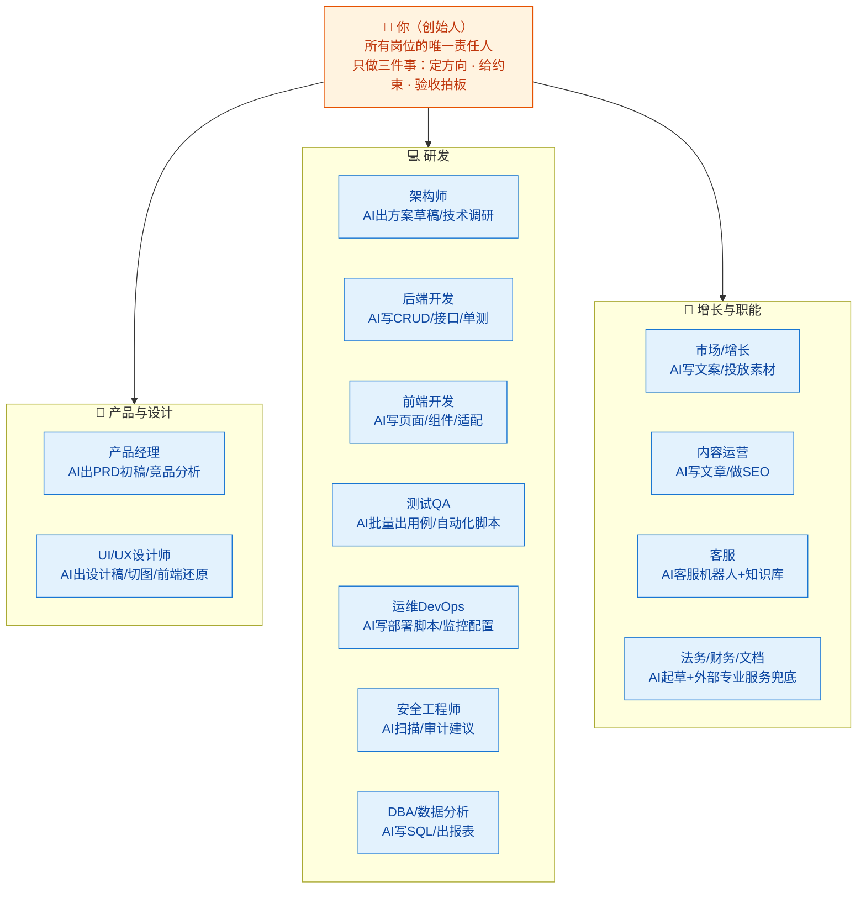
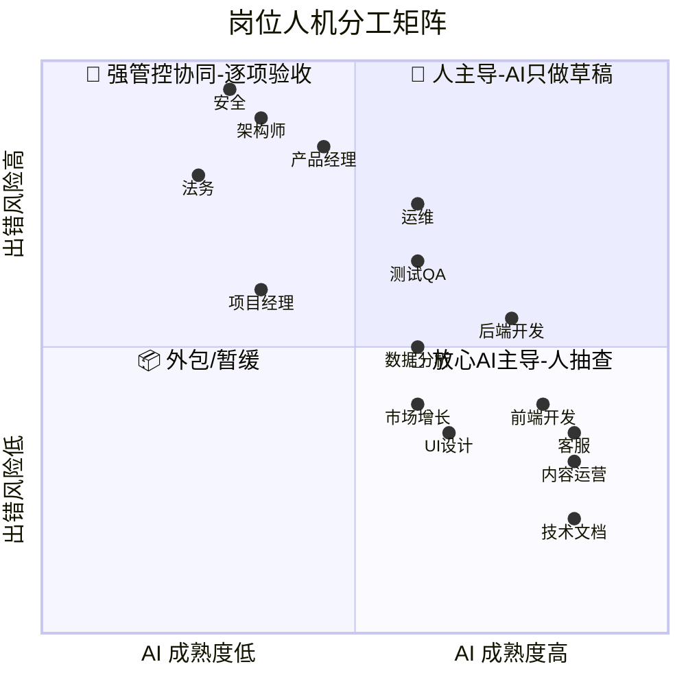
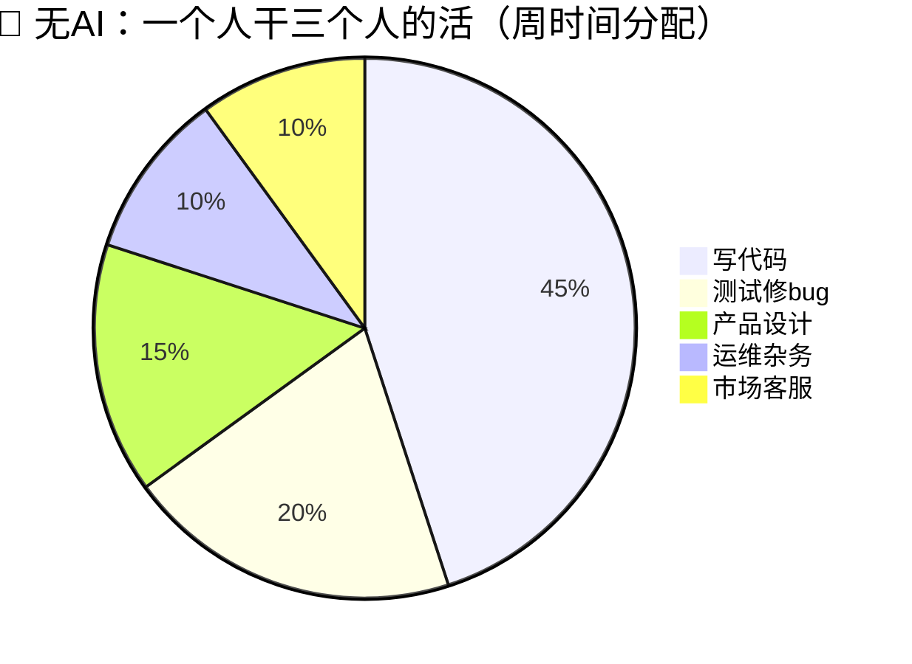
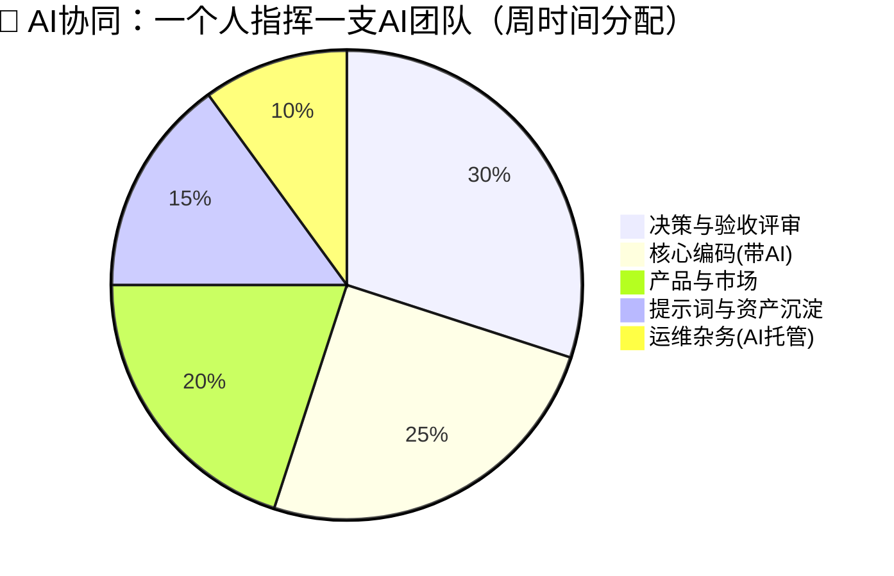
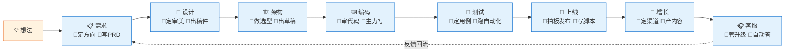

# 00-汇总 · 一人公司 AI 协同岗位全景

> 💬 **一句话读懂本篇**：一人公司不是"一个人干所有活"，而是"一个人当所有岗位的**决策者**，AI 当所有岗位的**执行者**"。

| 版本 | 适用范围 | 维护 |
|---|---|---|
| V0.1（汇总稿） | 一人公司 / 超级个体 / 微型团队 | 本人 |

**系列定位**：《AI协同开发规范》系列为一人科技公司设计。总纲见 [AI协同开发规范](/2026/10/12/ai-collaborative-development-specification/)（G-P-R-L 闭环、风险分级、安全红线对全系列生效），本篇是**岗位汇总与分册规划**，每册写透一个岗位。全系列导航见 [AI协同开发规范 · MOC](/2026/10/12/ai-collaboration-specification-moc/)，干活抄模板走 [00-模板库索引](/2026/10/12/prompt-library-index/)。

---

## 一、先想清楚：一人公司的"组织架构图"

传统公司靠**招人**补齐岗位；一人公司靠**AI 协同**补齐岗位——但每个岗位的**责任主体永远是你自己**。

> 💡 **和传统公司的本质区别**：传统架构里"人管人"，一人公司里"人管 AI"。管理对象变了，但**目标、约束、验收**这三样管理动作一样都不能少。

---

## 二、岗位清单总表（科技公司全岗位 × 一人公司处置方式）

**处置方式四档**：
- 🧠 **人主导**——决策/风险重，AI 只能打下手，你必须亲自把关
- 🤝 **人机协同**——人定框架，AI 填内容，逐项验收
- 🤖 **AI 主导**——成熟度高、风险低，AI 干 80%+，人抽查
- 📦 **外包/工具化**——不用 AI 也不用自己干，买服务解决

| # | 岗位 | 传统公司职责 | 一人公司处置 | AI 承担比例 | 系列分册 |
|---|---|---|---|---|---|
| 1 | 产品经理 | 需求调研、PRD、优先级 | 🧠 人主导 | ~40% | 01 |
| 2 | UI/UX 设计师 | 视觉稿、交互、设计规范 | 🤝 人机协同 | ~60% | 02 |
| 3 | 架构师 / 技术负责人 | 选型、分层、风险评估 | 🧠 人主导 | ~30% | 03 |
| 4 | 后端开发工程师 | 接口、业务逻辑、数据库 | 🤖 AI 主导 | ~70% | 04 |
| 5 | 前端开发工程师 | 页面、组件、交互实现 | 🤖 AI 主导 | ~70% | 05 |
| 6 | 移动端开发工程师 | App / 小程序 | 🤝 人机协同 | ~60% | 06（可选） |
| 7 | 测试工程师（QA） | 用例、自动化、验收 | 🤝 人机协同 | ~60% | 07 |
| 8 | 运维 / DevOps | 部署、监控、备份 | 🤝 人机协同 | ~60% | 08 |
| 9 | 安全工程师 | 漏洞、鉴权、合规 | 🧠 人主导 | ~30% | 09 |
| 10 | DBA / 数据分析师 | 建库调优、报表洞察 | 🤝 人机协同 | ~60% | 10 |
| 11 | 技术文档工程师 | 文档、API 说明 | 🤖 AI 主导 | ~85% | 11 |
| 12 | 市场 / 增长 | 获客、投放、品牌 | 🤝 人机协同 | ~60% | 12 |
| 13 | 内容运营 | 文章、SEO、社媒 | 🤖 AI 主导 | ~80% | 13 |
| 14 | 客服 | 答疑、工单、反馈 | 🤖 AI 主导 | ~85% | 14 |
| 15 | 项目经理 | 排期、跟进、协调 | 🧠 人主导（自我管理） | ~30% | 15 |
| 16 | 法务 / 合规 | 合同、隐私、许可 | 📦 外包 + AI 起草 | ~20% | 16（附录级） |
| 17 | 财务 | 记账、税务、发票 | 📦 外包 + 工具 | ~10% | 不单列 |
| 18 | HR / 行政 | 招聘、社保、杂务 | 📦 工具化（一人公司基本不需要） | — | 不单列 |

> ⚠️ **比例是"工作量占比"，不是"责任占比"——责任 100% 在你。** AI 承担 85% 的客服岗，出了舆情事故还是你背。

---

## 三、人机分工对照：每个岗位"谁干什么"

| 岗位        | 你负责（不能甩给 AI）        | AI 帮你干                  |
| --------- | ------------------- | ----------------------- |
| 产品经理      | 商业判断、优先级、需求真伪、业务规则  | PRD 初稿、竞品调研、用户故事拆解、FAQ  |
| UI/UX 设计  | 审美定调、品牌一致性、体验取舍     | 设计稿生成、图标/配图、切图、CSS 还原   |
| 架构师       | 技术选型、模块边界、风险评估、演进路线 | 方案对比草稿、技术调研、代码骨架、依赖检查   |
| 后端开发      | 核心逻辑设计、代码评审、性能与安全   | CRUD、接口样板、单元测试、重构、脚本    |
| 前端开发      | 交互细节验收、兼容性把关、组件规范   | 页面/组件代码、样式适配、Mock 数据    |
| 移动端       | 上架合规、机型适配验收、推送策略    | 跨端代码、适配样板、崩溃日志分析        |
| 测试 QA     | 测试策略、边界场景、验收标准      | 批量用例、自动化脚本、日志比对         |
| 运维 DevOps | 生产变更拍板、备份恢复演练、告警响应  | CI/CD 配置、部署脚本、监控面板、日志分析 |
| 安全        | 安全决策、渗透验证、数据合规      | 漏洞扫描建议、代码审计初筛、配置核查      |
| DBA/数据    | 数据模型拍板、指标口径、隐私脱敏    | 建表 SQL、查询优化建议、报表与图表     |
| 技术文档      | 事实核对、口径统一           | README、API 文档、变更日志、教程初稿 |
| 市场增长      | 定位、定价、渠道选择、预算       | 文案批量生成、落地页、投放素材、A/B 方案  |
| 内容运营      | 选题方向、观点立场、事实核查      | 文章初稿、SEO 关键词、多平台改写、配图   |
| 客服        | 投诉升级、退款决策、机器人知识库    | 自动答疑、工单分类、话术生成、情绪识别     |
| 项目经理      | 目标取舍、里程碑拍板、精力分配     | 排期草案、任务拆解、周报生成、风险提醒     |
| 法务合规      | 最终签署、纠纷应对           | 合同/隐私政策初稿、许可证核查清单       |

---

## 四、图表：一眼看懂一人公司 × AI

### 4.1 人机分工矩阵（风险 × AI 成熟度）

**越靠右上，越放心交给 AI；越靠左下，越要亲自盯。**

### 4.2 时间都花在哪：传统一人公司 vs AI 协同一人公司

> 💡 变化本质：**从" hands-on 干活"转向" minds-on 把关"**。省下的执行时间，必须投到评审、决策和沉淀上，否则 AI 的产出就是无人验收的库存。

### 4.3 一条产品流水线：每个环节谁上场

---

## 五、一人公司 AI 协同三原则（全系列通用）

1. **人管决策，AI 管执行**——每个岗位都可以 AI 化"手"，但不能 AI 化"脑"。凡是对外产生法律、资金、安全后果的动作，必须本人确认。
2. **岗位可以合并，验收不能省略**——一人公司天然"身兼数职"，AI 让你能兼更多职；但每换一个岗位帽子，就要按该岗位的验收标准过一遍（各分册附验收清单）。
3. **资产沉淀就是你的"团队"**——提示词库、代码模板、SOP、坑点清单，是一人公司唯一会复利增长的东西。今天存一条模板，等于给明天的自己招了一个熟手。

---

## 六、系列分册写作计划

> 每册结构统一：**岗位传统画像 → AI 协同后的新画像 → 对比表 → 协同工作流（图）→ 提示词模板 → 验收清单 → 坑点**。

- [x] [01-产品经理 × AI 协同](/2026/10/12/ai-collaboration-product-manager/)
- [x] [02-UIUX 设计 × AI 协同](/2026/10/12/ai-collaboration-uiux-design/)
- [x] [03-架构师 × AI 协同](/2026/10/12/ai-collaboration-architect/)
- [x] [04-后端开发 × AI 协同](/2026/10/12/ai-collaboration-backend-dev/)
- [x] [05-前端开发 × AI 协同](/2026/10/12/ai-collaboration-frontend-dev/)
- [x] [06-移动端开发 × AI 协同](/2026/10/12/ai-collaboration-mobile-dev/)（可选，视产品形态）
- [x] [07-测试 QA × AI 协同](/2026/10/12/ai-collaboration-qa-testing/)
- [x] [08-运维 DevOps × AI 协同](/2026/10/12/ai-collaboration-devops/)
- [x] [09-安全 × AI 协同](/2026/10/12/ai-collaboration-security/)
- [x] [10-数据库与数据分析 × AI 协同](/2026/10/12/ai-collaboration-database-data/)
- [x] [11-技术文档 × AI 协同](/2026/10/12/ai-collaboration-tech-docs/)
- [x] [12-市场增长 × AI 协同](/2026/10/12/ai-collaboration-marketing-growth/)
- [x] [13-内容运营 × AI 协同](/2026/10/12/ai-collaboration-content-ops/)
- [x] [14-客服 × AI 协同](/2026/10/12/ai-collaboration-customer-service/)
- [x] [15-项目管理（自我管理）× AI 协同](/2026/10/12/ai-collaboration-project-management/)
- [x] [16-法务合规 × AI 协同](/2026/10/12/ai-collaboration-legal-compliance/)（终册·附录级，外包为主）

---

> 🎉 **进度**：全系列 16 册已成稿。全系列一句话总纲：**AI 出产量，你出判断；AI 可以错，你不能不看。** 完结页与分线索引见 [16-法务合规 × AI 协同](/2026/10/12/ai-collaboration-legal-compliance/) 末尾。
