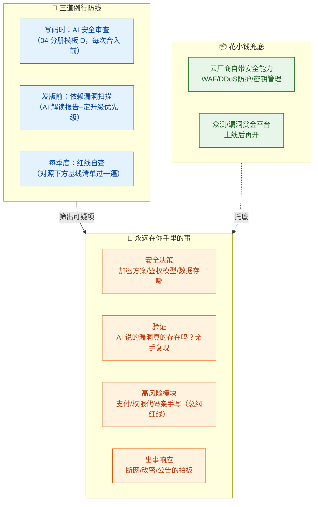
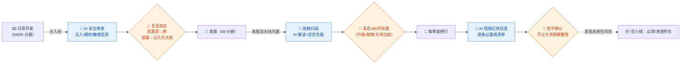

# 09-安全 × AI 协同

> 💬 **一句话读懂本篇**：安全是唯一一个"**对手也在用 AI**"的岗位——AI 帮你初筛能省 80% 力气，但剩下 20%（安全决策、验证、合规）恰恰是出事时最要命的部分，永远只能你自己扛。

| 版本 | 适用范围 | 前置阅读 |
|---|---|---|
| V0.1 | 一人公司 / 超级个体 | [AI协同开发规范](/2026/10/12/ai-collaborative-development-specification/)（总纲，尤其五条红线）、[00-汇总·一人公司AI协同岗位全景](/2026/10/12/ai-collaboration-roles-overview/) |

**岗位定位**：🧠 人主导 · AI 承担约 30% 工作量——全系列最低之一（与架构师并列）。安全岗的特殊性：**AI 既不能替你决策，也不能替你验证**；它审出的问题可能是误报，它没审出的问题才是真炸弹。

---

## 一、传统画像：安全工程师原来干什么

| 工作项 | 传统做法 | 一人公司的现实 |
|---|---|---|
| 代码审计 | SAST 工具 + 人工复审 | 买不起企业版，靠开源工具+AI |
| 渗透测试 | 专人/外包做渗透 | 请不起，靠自查+众测平台兜底 |
| 漏洞管理 | 盯 CVE、升级依赖 | 容易忘，一忘就是 Log4Shell 级事故 |
| 鉴权与加密 | 安全工程师设计方案 | **必须自建审查关口，见第三节** |
| 合规 | 隐私政策、等保、GDPR | 外包+AI 起草（16 分册） |
| 应急响应 | 安全团队 on-call | 出事了只有你；预防 >> 应急 |

## 二、AI 协同后的新画像

**你是"安全负责人"，AI 是"安全实习生"：跑腿扫描可以，签字画押不行。** 一人公司做安全的正确姿势不是"雇个 AI 安全专家"，而是**把安全动作织进开发流程**——每个分册的验收清单里已经有安全项，本册给你一套例行程序。



---

## 三、一人公司最小安全基线（AI 替代不了的部分，逐条落实）

| # | 基线 | 最低要求 | AI 能帮的 |
|---|---|---|---|
| 1 | 鉴权 | 用成熟托管方案（Auth0/Clerk/云认证），**禁止自造登录/自写 JWT 校验** | 审查接入代码是否用对 |
| 2 | 密钥管理 | 全部走环境变量/密钥管理服务，仓库零明文 | 扫描仓库找泄露 |
| 3 | 传输加密 | 全站 HTTPS（托管平台默认），敏感接口不留 HTTP 后门 | 检查配置遗漏 |
| 4 | 存储加密 | 密码用 bcrypt/argon2；敏感字段落库加密 | 审查是否用了弱哈希 |
| 5 | 权限模型 | 每个数据操作问一句"操作者凭什么能动这条数据" | 枚举越权路径 |
| 6 | 日志审计 | 登录、改密、支付、删数据必须留痕，日志不含敏感明文 | 审查日志点位 |
| 7 | 依赖安全 | 依赖清单可导出，高危 CVE 48h 内响应 | 解读扫描报告 |
| 8 | 备份 | 见 08 分册——**勒索软件时代，备份就是安全能力** | 写演练脚本 |
| 9 | 最小暴露面 | 不开放用不到的端口/接口/后台；管理后台加 IP 白名单或独立鉴权 | 梳理暴露面清单 |
| 10 | 应急预案 | 一页纸：改密顺序/关服命令/公告模板，出事前写好 | 起草模板 |

---

## 四、逐项对比：传统做法 vs AI 协同做法

| 工作项 | 🐢 传统做法 | 🚀 AI 协同做法 | 谁主导 |
|---|---|---|---|
| 代码安全审计 | SAST + 安全工程师复审 | AI 按攻击面审代码（模板 A），**你亲手复现每个"漏洞"** | 🤝 AI 初筛你验证 |
| 鉴权/加密方案 | 安全架构师设计 | **直接用托管服务，不自设计**；AI 只审"用得对不对" | 🧠 你拍板（红线） |
| 依赖漏洞 | 安全团队盯 CVE | 扫描工具出报告→AI 解读"哪些真的可达、先修哪个" | 🤝 AI 解读你定序 |
| 渗透测试 | 外包/专职 | AI 给你"攻击者视角自查清单"，你按清单手测关键面 | 🤝 人机协同 |
| 隐私合规 | 法务+安全联合 | AI 起草隐私政策初稿，逐条核对实际数据行为（16 分册） | 📦 AI起草+外包终审 |
| 应急响应 | 团队作战 | AI 帮分析入侵痕迹；**断网/改密/公告的每个决定是你** | 🧠 人主导 |
| 安全评审关口 | 上线前安全签字 | 高风险变更（碰钱/权限/数据）合入前强制过模板 A | 🧠 **你签字** |

> ⚠️ **双向警惕**：AI 审代码有**误报**（浪费你时间）也有**漏报**（要你的命）。所以规矩是：AI 报的漏洞→亲手复现再修；AI 没报≠没有→基线清单每季度人工过一遍。

---

## 五、协同工作流：安全动作织进开发流



---

## 六、提示词模板（直接抄作业）

### 模板 A · 攻击面审查（合入前例行）

```text
以下是即将合入的代码（粘贴）。你同时扮演两个角色：
【角色1：白帽】找出安全问题，按 OWASP Top 10 归类：
每条给出：位置 / 攻击路径（具体到"攻击者输入什么会发生什么"）/ 严重度 / 修复代码
【角色2：怀疑者】对角色1的每条发现，评估误报可能性并说明理由
【约束】
1. 只基于我贴的代码，不要假设我没贴的部分"应该没问题"——列出你无法看到、需要我补充的部分
2. 重点盯：用户输入的每一条数据流向（入口→处理→存储→输出）
3. 没有发现也要输出"已检查项清单"，禁止空手而归
```

### 模板 B · 鉴权越权专项

```text
【输入】权限模型描述：（角色有哪些、各能干什么）；接口清单+代码：（粘贴）
【任务】枚举越权测试矩阵：
1. 水平越权：每个"按 ID 取数据"的接口，用户改 ID 访问他人数据会怎样？逐个接口回答
2. 垂直越权：普通用户直接调管理接口会怎样？逐个接口回答
3. 输出表格：接口 / 预期拦截点 / 代码里实际拦截了吗 / 建议的手工验证步骤
【约束】"没看到显式校验"就标 ❌，宁可误报不可漏报——我会逐个手工验证。
```

### 模板 C · 依赖漏洞解读

```text
【输入】扫描报告：（粘贴 npm audit / pip audit 等输出）；项目实际用到这些依赖的方式：（描述）
【任务】把报告变成行动清单：
1. 过滤：哪些漏洞在本项目中根本不可达（说明判断依据）
2. 排序：可达的按「利用难度 × 影响」排序
3. 行动：每条给处置方式（升级/替换/配置缓解/接受风险+理由）
【约束】"接受风险"的建议必须写明触发条件和复查时间，不许一句"影响不大"带过。
```

### 模板 D · 应急预案起草

```text
【背景】一人公司，服务架构：（粘贴）；托管平台：xxx；域名/证书/数据库分别在：xxx
【任务】起草一页纸安全应急预案，覆盖三种场景：
1. 疑似数据泄露  2. 服务器被入侵/勒索  3. 密钥泄露
每场景：立即动作（按分钟排序，含具体命令/控制台路径）→ 止损 → 取证 → 用户公告要点
【约束】动作必须具体到我半夜三点照着做不会错；不确定我环境的地方标【需我确认】。
```

---

## 七、验收清单（安全关口逐项勾）

**每次合入（碰用户输入/权限/数据的代码）**
- [ ] 模板 A 审查跑过，发现项逐条**亲手复现**后处置（修/记误报）
- [ ] 用户输入的每条数据流向说得清：入口校验→处理→存储→输出转义
- [ ] 鉴权：新接口的"凭什么能访问"回答得出（模板 B 矩阵更新）

**每次发版**
- [ ] 依赖扫描无未处置的高危（处置≠升级，"接受风险+理由"也算，但要留痕）
- [ ] 配置变更不含明文密钥；日志级别没把敏感信息放出来

**每季度**
- [ ] 第三节基线清单 10 条逐条过，签字留痕
- [ ] 密码哈希算法、加密库版本未过时
- [ ] 应急预案更新过（架构变了预案就得变），关键命令验证可用
- [ ] 管理后台/调试接口没有意外暴露公网

**永远**
- [ ] 支付/权限/核心加密代码是你亲手写或逐行重写的（总纲高风险红线）
- [ ] 没用 AI 产出绕过鉴权/加密/审计日志（总纲红线第 4 条）
- [ ] 真实用户数据、生产密钥从未出现在 AI 对话里（总纲红线第 1、2 条）

---

## 八、坑点清单

| 坑 | 长什么样 | 怎么防 |
|---|---|---|
| AI 漏报当安全感 | "AI 审过没问题"→上线被脱库 | AI 初筛 ≠ 安全；基线清单季度人工过 |
| 误报疲劳 | AI 报 20 个"高危"，19 个误报，你开始整个忽略 | 模板 A 角色 2 先自评误报率；误报记入坑点库喂回提示词 |
| 自造轮子加密 | 让 AI"写个 JWT 校验/密码加密"，看着能跑实则处处洞 | 基线第 1、4 条：鉴权加密只用托管/成熟库 |
| 排障泄密 | 生产日志带用户数据，直接贴给 AI 分析 | 贴前脱敏，肌肉记忆（08 分册同款坑） |
| 依赖僵尸 | 扫描报告没人看，高危挂了三个月 | 发版流水线内置扫描，高危 48h 响应写进流程 |
| 演示后门 | 开发期加的"跳过登录"开关忘了删，跟着上了生产 | 合入清单加一条：grep 调试开关；暴露面季度自查 |
| 预案纸上谈兵 | 出事了才找预案，命令全是错的 | 模板 D 的"半夜三点标准"；关键命令提前验证 |

---

> 💬 **收尾一句**：一人公司的安全策略就八个字：**托管兜底、流程织入、亲自签字**。你不需要成为安全专家，但需要让"安全检查"像刷牙一样长在流程里——AI 帮你挤牙膏，刷必须你自己刷。
> **下一册**：[10-数据库与数据分析 × AI 协同](/2026/10/12/ai-collaboration-database-data/)——AI 写 SQL 又快又溜，但索引方向反了、口径漂了，报表越漂亮错得越自信。
