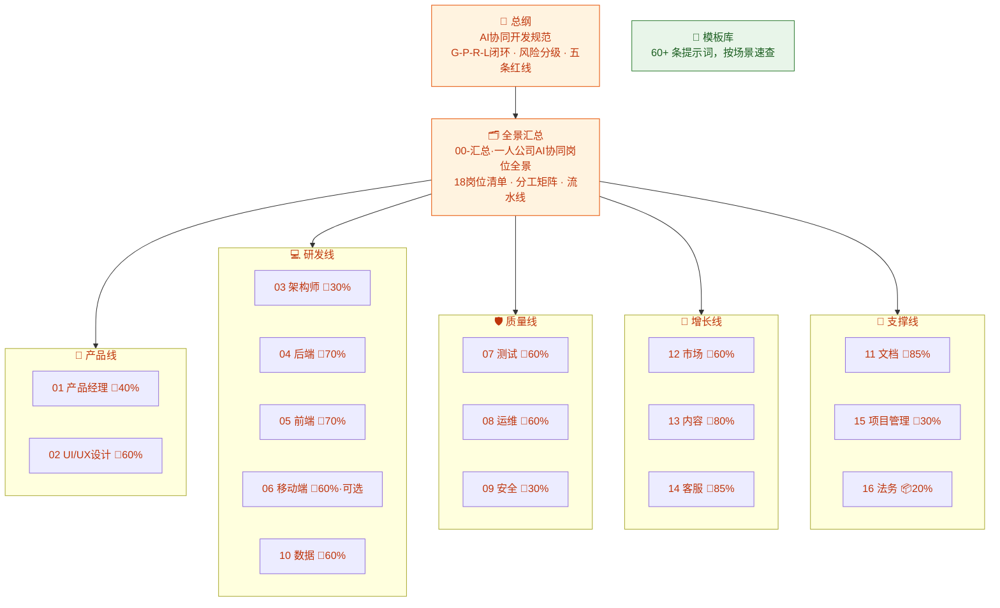

# 🏠 AI协同开发规范 · MOC（系列首页）

> 💬 **全系列一句话总纲**：**AI 出产量，你出判断；AI 可以错，你不能不看。**
> 这是一套为一人科技公司写的完整"数字员工管理手册"：1 篇总纲定纪律，1 篇汇总看全景，16 册分岗位给打法，1 个模板库直接抄作业。

---

## 🗺 系列地图

---

## 📚 全册速览（每册一句话灵魂）

| 册 | 岗位 | AI占比 | 一句话灵魂 |
|---|---|---|---|
| 总纲 | 全员纪律 | — | 人定约束 AI 填充，人做校验 AI 提速；G-P-R-L 闭环 + 风险分级 + 五条红线 |
| [00](/2026/10/12/ai-collaboration-roles-overview/) | 全景 | — | 一人公司 = 一个人当所有岗位的决策者，AI 当所有岗位的执行者 |
| [01](/2026/10/12/ai-collaboration-product-manager/) | 产品经理 | ~40% | AI 化的是笔不是脑；三关口：定方向、判真伪、拍优先级 |
| [02](/2026/10/12/ai-collaboration-uiux-design/) | UI/UX | ~60% | AI 产出的不是"错误"是"平庸"；你定调、挑选、克制 |
| [03](/2026/10/12/ai-collaboration-architect/) | 架构师 | ~30% | 无聊优先、托管优先、单体优先——你一个人养得起才是好架构 |
| [04](/2026/10/12/ai-collaboration-backend-dev/) | 后端 | ~70% | 按风险分工：CRUD 全交 AI，支付/权限/资金亲手写 |
| [05](/2026/10/12/ai-collaboration-frontend-dev/) | 前端 | ~70% | AI 负责快，你负责细；验收靠真人真浏览器真操作 |
| [06](/2026/10/12/ai-collaboration-mobile-dev/) | 移动端 | ~60% | 90% 场景选跨端；真机验收、审核应对、发版拍板三座山自己爬 |
| [07](/2026/10/12/ai-collaboration-qa-testing/) | 测试 | ~60% | 用例从需求生成不从代码生成——防"自己检查自己作业" |
| [08](/2026/10/12/ai-collaboration-devops/) | 运维 | ~60% | AI 写 100% 的脚本，你按 100% 的回车；部署回滚强制成对 |
| [09](/2026/10/12/ai-collaboration-security/) | 安全 | ~30% | 托管兜底、流程织入、亲自签字；唯一"对手也在用 AI"的岗位 |
| [10](/2026/10/12/ai-collaboration-database-data/) | 数据 | ~60% | AI 管语法，你管语义：模型拍板、口径唯一、脱敏红线 |
| [11](/2026/10/12/ai-collaboration-tech-docs/) | 文档 | ~85% | AI 出字数，你出真相；警惕"流畅的错误" |
| [12](/2026/10/12/ai-collaboration-marketing-growth/) | 增长 | ~60% | 你定定位，AI 铺量，数据裁决；每块钱投放为一个写下来的假设服务 |
| [13](/2026/10/12/ai-collaboration-content-ops/) | 内容 | ~80% | 你出真相，AI 出产量；没原料不写，发布前必去 AI 味 |
| [14](/2026/10/12/ai-collaboration-customer-service/) | 客服 | ~85% | AI 挡量你保质；机器人三笼头：无据不答、敏感转人工、不承诺 |
| [15](/2026/10/12/ai-collaboration-project-management/) | 项目管理 | ~30% | AI 给结构，你给取舍；本周必须完成 ≤3 件 |
| [16](/2026/10/12/ai-collaboration-legal-compliance/) | 法务 | ~20% | AI 起草降成本，专业人士控风险上限，你签字负全责 |

---

## 🚦 三条阅读路线

- **第一次来**：总纲 → 00 汇总 → 15 项目管理（先建节奏）→ 你当前最缺的岗位分册
- **日常干活**：[模板库速查](/2026/10/12/prompt-library-index/) 直接抄 → 拿不准验收标准时回分册查清单
- **季度复盘**：总纲第七节指标 → 各分册验收清单抽查 → 坑点清单补货 → 模板库更新

## 🔁 全系列通用纪律（每册都引用，这里只说一遍）

1. **G-P-R-L 闭环**（总纲二）：目标→提示→生成→评审→沉淀，评审不许省
2. **风险分级**（总纲三）：🟢自查 / 🟡完整评审 / 🔴亲手写——拿不准就高不就低
3. **五条红线**（总纲五）：密钥、真实数据、依赖白名单、绕过鉴权、许可证
4. **三原则**（00 汇总五）：人管决策 AI 管执行 · 岗位可合并验收不省略 · 资产沉淀就是团队

---

> 🧭 **维护说明**：本页是系列唯一入口，新增/改名分册时同步更新此页与 [00-汇总·一人公司AI协同岗位全景](/2026/10/12/ai-collaboration-roles-overview/) 第六节。模板库更新纪律见 [模板库索引](/2026/10/12/prompt-library-index/) 第三节。
