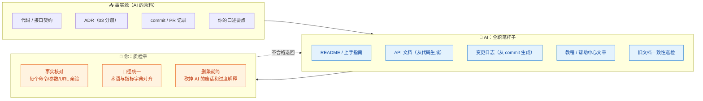
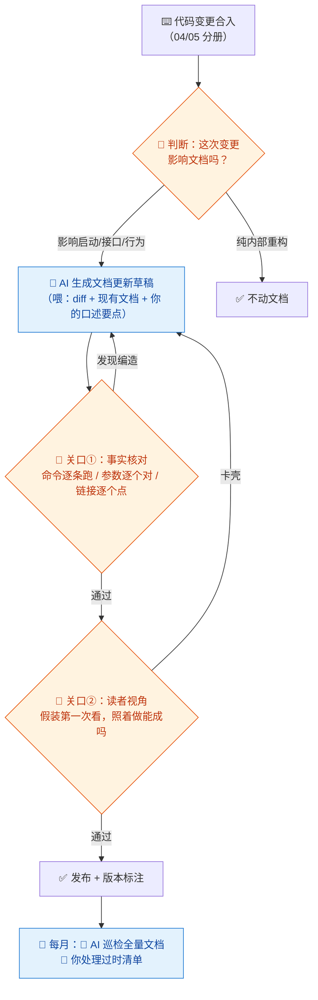

# 11-技术文档 × AI 协同

> 💬 **一句话读懂本篇**：文档是 AI 承担比例最高的岗位（~85%）——但 AI 写得越顺，越要警惕"**流畅的错误**"：你的活儿只剩四个字，事实核对。

| 版本 | 适用范围 | 前置阅读 |
|---|---|---|
| V0.1 | 一人公司 / 超级个体 | [AI协同开发规范](/2026/10/12/ai-collaborative-development-specification/)（总纲）、[00-汇总·一人公司AI协同岗位全景](/2026/10/12/ai-collaboration-roles-overview/) |

**岗位定位**：🤖 AI 主导 · AI 承担约 85% 工作量。一人公司的文档岗有个反直觉的价值排序：**文档首先是写给未来的自己的**（三个月后的你不记得为什么这么设计），其次才是给用户看的。AI 让"随手留档"的成本趋近于零，所以纪律是：干完一件事，顺手让 AI 写一篇。

---

## 一、传统画像：技术文档工程师原来干什么

| 工作项 | 传统做法 | 痛点 |
|---|---|---|
| README / 上手指南 | 开发顺手写（通常不写） | 新人入职靠口口相传 |
| API 文档 | 手写或注释生成 | 和代码脱节，越来越旧 |
| 架构/设计文档 | 大项目才写 | 一人公司全在脑子里 |
| 变更日志 | 发版时补 | 补不出来，靠翻 commit |
| 用户教程/帮助中心 | 专人维护 | 更新永远慢半拍 |

## 二、AI 协同后的新画像

**你是"事实核对员 + 口径管理员"，AI 是全职笔杆子。** 文档工作的新原则：**代码即事实源，AI 即打字员，你即质检章。**



---

## 三、逐项对比：传统做法 vs AI 协同做法

| 工作项 | 🐢 传统做法 | 🚀 AI 协同做法 | 谁主导 |
|---|---|---|---|
| README | 建项目时写一次，之后腐烂 | 每次架构/启动方式变更，让 AI 按当前代码重写，你核对启动步骤 | 🤖 AI 主导 |
| API 文档 | 手写，注定过时 | 从代码/契约自动生成（模板 B），CI 里强制更新 | 🤖 AI 全自动 |
| 变更日志 | 发版前痛苦回忆 | AI 从 commit 记录生成用户视角的 changelog，你调语气分主次 | 🤖 AI 主导 |
| 设计/决策文档 | 不写 | ADR 你写三行核心理由，AI 扩写成规范格式（03 分册呼应） | 🤝 你出核，AI 整形 |
| 用户教程 | 专人写 | AI 按功能清单批量出教程初稿，**你亲手照着做一遍**再发布 | 🤝 强管控协同 |
| 文档巡检 | 没人做 | 定期让 AI 对照代码找文档过时处（模板 D） | 🤖 AI 主导 |
| 内部 SOP | 口口相传 | 每踩一个坑/做完一次变更，口述给 AI 整理成 SOP 入库 | 🤝 你说 AI 写 |

> ⚠️ **文档岗的第一坑是"流畅的错误"**：AI 写的教程步骤通顺、语气专业，但第 4 步的命令参数是编的。规矩：**发布级文档，每个可执行的内容（命令/URL/配置/版本号）必须亲手验证过。**

---

## 四、协同工作流：文档跟着代码走



**节奏建议**：把"文档更新"塞进 Definition of Done——功能没配文档不算完成。AI 时代这条纪律的成本从"半天"降到了"十分钟"，再也没有借口。

---

## 五、提示词模板（直接抄作业）

### 模板 A · README 生成/重写

```text
【输入】项目代码结构与入口文件：（粘贴）；启动相关配置：（粘贴，脱敏）；本次变更：xxx
【任务】重写 README，结构：一句话简介 / 技术栈（带版本）/ 快速开始（可复制的命令块）/
配置说明（环境变量表格，值用占位符）/ 常见报错 Top3
【约束】
1. 只写你从输入材料中能确认的内容，推断的部分标【需确认】
2. 命令必须是完整可复制的，禁止"根据实际情况调整"这种话
3. 篇幅克制：能在 3 屏内讲完就不写 5 屏
```

### 模板 B · API 文档生成

```text
【输入】接口代码/契约：（粘贴）；错误码表：（粘贴）
【任务】为每个接口生成文档：路径与方法 / 鉴权要求 / 请求参数表（名称/类型/必填/说明/示例）/
响应结构（成功+每种失败）/ curl 示例（可直接运行，域名用占位符）
【约束】示例值用假数据；代码里没有的行为禁止补充"通常应该有"的内容；
发现代码与既有文档矛盾处，单独列出来给我。
```

### 模板 C · Changelog 生成

```text
【输入】上次发版以来的 commit 记录：（粘贴）
【任务】生成面向用户的 changelog：新增 / 优化 / 修复 / 破坏性变更（置顶加粗）
【约束】
1. 用户视角说人话："重构了xxx模块"→ 不提；"下单支持保存多个地址"→ 提
2. 破坏性变更必须写明"用户需要做什么"
3. 拿不准用户是否可感知的 commit，列入【待我确认】区
```

### 模板 D · 文档巡检

```text
【输入】现有文档：（粘贴）；当前代码事实：（粘贴关键配置/接口/结构）
【任务】找出文档与代码不一致的地方，输出表格：
文档位置 / 文档说法 / 代码事实 / 严重度（误导用户/轻微过时/无伤大雅）/ 修改建议
【约束】只报告有把握的不一致；怀疑但不确定的单列【疑似】区。
```

---

## 六、验收清单（发布前逐项勾）

**事实性（最优先）**
- [ ] 每个命令亲手跑过，输出与文档一致
- [ ] 参数名/环境变量名/版本号逐个和代码对过
- [ ] 链接逐个点过；截图是最新界面（旧截图比没截图更误导）
- [ ] AI 标注的【需确认】全部落实，无遗留

**可用性**
- [ ] 新读者视角：假装第一次接触，照着"快速开始"能走通
- [ ] 复制粘贴即用：无"酌情修改"的半截命令
- [ ] 无真实密钥/内网地址/用户数据（总纲红线）

**可维护性**
- [ ] 术语与指标字典一致（07/10 分册口径统一）
- [ ] 文档标注了适用版本和更新日期
- [ ] 砍掉了 AI 式废话（"在当今快速发展的技术时代"这类开头一律删）

---

## 七、坑点清单

| 坑 | 长什么样 | 怎么防 |
|---|---|---|
| 流畅的错误 | 教程写得专业漂亮，第 4 步命令是编的 | 发布级文档 100% 亲手验证可执行内容 |
| 文档僵尸 | 生成了一堆，没人看没人更新 | 只写"有读者"的文档：给自己（SOP/ADR）或给用户（教程/API） |
| 版本错位 | 文档描述的是三个版本前的行为 | 文档头标适用版本；每月模板 D 巡检 |
| AI 式冗长 | 一句话能说清的写了三段排比 | 提示词限篇幅；验收"砍废话"一项 |
| 口径打架 | 文档里的指标定义和报表不一致 | 一律引用指标字典（10 分册），不许文档自立口径 |
| 敏感信息顺手贴 | 为了让 AI 写配置说明，贴了真实 .env | 只贴占位符版本；贴前脱敏肌肉记忆 |

---

> 💬 **收尾一句**：文档岗的 AI 协同公式是"**AI 出字数，你出真相**"。一人公司的文档不必多，但每篇都得经得起"照着做"——这是它和营销文案的本质区别。
> **下一册**：[12-市场增长 × AI 协同](/2026/10/12/ai-collaboration-marketing-growth/)——从研发线转到增长线：AI 量产文案素材，你守住定位和"不骗人"的底线。
