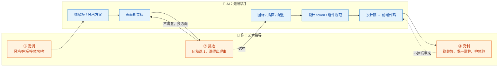
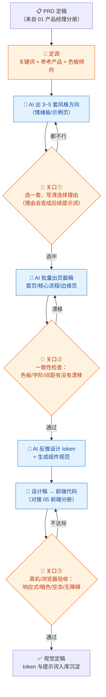

# 02-UI/UX 设计 × AI 协同

> 💬 **一句话读懂本篇**：AI 出稿快但审美平均——你的价值不是画得比它好，而是**定调、挑选、克制**：知道哪一稿配得上你的产品，以及什么时候该停。

| 版本 | 适用范围 | 前置阅读 |
|---|---|---|
| V0.1 | 一人公司 / 超级个体 | [AI协同开发规范](/2026/10/12/ai-collaborative-development-specification/)（总纲）、[00-汇总·一人公司AI协同岗位全景](/2026/10/12/ai-collaboration-roles-overview/) |

**岗位定位**：🤝 人机协同 · AI 承担约 60% 工作量。设计岗的特殊性：**AI 产出的不是"错误"而是"平庸"**——代码错了跑不起来，设计丑了照样上线。所以验收标准不是"对不对"，而是"配不配"。

---

## 一、传统画像：UI/UX 设计师原来干什么

| 工作项 | 传统做法 | 痛点 |
|---|---|---|
| 设计探索 | 找参考（Dribbble/竞品截图）、画情绪板 | 参考收集耗时长 |
| 视觉稿 | Figma/Sketch 逐页绘制 | 一个产品 20+ 页面，画一周起步 |
| 设计规范 | 手工维护色板、字阶、组件库 | 一人公司往往懒得做，后期风格漂移 |
| 切图标注 | 导出资源、写标注文档 | 纯体力活 |
| 前端还原 | 和前端反复对像素 | 一人公司：自己和自己对像素 |

## 二、AI 协同后的新画像

**你从"画图的人"变成"艺术指导（Art Director）"**——AI 是产量无限但需要盯的稿手，你做三件事：**定调（风格方向）、挑选（海量稿里选一）、克制（砍掉花哨保体验）**。



---

## 三、逐项对比：传统做法 vs AI 协同做法

| 工作项 | 🐢 传统做法 | 🚀 AI 协同做法 | 谁主导 |
|---|---|---|---|
| 风格探索 | 手动收集参考，画情绪板 | AI 一次出 3~5 套风格方向（含色板/字体/示例页），你选一套 | 🤖 AI 量产，**你定调** |
| 页面视觉稿 | Figma 逐页画 | AI 生图工具出高保真概念稿；或直接生成 HTML/Tailwind 页面稿 | 🤖 AI 主导 |
| 设计规范 | 手工建组件库 | AI 从选中稿件反推设计 token（色/字/距/圆角），生成规范文档 | 🤝 人机协同 |
| 图标/配图 | 找图标库、买素材、手绘 | AI 生成成套图标（统一风格提示词），注意许可证 | 🤖 AI 主导 |
| 交互细节 | 逐状态画（空态/加载/错误） | AI 枚举页面状态清单并补齐设计，你审体验合理性 | 🤝 人机协同 |
| 前端还原 | 切图+标注，和前端对像素 | **设计稿即代码**：AI 直接产出可用的 React/Vue/Tailwind 组件 | 🤖 AI 主导，**你验收** |
| 品牌一致性 | 靠设计师自觉 | 把设计 token 写进提示词模板，每次生成强制引用 | 🤝 模板保障 |

> 💡 **一人公司专属红利**：传统流程里"设计→标注→还原"三个环节是三次信息损耗；AI 协同时**设计和前端可以是同一份产物**（设计稿即代码），你少当两次传话筒。

---

## 四、协同工作流：从定调到上线



**节奏建议**：风格探索阶段"多生成、快淘汰"（一稿看 30 秒就毙）；进入页面稿阶段后"少生成、精修"——换方向的成本越高，越要守住 token 一致性。

---

## 五、提示词模板（直接抄作业）

### 模板 A · 风格方向探索

```text
【产品】xxx（一句话描述 + 目标用户）
【任务】给出 4 套差异明显的视觉风格方向，每套包含：
1. 风格关键词（3~5 个）
2. 色板（主色/辅色/中性色，给 HEX 值）
3. 字体建议（中文 + 英文，注明开源可商用）
4. 圆角/阴影/留白的总体倾向
5. 一个对标产品或参考流派
【约束】四套方向必须互相拉开差距，禁止四套都是"蓝白极简SaaS风"。
```

### 模板 B · 页面视觉稿（生图工具）

```text
High-fidelity UI design of「页面名称」for「产品类型」,
style:「从模板A选定的风格关键词」,
color palette:「HEX色板」, font:「字体」,
包含模块:「导航/列表/表单等具体清单」,
状态:「默认态」, clean layout, realistic content（用真实感假数据，禁止乱码占位）
--另出：空数据态 / 加载态 / 错误态 各一版
```

### 模板 C · 设计 token 反推

```text
以下是我选定的设计稿（贴图/描述）。请反推出设计 token：
1. colors（primary/secondary/neutral/semantic，HEX + 使用场景）
2. typography（字阶 h1~body~caption：字号/字重/行高）
3. spacing（间距体系，建议 4px 基准）
4. radius / shadow / border
输出为 JSON（可直接进 Tailwind config），并附一份「什么场景用什么 token」的使用规则。
```

### 模板 D · 设计稿转前端代码

```text
【输入】设计稿（贴图）+ 设计 token（粘贴模板C输出）
【任务】用「技术栈+版本号」实现该页面为可复用组件
【约束】
1. 所有颜色/字号/间距必须引用 token，禁止硬编码魔法值
2. 覆盖状态：默认/悬停/加载/空数据/错误
3. 响应式：移动端优先，断点 xxx
4. 无障碍：对比度达标、可聚焦元素有 focus 态、图片有 alt
【输出】完整组件代码 + token 配置文件 + 与设计稿的差异说明（如有妥协，列出来）
```

---

## 六、验收清单（视觉定稿前逐项勾）

**一致性（最重要）**
- [ ] 全部页面共用同一套 token，无"这页蓝一点那页蓝一点"
- [ ] 字体不超过 2 族，字阶来自 token 而非手调
- [ ] 图标风格统一（线性/面性不混用）

**完整性**
- [ ] 每个页面覆盖五态：默认/悬停/加载/空数据/错误
- [ ] 响应式三档验证：手机/平板/桌面
- [ ] 暗色模式（若支持）单独过一遍，不是简单反色

**体验底线**
- [ ] 正文对比度 ≥ 4.5:1（无障碍）
- [ ] 可点击元素有明确的可点击感，触控目标 ≥ 44px
- [ ] 关键流程步数没有被"美观"拖累（装饰不挡操作）

**合规**
- [ ] AI 生成的图标/插画/字体确认**可商用许可**
- [ ] 未使用与知名品牌高度雷同的 AI 产出（避免抄袭争议）
- [ ] 设计稿中的假数据不含真实用户信息

---

## 七、坑点清单

| 坑 | 长什么样 | 怎么防 |
|---|---|---|
| 平庸审美 | AI 稿"都对但没记忆点"，四套方向长得像一套 | 模板 A 强制拉开差距；你提供小众参考物而不是形容词 |
| 风格漂移 | 第 10 页开始色板悄悄变了 | token 先行（模板 C），每次生图/生成代码强制粘贴 token |
| 文字乱码 | 生图工具里的界面文字是"伪汉字"或乱码 | 生图只当概念稿，**最终界面文字一律走代码渲染** |
| 过度设计 | 首页很炫，但转化路径被动画和装饰埋了 | 关口③问一句"用户完成核心任务点几次？"超了就砍 |
| 许可证雷区 | AI 字体/图标/素材实际不可商用 | 只用明确开源可商用资源；对应总纲红线第 5 条 |
| 还原落差 | 设计稿很美，AI 转的代码一塌糊涂 | 用模板 D 要求"列出差异说明"，差异处人工修，别整页重写 |
| 无限改稿 | 和 AI 反复微调一个按钮，一下午没了 | 设"改稿预算"：单元素最多 3 轮，不行就换方案或手写 |

---

> 💬 **收尾一句**：设计岗被 AI 改变的不是"谁来画"，而是"画多少选一"。一人公司的你，审美可以不是顶尖，但**标准必须明确**——标准写进 token 和提示词，AI 才能替你守住一致性。
> **下一册**：[03-架构师 × AI 协同](/2026/10/12/ai-collaboration-architect/)（规划中）——技术选型这件事，AI 给得了对比表，给不了"适合你"。
