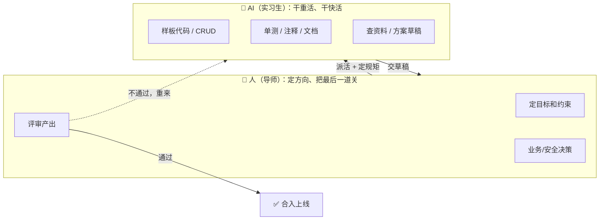
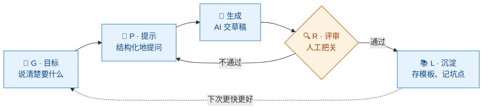
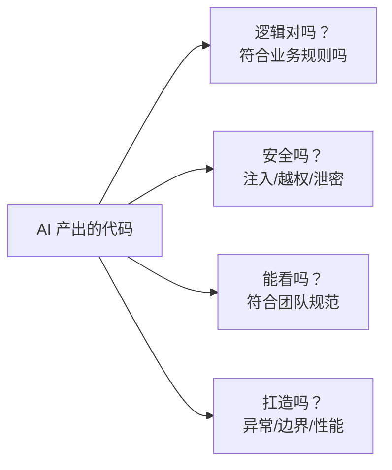
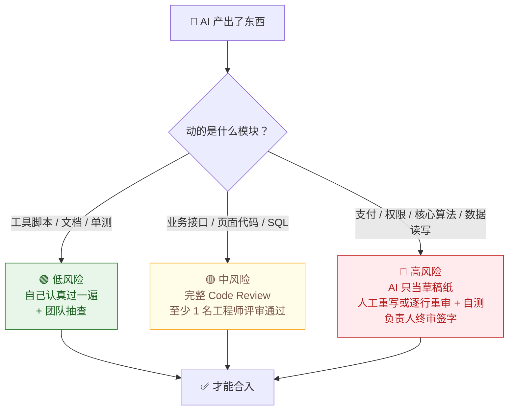
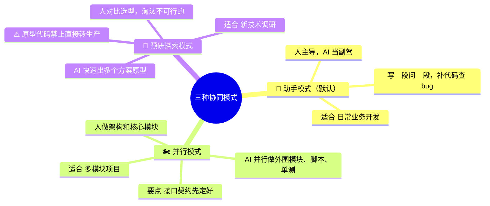
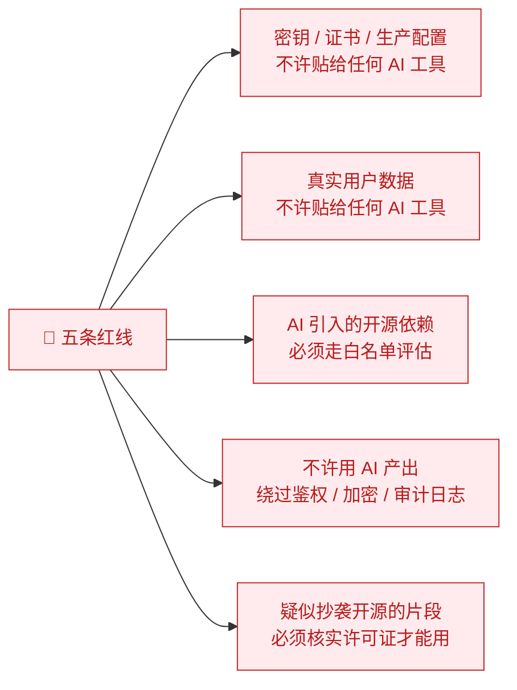
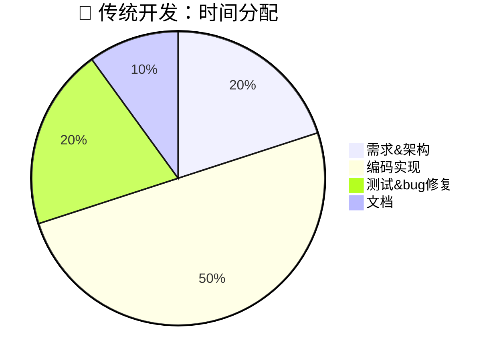
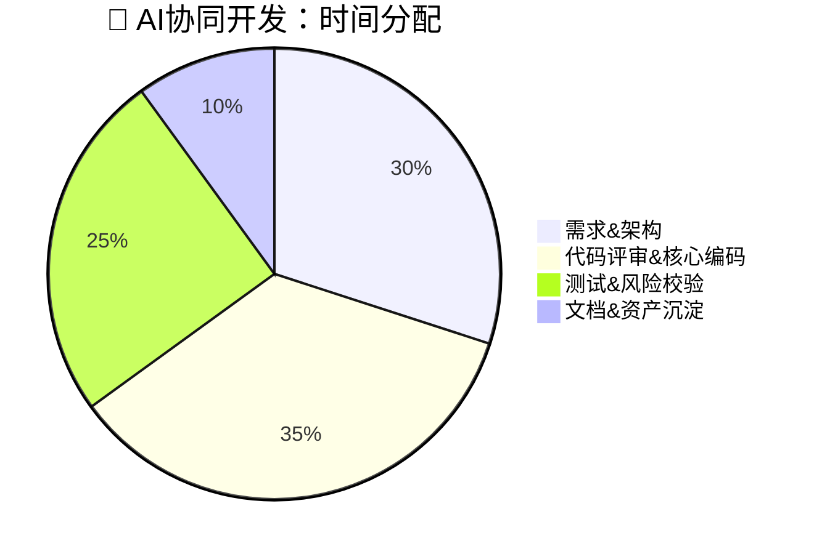

# AI协同开发规范

> 💬 **一句话读懂本规范**：AI 帮你把代码写快，但上线前必须人看过；越关键的模块，看得越严。

| 版本 | 适用范围 | 维护 |
|---|---|---|
| V1.1 | 研发部全体成员（产品/测试/运营可参照） | 技术委员会 |

---

## 一、先搞清楚：AI 干什么，人干什么

**AI 是一个手速极快的实习生**——干活快、不知累，但会犯错、会瞎编，需要有人带；
**你是带教导师**——负责派活、定规矩、验收结果。出了事，责任在导师，不在实习生。



### 各角色分工一览

| 你是谁 | 你负责（不能甩给AI） | AI 帮你干 |
|---|---|---|
| 架构师 / 负责人 | 需求拆解、技术选型、风险评估、最终验收 | 方案草稿、技术调研、代码骨架 |
| 开发工程师 | 核心逻辑设计、代码评审、疑难 bug、性能与安全 | 样板代码、CRUD、单测、注释、重构、脚本 |
| 测试工程师 | 测试策略、场景设计、边界用例、验收标准 | 批量用例、自动化脚本、日志分析 |
| 产品经理 | 业务目标、优先级、业务规则 | PRD 初稿、需求清单、FAQ |

> 💡 **记住一句话：人定约束，AI 填充；人做校验，AI 提速。**

---

## 二、核心工作流：G-P-R-L 闭环

任何 AI 辅助任务，都按这个圈走一遍：



### G · 目标——先把要什么说清楚

动手前想清楚 4 件事，**缺一件就先别找 AI**：

- [ ] 要解决什么问题、给谁用
- [ ] 必须遵守哪些业务规则、不能碰什么
- [ ] 技术栈、框架版本、编码规范是什么
- [ ] 怎样算做完了（可测试、可度量）

### P · 提示——好好提问，别甩一句话

| ❌ 反面示范 | ✅ 正确姿势 |
|---|---|
| "帮我写个订单功能" | 背景 + 任务 + 约束 + 输出要求，分段说清（模板见附录 A） |
| 复杂系统让 AI 一次写完 | 拆成小任务，一步一步生成 |
| 把密钥、真实用户数据贴给 AI | 用假数据、脱敏数据演示 |

### 生成——AI 交的是草稿，不是成品

1. **看不懂的代码不许提交**——提交人必须逐行读懂。
2. **当心 AI 瞎编**——它可能调用根本不存在的 API，提交前逐个核实。

### R · 评审——人工把关（这一步不许省）

四个维度快速过一遍（详细清单见附录 B）：



### L · 沉淀——把经验变成团队资产

- 好用的提示词 → 提交到提示词模板库（附录 A）
- 踩过的坑 → 记入坑点清单（附录 C）
- 可复用的代码 → 归入团队模板仓库

---

## 三、AI 产出审多严？看风险等级

**一句话原则：模块越要命，审得越狠；拿不准等级，就高不就低。**



补充 3 条规矩：

1. 高风险模块的 AI 产出**禁止直接合入主干**，必须负责人留痕确认。
2. AI 写的代码和手写代码**一样进代码审计**，提交时标注"AI 辅助生成"。
3. 评审发现"带病"，要么改提示词重新生成，要么人工改写——**禁止带病合入**。

---

## 四、三种用法，按场景选



---

## 五、安全红线：碰了就是事故



还有一条隐形红线：**安全决策、业务决策、复杂业务规则，永远由人拍板，AI 只能提建议。**

---

## 六、用了 AI 之后，时间都去哪了

编码时间确实少了，但**评审和需求拆解的时间变多了**——别指望"躺着变快"，要习惯"把功夫前置"。





---

## 七、怎么知道用得好不好（每月看这几个数）

| 指标 | 看什么 | 期望方向 |
|---|---|---|
| 编码阶段耗时 | 同类需求，编码工时降没降 | ⬇️ |
| AI 幻觉拦截数 | 评审时抓到多少"瞎编的 API / 错误逻辑" | 📝 记录即可，喂给坑点清单 |
| bug 来源分布 | bug 是手写的多，还是 AI 产出的多 | 👀 监控 |
| 评审一次通过率 | AI 产出一次过审的比例 | ⬆️ |
| 资产沉淀数 | 新增了多少提示词模板、坑点记录 | ⬆️ |

每月一次团队复盘：分享好用的提示词、通报典型坑点；每季度按数据修订本规范。

---

## 附录 A：提示词模板（直接抄作业）

### A.1 让 AI 写代码

```text
【背景】技术栈：xxx；相关模块：xxx；现有代码/接口定义：（粘贴）
【任务】实现 xxx 功能
【约束】
1. 遵循编码规范：xxx
2. 依赖限制：不引入新依赖 / 仅白名单内：xxx
3. 必须处理的边界情况：xxx
【输出要求】
1. 完整可运行代码 + 关键逻辑注释
2. 列出你做出的所有假设
3. 配套单元测试用例
```

### A.2 让 AI 帮你审代码（审完人还要再过一遍）

```text
以下代码由 AI 生成，请以资深工程师视角审查，重点找出：
1. 逻辑错误与业务规则偏差（业务规则：xxx）
2. 安全漏洞（注入、越权、敏感信息）
3. 不存在的 API / 过时用法（幻觉）
4. 异常与边界处理缺失
代码：（粘贴）
输出：按严重程度分级列出问题，每条给修复建议。
```

### A.3 提交新模板的格式

模板名称 + 适用场景 + 模板正文 + 使用示例 + 提交人 + 至少 1 次实际使用效果记录。

---

## 附录 B：AI 代码评审清单（评审时逐项勾）

**逻辑对不对**
- [ ] 业务逻辑与需求一致，没有"想当然"的默认行为
- [ ] 边界条件覆盖（空值、越界、并发、超时）
- [ ] 无幻觉：所有 API、方法、依赖真实存在且版本正确

**安全不安全**
- [ ] 无 SQL 注入 / 命令注入 / XSS
- [ ] 权限校验完整，无越权路径
- [ ] 无硬编码密钥、密码、内网地址、敏感数据

**代码能不能看**
- [ ] 命名、分层、注释符合团队规范
- [ ] 没有重复造轮子（已有工具类没用上）

**扛不扛造**
- [ ] 异常处理完整，失败路径有兜底
- [ ] 无明显性能问题（循环内 IO、N+1 查询等）

**合不合规**
- [ ] 新增依赖走了白名单流程
- [ ] 无疑似不兼容许可证的开源片段
- [ ] 提交信息已标注 AI 辅助生成

---

## 附录 C：AI 常见坑点清单（持续补充）

| 坑 | 长什么样 | 怎么防 |
|---|---|---|
| 幻觉 API | 调用根本不存在的方法/库，或已废弃的旧 API | 逐个核实依赖和 API；本地跑一遍 |
| 过时知识 | 用旧版本框架写法，和新版本不兼容 | 提示词里写明框架版本号 |
| 想当然逻辑 | 自己脑补业务规则，和真实需求跑偏 | 提示词给全业务约束；评审对照需求逐条核对 |
| 隐性安全漏洞 | 拼接 SQL、日志打印敏感信息、鉴权放水 | 强制用附录 B 清单；高风险模块人工重写 |
| 表面正确的单测 | 只测顺利路径，断言形同虚设 | 人工补边界用例，检查断言是否真的在断言 |
| 过度工程 | 三行能解决的事，给你抽象出八个类 | 提示词约束"最简实现"；评审砍掉多余抽象 |

---

> 💬 **最后再啰嗦一遍**：AI 是实习生不是背锅侠——活是它干的，责任是你担的。看得懂、审得过，才能合得进。
