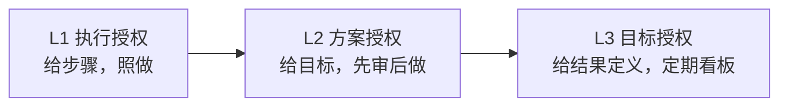
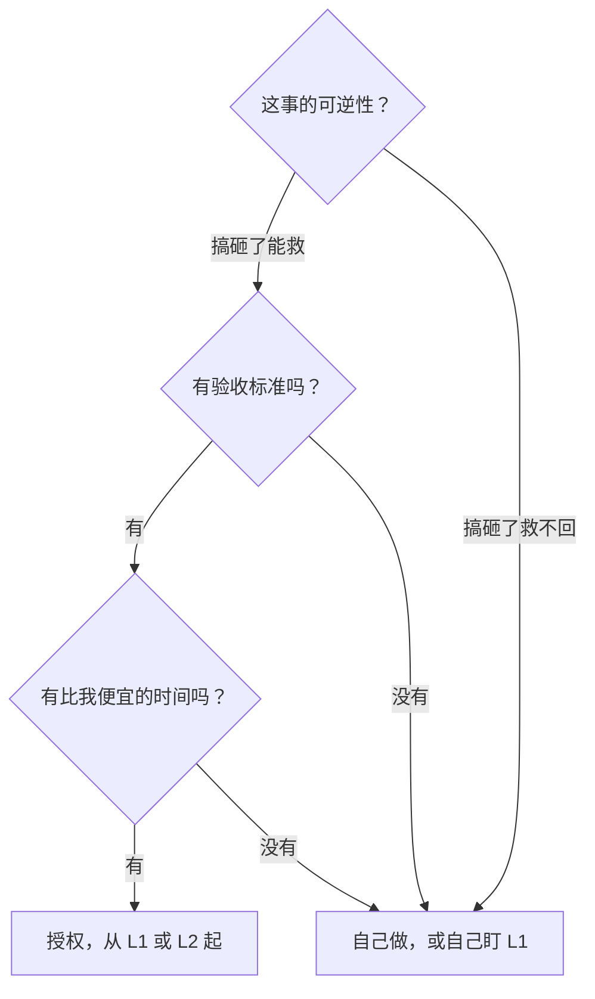

> 🤖 **AI 协作说明**：本文由 AI 起草框架与初稿，作者负责结构取舍、案例校准与终审。协作纪律详见 [《AI协同开发规范》](/2026/10/12/ai-collaborative-development-specification/)。

管理者最常见的困局：事情自己做只要 1 小时，教会别人要 3 小时，还要返工 2 小时——于是永远自己做。解法不是"忍痛放手"，而是**把授权变成一个有层级的渐进过程**：不是"做还是不做"，而是"完备度给到多少"。

## 一、授权的三个层级

| 层级 | 你给什么 | 对方带什么回来 | 适用对象 |
|------|------|------|------|
| **L1 执行授权** | 完整步骤 + 红线 | 执行结果 | 新人 / 新场景 |
| **L2 方案授权** | 目标 + 约束条件 | 方案，你批准后执行 | 有经验的熟手 |
| **L3 目标授权** | 结果定义 + 检查节奏 | 定期看板 + 异常上报 | 独当一面的骨干 |

授权的本质是**逐层放完备度**：L1 你把"怎么做"想好，L2 只把"做成什么样"想好，L3 连"什么时候汇报"都由对方定义。

## 二、每一层的交接清单

**L1 → 说清四件事**：背景一句话、步骤在哪、红线是什么、卡住找谁。

**L2 → 说清三件事**：目标与验收标准、约束条件（预算/时间/不可碰的东西）、方案评审的时间点。

**L3 → 说清两件事**：结果定义与截止、看板节奏（每周同步什么指标）。L3 的配套是文档化——把"什么情况必须上报我"写成 [SOP](/2026/11/12/sop-implicit-knowledge/)，其余的真的忍住不问。

## 三、该不该授权：先回答四个问题

授权最大的心理障碍是"教会徒弟饿死师傅"——在小团队里恰恰相反：**你只有把 L1/L2 的事情放出去，才可能去做 L3 级别的判断**。这与[一人公司的岗位分工逻辑](/2026/10/12/ai-collaboration-roles-overview/)一致：人的时间应该花在判断上，执行交给体系——无论是人还是 AI。

## 四、最常见的失败：授权不配检查

授权失败很少是因为人不行，而是因为**只给活不给检查点**。L2 授权没有方案评审时间，等于鼓励对方闷头猜你想要什么；L3 授权没有看板节奏，等于把失控包装成信任。**授权的完备度可以低，检查的完备度不能低。**

> 授权不是"我不管了"，而是"我把判断的完备度降到你刚好能接住的程度，然后陪你升级"。
