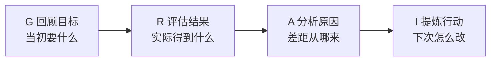
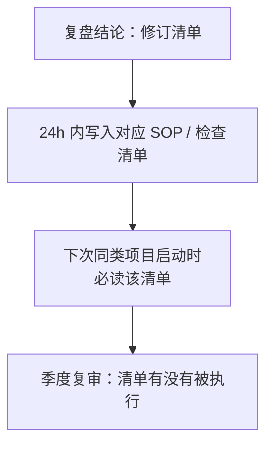

> 🤖 **AI 协作说明**：本文由 AI 起草框架与初稿，作者负责结构取舍、案例校准与终审。协作纪律详见 [《AI协同开发规范》](/2026/10/12/ai-collaborative-development-specification/)。

复盘失败的样子高度雷同：开头念一遍数据，中段各部门表功，结尾领导讲话"下季度继续努力"。全程没有一个结论可以说清楚"下次遇到同类事情，具体怎么做不同"。复盘的产出不是情绪，不是态度，**是一条条可执行的策略修订**。

## 一、GRAI 四步法

| 步骤 | 关键动作 | 常见跑偏 |
|------|------|------|
| **G 目标回顾** | 重述当初的验收标准 | 目标模糊导致无从比较——先补写当初的目标 |
| **R 结果评估** | 只列事实与数据 | 过早进入归因，情绪抢在事实前面 |
| **A 原因分析** | 挖到"机制/流程"层 | 停在"人不够努力"——这是归因失败的标志 |
| **I 行动提炼** | 改流程/改清单/改模板 | 产出"下次注意"这类不可执行的结论 |

## 二、主持人控场四纪律

1. **对事不对人**：一旦讨论滑向"某人当时应该"，主持人立刻拉回"流程里哪个环节允许了这个错误"；
2. **先事实后归因**：前 1/3 时间只允许陈述发生了什么，禁止说"因为"；
3. **平等发言**：决策者最后说话——领导先定调，复盘就只剩附和；
4. **产出必须是"修订物"**：每个 I 必须落到具体的 SOP 条款、检查清单或模板变更，写明责任人与截止日。

## 三、让结论活过 48 小时

复盘结论的死亡率极高，靠追踪机制续命：

复盘的真正价值在复利：每次项目只留下一页纸的修订，一年后你就有了一套**用真实教训写成的操作系统**。这正是把经验沉淀为[组织 SOP](/2026/11/12/sop-implicit-knowledge/) 的主通道。

## 四、多久复盘一次

- **项目级**：里程碑结束即复盘，热炉效应，趁记忆新鲜；
- **周期级**：季度复盘只看趋势与机制，不重翻个案；
- **事件级**：重大事故 24 小时内做，只问机制不问责——事故后的第一场会如果变成追责会，下一次事故就没人第一时间上报。

> 复盘的目的不是知道错了，是让"错"变成下一次的默认正确。
