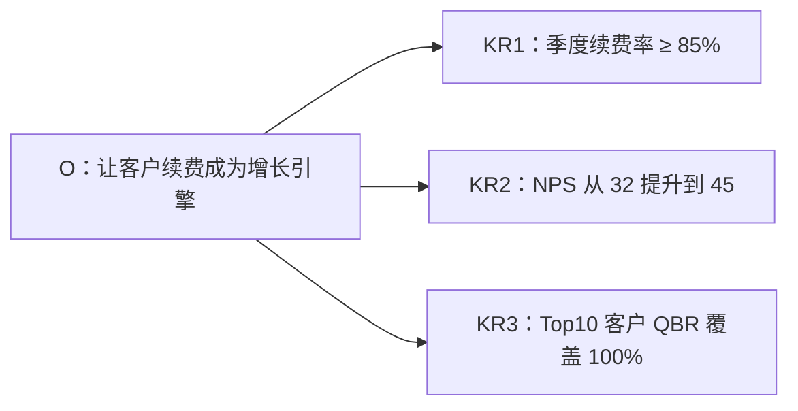
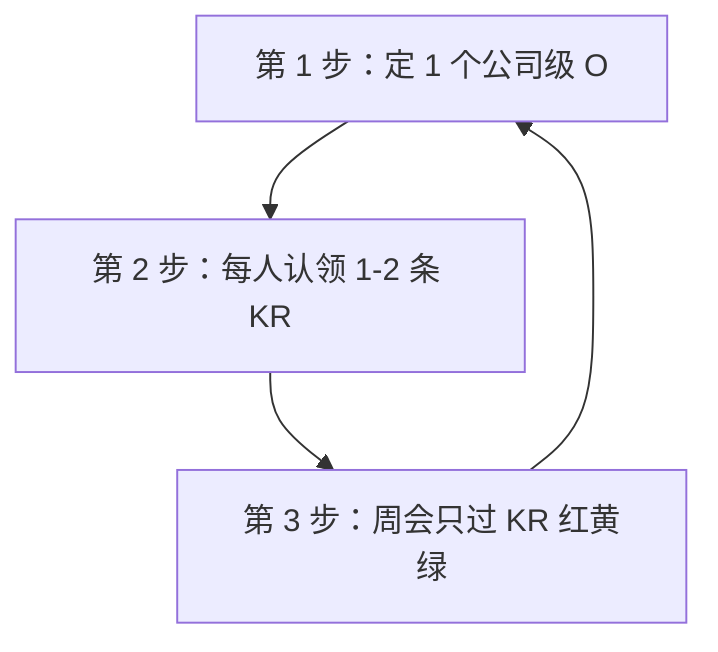

> 🤖 **AI 协作说明**：本文由 AI 起草框架与初稿，作者负责结构取舍、案例校准与终审。协作纪律详见 [《AI协同开发规范》](/2026/10/12/ai-collaborative-development-specification/)。

很多公司引入 OKR 的动机是"谷歌也在用"，三个月后的结局几乎都一样：季度末填一次表，OKR 变成了换皮 KPI，员工学会了一套新的填表话术。问题不在 OKR 本身，而在把它当成了**考核工具**——OKR 的本质是**对齐工具**，它回答的是"我们为什么做这件事"，而不是"你完成得怎么样"。

## 一、O 与 KR 的写法：一个公式

**O（目标）回答"去哪"**，要求定性、有野心、能点燃人；**KR（关键结果）回答"怎么知道到了"**，要求定量、可验证、有截止。

一个自检问题：**如果 KR 全部达成，O 算实现了吗？** 如果答案是"不确定"，说明 KR 写偏了——你度量的是工作量，不是目标本身。

## 二、最常见的五个落地坑

| 坑 | 典型症状 | 解法 |
|------|------|------|
| KR 写成任务清单 | "上线新官网"、"完成培训" | 任务写进执行计划，KR 只留可度量的结果 |
| 全部 KR 都是 100% 达成 | 没有挑战，年度100% | KR 达成 70% 属正常，100% 说明定低了 |
| OKR 与考核强挂钩 | 打分直接算绩效奖金 | OKR 评分与薪酬解耦，考核看长期贡献 |
| 上下不对齐 | 各部门 OKR 互不相干 | 下级的 O 必须能支撑上级的某条 KR |
| 只在季度末看 | 平时无人提及 | 每周例会过一次 KR 进度，红黄绿打标 |

## 三、小团队三步上手

1. **先定一个公司级 O**——小团队不要超过一个季度一个 O，聚焦是 OKR 的全部价值；
2. **每人认领而不是摊派**——认领制让 KR 的 owner 从"被要求"变成"我承诺"；
3. **周会只过红黄绿**——绿=正常推进，黄=有风险需支援，红=阻塞需要决策。一句话说完，不写报告。

配合每周的目标进度检查，可以套用我之前写的[高效会议公式](/2026/06/23/efficient-meeting-formula/)——会前对齐、方案确认、决策落地，OKR 例会尤其忌讳变成汇报表演。

## 四、什么时候不该用 OKR

诚实地说，OKR 不是万金油：**业务路径完全确定、只需要执行力的团队**，KPI 更高效；**十人以下、方向还在探索的团队**，一周一次的方向校准比季度 OKR 更敏捷。OKR 适合的是"方向大致清楚、路径需要探索"的中型团队。

> 目标管理的终点不是表格，是团队每个人在周一早上都知道这周为什么而战。
