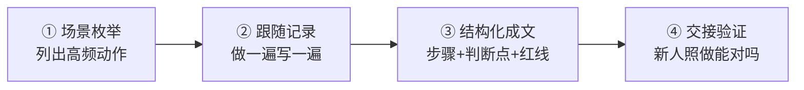

> 🤖 **AI 协作说明**：本文由 AI 起草框架与初稿，作者负责结构取舍、案例校准与终审。协作纪律详见 [《AI协同开发规范》](/2026/10/12/ai-collaborative-development-specification/)。

问一个扎心的问题：如果你休假两周，公司哪几件事会立刻停摆？答案不是"没有"，而是"你根本不敢试"。小公司最大的资产风险不是账上现金，而是**核心流程只存在于创始人脑子里**——报价怎么定、Exception 怎么处理、客户投诉第一句话说什么，全靠"你看着办"。

## 一、隐性知识萃取四步法

1. **场景枚举**：写下"没人教就会出错"的高频动作，通常 10-20 个（报价、退货、开票、故障响应……）；
2. **跟随记录**：下次你自己做这件事时，让 AI 助手或新人实时记录你的每个决策点——**判断比步骤值钱**；
3. **结构化成文**：每个 SOP 固定三段式——*操作步骤*（怎么做）、*判断点*（什么情况走分支）、*红线*（绝不能做什么）；
4. **交接验证**：交给一个没做过的人照着执行一次，卡住的地方就是 SOP 的缺口，迭代它。

## 二、SOP 写作的三个纪律

| 纪律 | 反例 | 正例 |
|------|------|------|
| 写判断不写套话 | "热情接待客户" | "客户提及竞品时，先问对比维度，不主动贬低对方" |
| 一页一件事 | 万字操作手册没人看 | 一个 SOP 只覆盖一个场景，超过两页就拆 |
| 标注更新日期 | 一年前的 SOP 照常执行 | 文档头写版本与日期，每季度复审一次 |

## 三、让 SOP 真正被执行的三个前提

1. **创始人自己先遵守**——你绕过流程的那一次，就是流程死亡的开始；
2. **把 SOP 放进工作流，而不是文档库**——执行动作的入口直接链到对应 SOP，没人会为查文档多点两下；
3. **允许一线提修订**——每个 SOP 文档头留"改进建议"区，被采纳的建议公开署名，流程才有生命力。

## 四、和 AI 的关系：萃取成本降低了 10 倍

过去写 SOP 贵在"跟随记录"这一步——创始人的时间太贵。现在这件事可以让 AI 做：会议录音转写、操作录屏转步骤草稿、人工只做校对与判断点补充。一人公司的 18 个岗位里，[技术文档岗位的 AI 化率最高](/2026/10/12/ai-collaboration-roles-overview/)，SOP 萃取正是它最典型的应用场景。

> 流程化不是官僚化。流程的作用是把你的判断力从重复决策中解放出来，去处理真正需要你出手的事。
