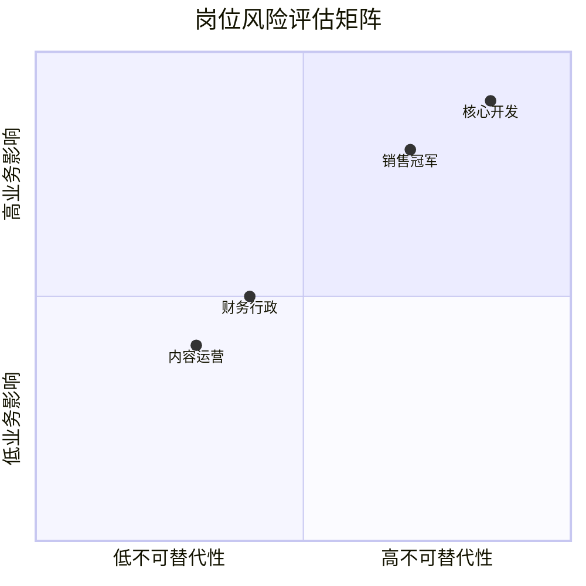

> 🤖 **AI 协作说明**：本文由 AI 起草框架与初稿，作者负责结构取舍、案例校准与终审。协作纪律详见 [《AI协同开发规范》](/2026/10/12/ai-collaborative-development-specification/)。

先做一个测试：写下公司里每个岗位的名字，然后假设这个人明天离职，逐个问"业务还能转吗"。能坦然通过测试的公司很少。小团队尤其脆弱——**一个岗位一个人，一个人一走，业务直接断电**。这不是人事问题，是业务架构问题。

## 一、先盘点：关键人物风险矩阵

对每个岗位问三个问题：**只有他会吗**（技能集中度）、**离开多久会出事**（响应窗口）、**出事的代价多大**（业务影响）。右上角的岗位是重点对象——注意"核心开发"和"销售冠军"只是示例，你需要按自己的业务实际标注。

## 二、三层梯队建设法

| 层级 | 做法 | 成本 | 见效周期 |
|------|------|------|------|
| **① 文档层** | 核心流程 [SOP 化](/2026/11/12/sop-implicit-knowledge/)，离职不带走知识 | 低 | 1-2 月 |
| **② 备份层** | 每个关键岗位指定一个"影子人"，参与 20% 的实际工作 | 中 | 3-6 月 |
| **③ 招聘层** | 影子人验证不了的岗位，提前蓄水候选人管道 | 高 | 6-12 月 |

顺序很重要：**先文档层再招聘层**。很多管理者的第一反应是"再招一个"，但没文档的岗位，新人要重新踩一遍所有的坑，招人只是把风险延迟了三个月。

## 三、小团队也用得起的轮岗机制

大公司的轮岗制度小团队学不了，但可以学它的最小版本：

1. **每月一天"换位日"**：影子人独立处理关键岗位的当天事务，正主只做观察员——一天胜过十次培训；
2. **故障演练**：每季度挑一次"模拟离职"演练，影子人全权处理一周的真实业务；
3. **知识文档纳入考核**：写 SOP 不再是额外奉献，而是岗位 KPI 的一部分——[复盘产出的修订](/2026/11/12/grai-retrospective-method/)也直接进入文档层。

## 四、别把梯队建设做成"备胎文化"

梯队建设的目标是**业务连续性**，不是给任何人贴"可替换"标签。落地时注意：轮岗和影子机制要公开讲清楚是风险管理，而不是暗地里物色替代者——信任一旦破裂，梯队还没建成，骨干先走了。

> 梯队建设的最高境界：任何一个人的离开（包括你自己）都只是少了一双手，而不是断了一根神经。
